# DDD 图表 Mermaid 语法指南 (Mermaid Syntax Guide for DDD Diagrams)

使用 Mermaid 构建高效系统图表的速查指南，重点聚焦于 DDD（图驱动开发）常用的图表模式。

## Mermaid 基础设计模式

### 流程图 (Flowchart，DDD 最常用模式)

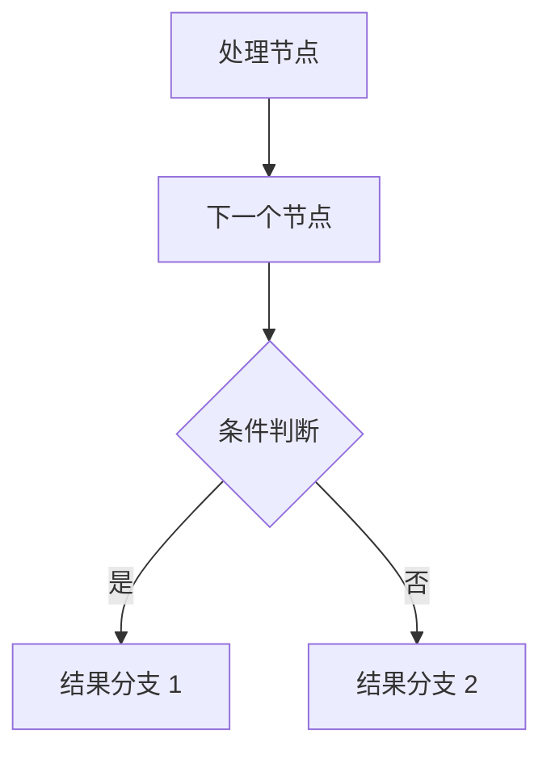

**布局方向：**
- `graph TD` - 从上到下 (Top to Down)
- `graph LR` - 从左到右 (Left to Right)
- `graph BT` - 从下到上 (Bottom to Top)
- `graph RL` - 从右到左 (Right to Left)

**节点形状速查：**
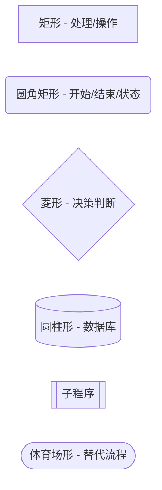

### 时序图 (Sequence Diagrams，用于用户旅程)

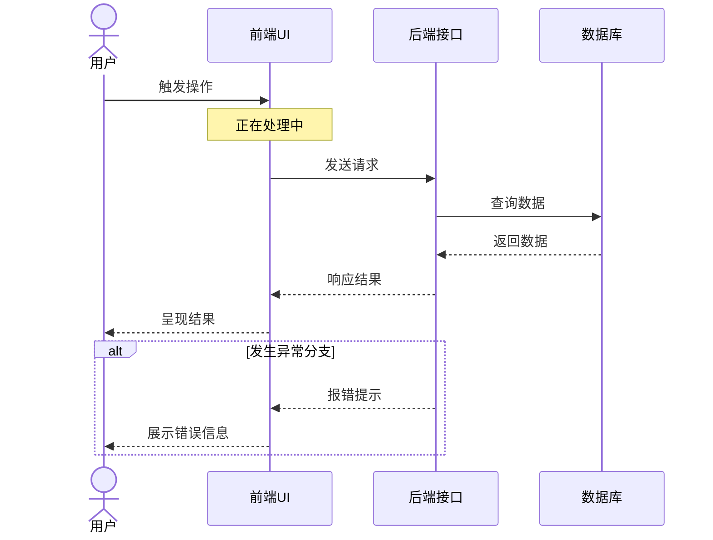

**核心语法要素：**
- `actor` - 用户实体（真人角色）
- `participant` - 参与系统或具体组件
- `->` 实线（同步调用）
- `-->` 虚线（异步调用/返回）
- `->>` 带实心箭头的实线（发送消息）
- `-->>` 带箭头的虚线（返回结果）
- `Note over` - 便签标注（用于影响说明）
- `alt`/`else`/`end` - 条件分支选择块

## DDD 专属图表模式

### 前台与后台子图划分 (Subgraphs)

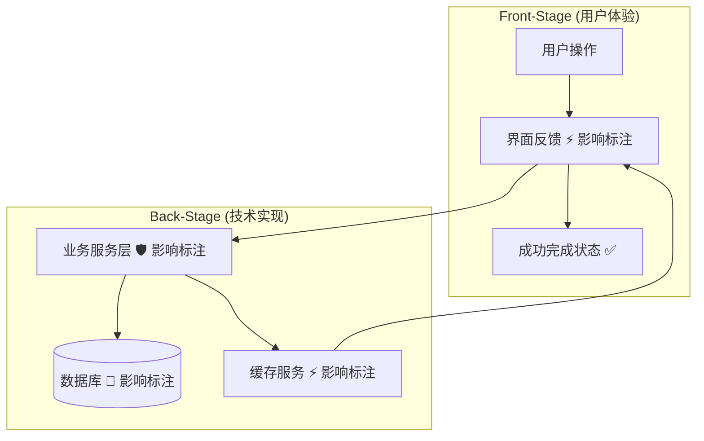

**子图使用技巧：**
- 必须明确使用 "Front-Stage" 与 "Back-Stage" 作为子图标头
- 在子图内部声明 `direction TB` 以保持纵向清爽排版
- 将所有面向用户的交互节点归入 Front-Stage
- 将所有后端实现与存储组件归入 Back-Stage

### 节点内部的影响标注写法

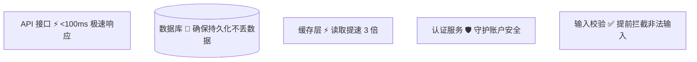

**标注格式规范：**
`组件名称 [图标] 影响收益描述`

### 错误处理分支规范

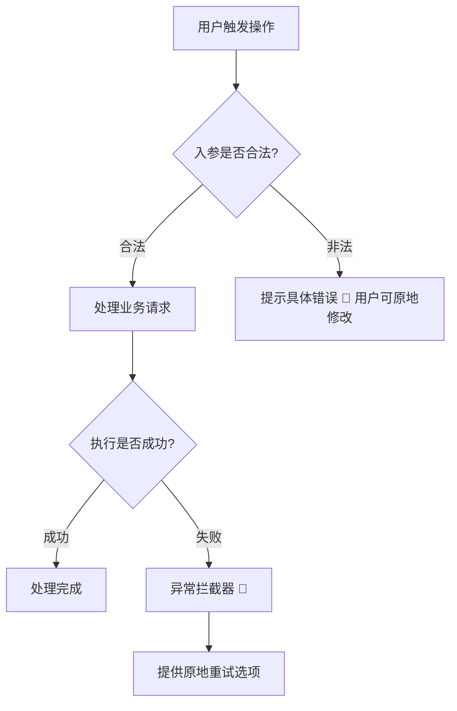

**错误路径设计要点：**
- 严禁隐去异常路径，必须完整展示
- 必须展示供用户恢复或重试的选项
- 恢复与重试操作统一使用 🔄 图标
- 让错误路径一目了然，绝不暗含隐蔽

## 样式与色彩定义

### 差异高亮规范（仅限重构对比图）

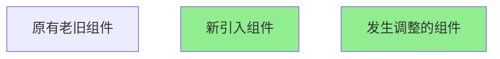

**刚性原则**：仅在重构前/后（Before/After）方案图中，允许使用 `#90EE90`（浅绿色）突出改动部分。严禁使用任何其他自定义颜色。

### 严禁随意为节点自定义着色

```mermaid
# ❌ 禁止此类做法（滥用自定义配色）
graph TD
    A[组件]
    style A fill:#ff0000,stroke:#333,stroke-width:4px
```

除重构对比改动外，一律保持 Mermaid 默认原生风格。

## 高级进阶模式

### 多终态分支结果

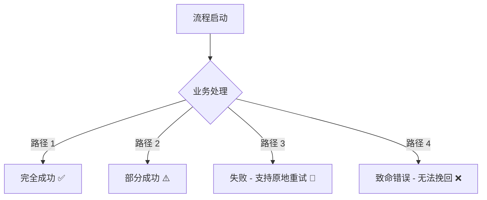

### 并行异步并发处理

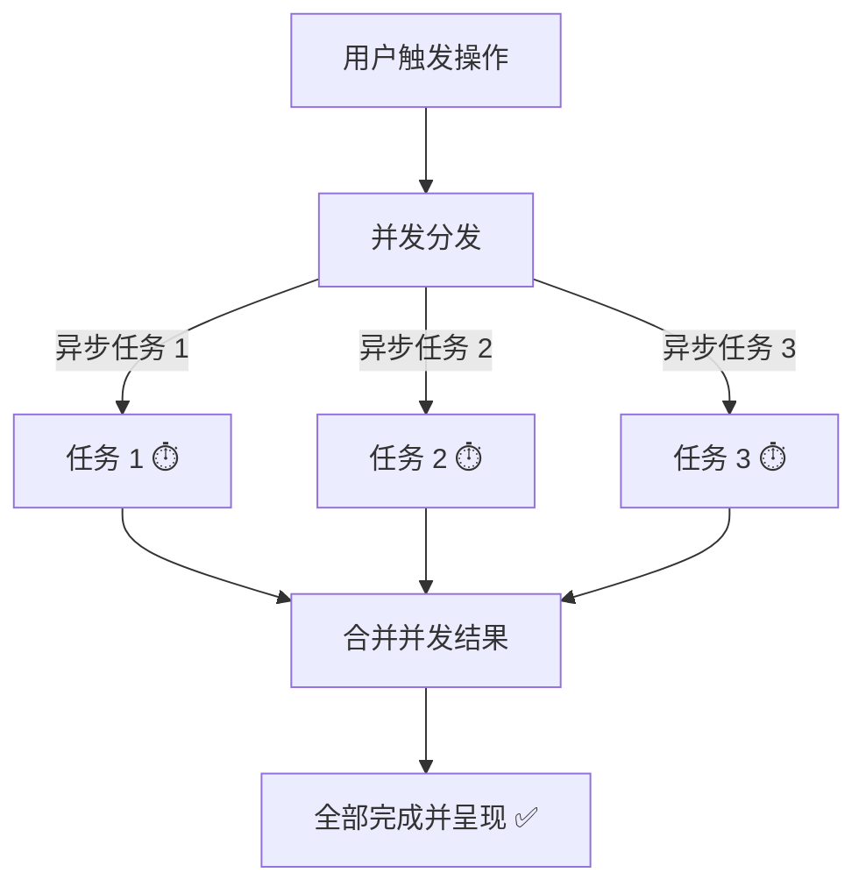

### 嵌套子图拓扑

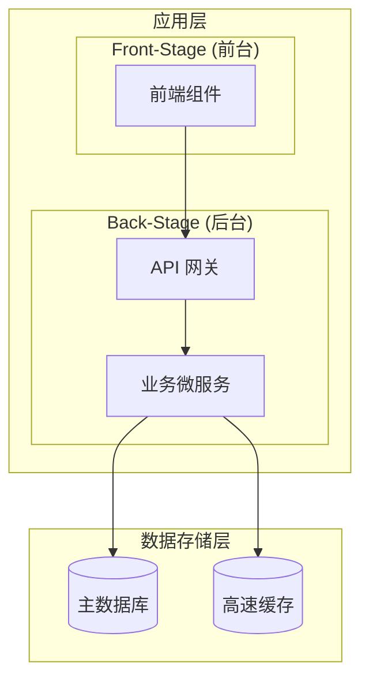

## 时序图进阶模式

### 基础请求与响应

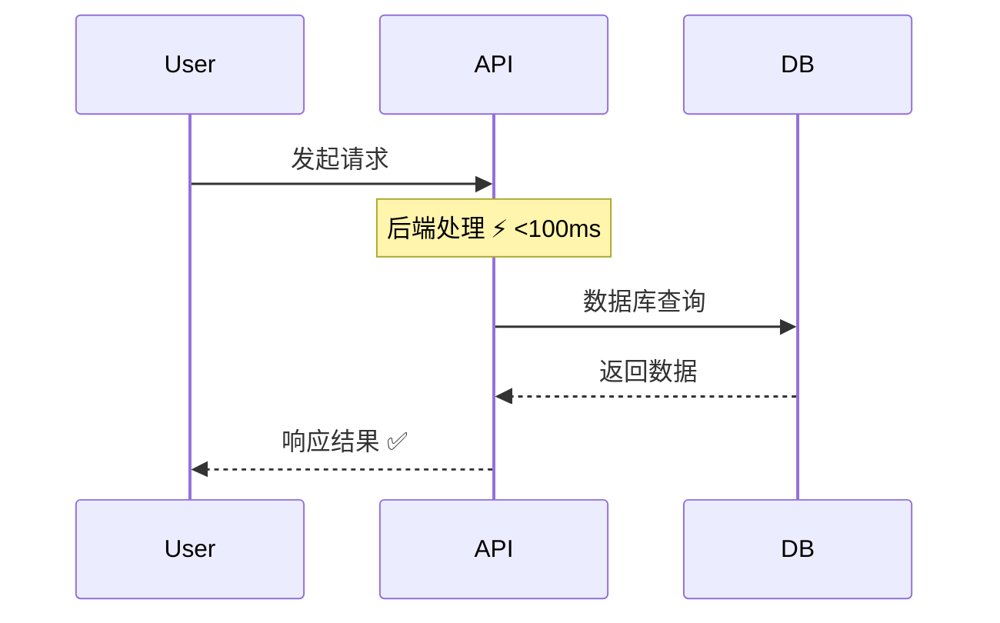

### 包含身份认证鉴权

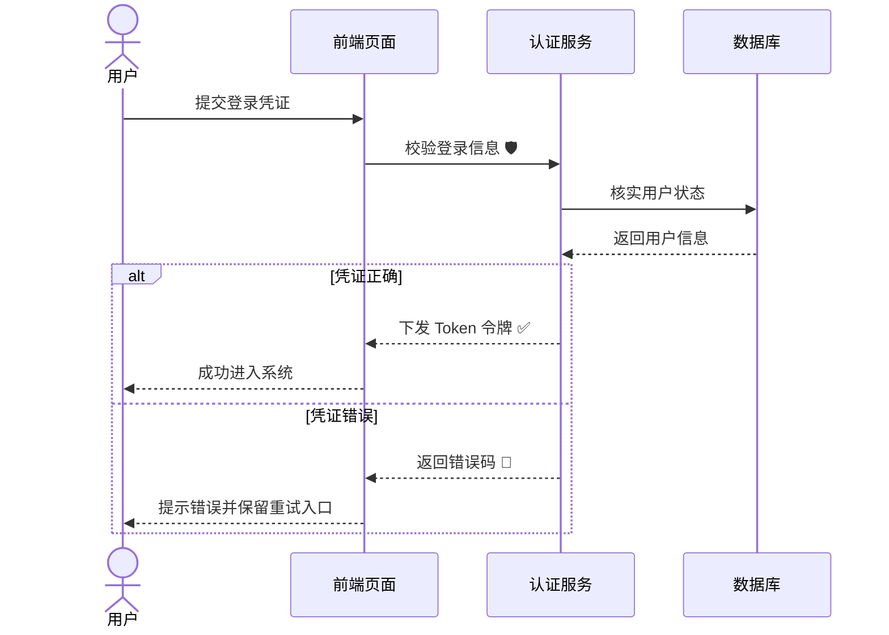

### 多场景分支对比 (alt/else)

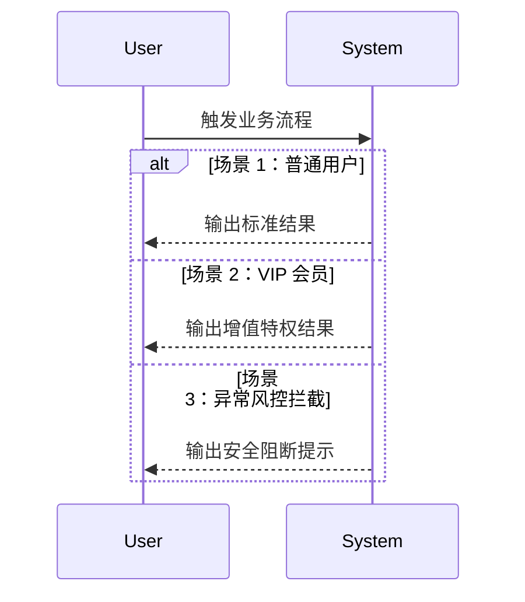

### 轮询与批处理循环 (loop)

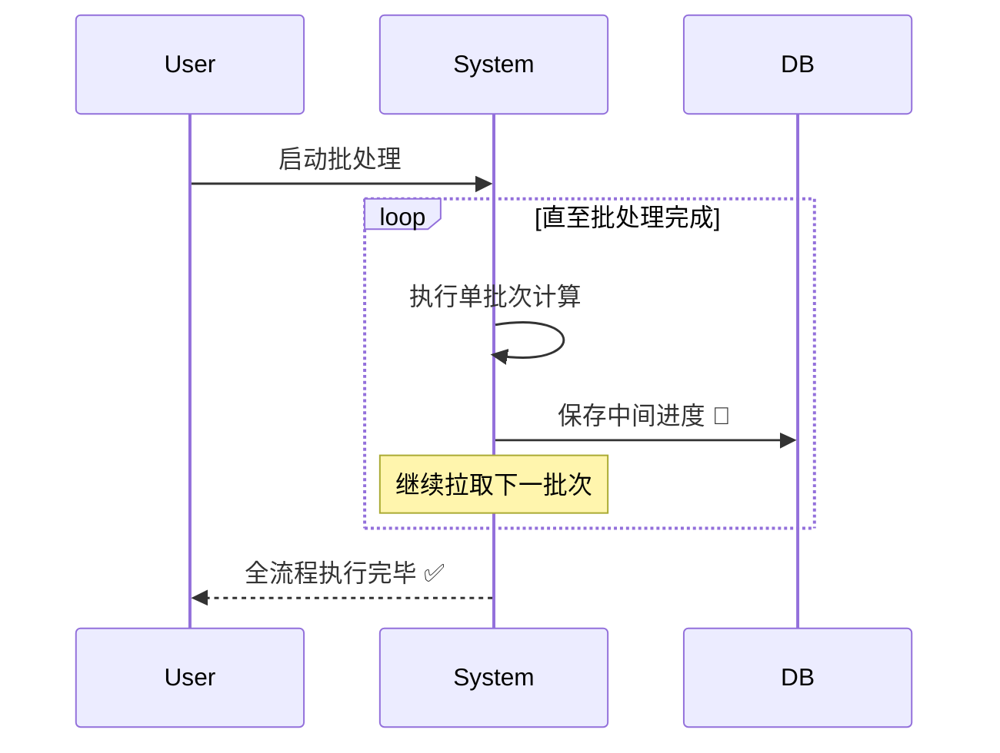

## 常见编写错误规避

### ❌ 图表过于庞杂

```mermaid
# 错误示范：节点过多，视线极难跟随
graph TD
    A --> B --> C --> D --> E --> F --> G --> H --> I --> J
```

**解决方案**：拆分成总览图与二级详情图，或借助子图归类收纳。

### ❌ 连线未标注含义

```mermaid
# 错误示范：缺少标注，无法理解分支含义
Decision --> Option1
Decision --> Option2
```

```mermaid
# 正确示范：分支意图清晰明了
Decision -->|参数合法| Option1
Decision -->|参数非法| Option2
```

### ❌ 隐去用户实体

```mermaid
# 错误示范：缺乏用户触点，沦为纯技术图
Service --> Database --> Cache
```

```mermaid
# 正确示范：用户清晰可见
User --> Service --> Database --> Cache --> User
```

### ❌ 缺失影响标注

```mermaid
# 错误示范：堆砌纯技术专有名词
API --> Database --> Response
```

```mermaid
# 正确示范：充分讲明对用户的价值
API --> Database[(数据库 💾 安全持久化订单)]
Database --> Response[响应结果 ⚡ 耗时 <100ms]
```

## 图表测试与校验

### 在线调试工具
推荐使用 [Mermaid 在线编辑器 (Mermaid Live Editor)](https://mermaid.live)：
- 校验语法是否合法
- 实时预览渲染效果
- 调试不同的布局方向
- 导出 PNG / SVG 图表预览

### 常见语法报错与修复

**遗漏图表方向：**
```mermaid
# ❌ 报错写法
graph
    A --> B

# ✅ 正确写法
graph TD
    A --> B
```

**节点 ID 中包含特殊连字符：**
```mermaid
# ❌ 易引发语法解析报错
graph TD
    node-1 --> node-2

# ✅ 正确写法（ID 使用纯英文字符，显示文本放中括号内）
graph TD
    node1[节点 1] --> node2[节点 2]
```

**括号未成对闭合：**
```mermaid
# ❌ 报错写法
graph TD
    A[处理节点 --> B

# ✅ 正确写法
graph TD
    A[处理节点] --> B
```

## 语法速查表

### 节点形状速查
```
[文本]           标准矩形
(文本)           圆角矩形
{文本}           条件菱形
[(文本)]         圆柱数据库
[[文本]]         子程序节点
([文本])         圆角体育场形
```

### 连线箭头速查
```
-->              实线带单箭头
->               实线单向调用
->>              实心消息箭头
-->>             虚线返回箭头
---|文本|-->     带文字标注的连线
```

### 排版方向速查
```
TD / TB          从上至下 (Top to Down / Bottom)
LR               从左至右 (Left to Right)
BT               从下至上 (Bottom to Top)
RL               从右至左 (Right to Left)
```

### 常用影响标注符号速查
```
⚡  速度 / 性能 (Speed/Performance)
💾  存储 / 持久化 (Storage/Persistence)
🛡️  安全 / 防护 (Security/Safety)
✅  校验 / 成功 (Validation/Success)
⏱️  响应度 / 流畅性 (Responsiveness)
🔄  恢复 / 重试 (Recovery/Retry)
📊  数据准确性 (Data Accuracy)
🎯  功能使能 (Feature Enable)
```

## 作图最佳实践

1. **保持精炼** - 过于复杂的图表应主动做合理拆分
2. **连接线标注明确** - 所有分支连线均注明触发条件
3. **以用户为中心** - 用户实体必须在图表中清晰出现
4. **必带影响标注** - 重点解释对用户的价值，避免堆砌死板技术名词
5. **画出异常路径** - 发生故障时的流向与恢复机制不可或缺
6. **提前测试语法** - 提交前在 Mermaid Live Editor 中预览验证
7. **风格规范统一** - 保持默认原生配色，避免随意使用花哨样式
8. **坚持双舞台视角** - 严格用子图分离前台 (Front-Stage) 与后台 (Back-Stage)
9. **方向清晰** - 依据逻辑主干选择从上至下 (TD) 或从左至右 (LR)
10. **确保渲染无误** - 保证生成的图表能够被正确解析

## 相关资源

- [Mermaid 官方文档](https://mermaid.js.org/)
- [Mermaid 在线编辑器 (Mermaid Live Editor)](https://mermaid.live)
- [Mermaid 速查表手册](https://jojozhuang.github.io/tutorial/mermaid-cheat-sheet/)
- [流程图官方语法手册](https://mermaid.js.org/syntax/flowchart.html)
- [时序图官方语法手册](https://mermaid.js.org/syntax/sequenceDiagram.html)
