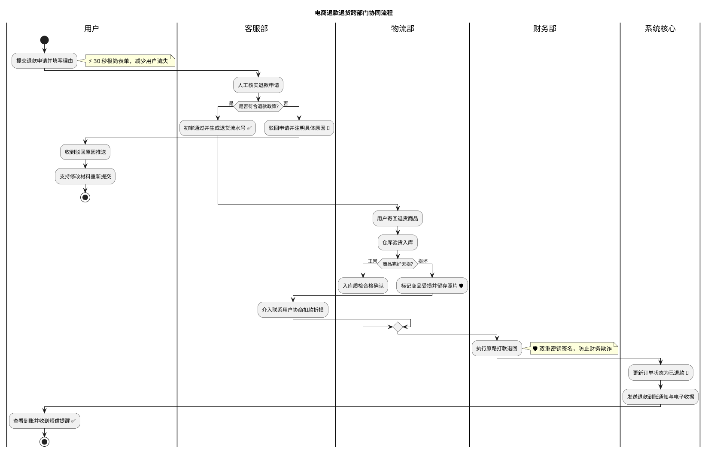
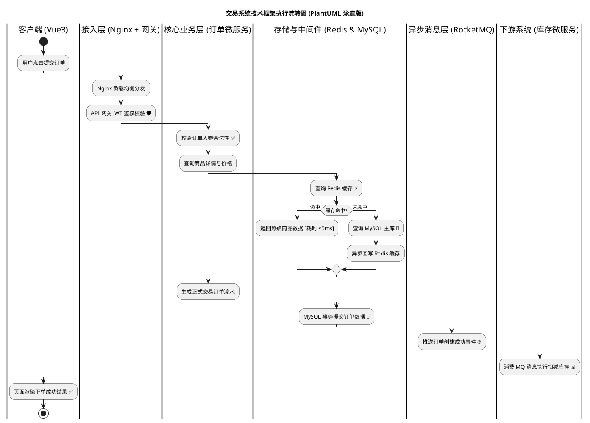
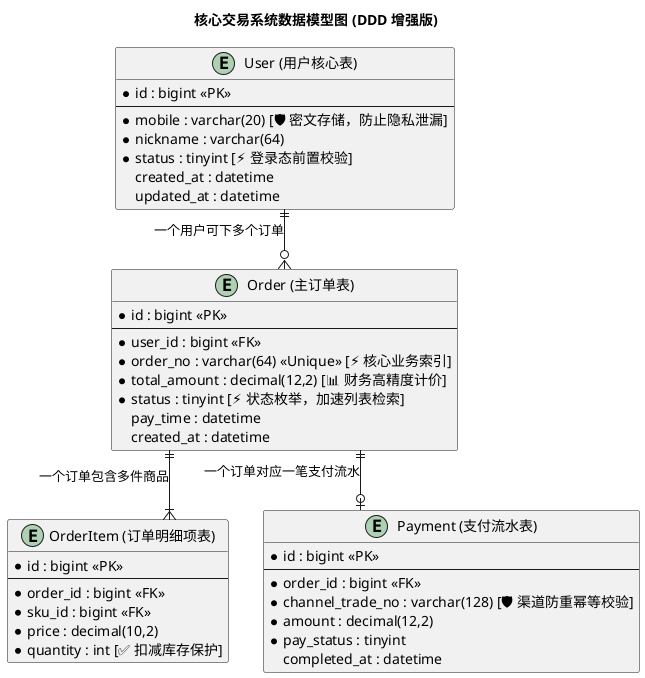
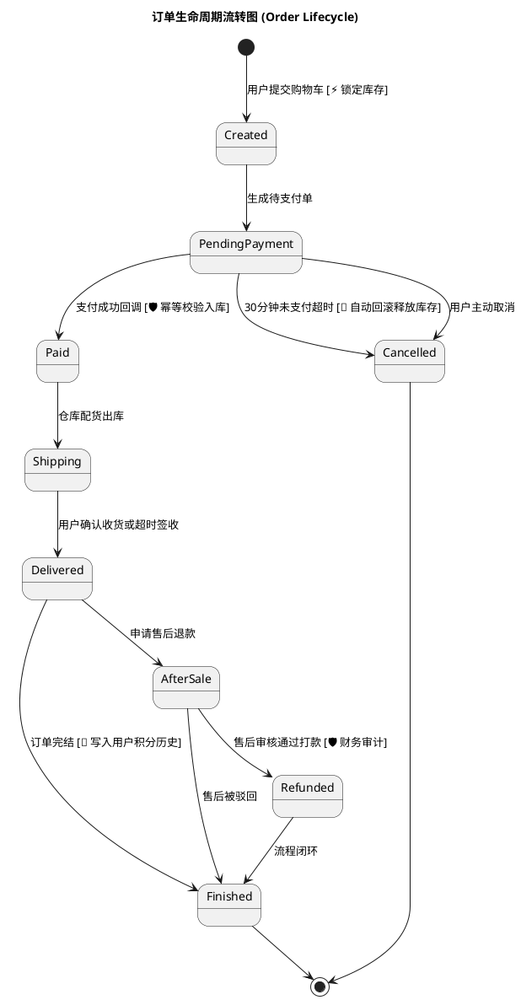

# DDD 图表 PlantUML 语法指南 (PlantUML Guide for DDD Diagrams)

使用 PlantUML 构建复杂系统图表与跨部门业务流的实操参考指南。重点聚焦于 Mermaid 表达受限的场景。

## 适用场景定位

在 DDD（图驱动开发）体系中，PlantUML 与 Mermaid 采用互补协作分工：
- **默认轻量场景**：优先使用 Mermaid（纯前端原生渲染，免环境配置）。
- **复杂场景推荐 PlantUML**：
  1. **跨部门或跨系统技术流转泳道图**：展示多部门协作、或请求跨技术分层（客户端/网关/微服务/中间件）的时序流转。
  2. **数据模型 ER 图**：展示数据库表结构、字段约束、主外键关系。
  3. **复杂状态机流转图**：展示业务对象复杂的生命周期与状态扭转。

### 核心选型规则：泳道图 vs 子图 (subgraph)
- **动态时序流转（必须首选 PlantUML 泳道图）**：凡是涉及请求在多个组件之间穿梭、存在“谁先执行、谁后执行”的动态流向（如：客户端 → 网关 → 微服务 → 缓存/数据库 → MQ），**严禁使用 Mermaid subgraph 来回连线**，必须使用 PlantUML 泳道图。这样可以确保连线绝不交叉打结，执行时间线严格自上而下推进。
- **静态结构划分（选用 Mermaid subgraph 或 PlantUML package）**：若只是表达系统模块的静态从属关系（没有先后执行顺序），则使用子图或包包裹。

---

## 核心设计模式

### 1. 跨部门业务泳道图 (Swimlane Activity Diagram)

泳道图使用竖线 `|泳道名称|` 明确划分各责任主体。



**设计规范要点：**
- 每个泳道对应一个独立部门、团队或系统边界。
- 关键节点必须附带 DDD 影响标注（如 `⚡`、`🛡️`、`💾`、`✅`、`🔄`）。
- 异常分支必须画出回退和挽救流向，严禁画死胡同。

#### 示例 1.2：技术分层与微服务调用流转泳道图 (动态框架流转首选)

当请求跨越前端、网关、微服务、缓存、数据库和消息队列时，使用泳道图表达执行流转：



**为什么比 Mermaid subgraph 更好：**
- 时间线严格自上而下推进，AI 和人类读者阅读逻辑完全一致。
- 绝不会发生 Mermaid 跨 subgraph 连线倒流、连线打结或遮挡节点的问题。
- 各个中间件和技术层的执行时机清晰落地。

---

### 2. 数据库实体关系 ER 图 (Entity-Relationship Diagram)

ER 图清晰表达数据库表、字段类型、主外键约束与 DDD 性能安全指标。



**关系符号速查：**
- `||--||` : 一对一必选 (Exactly One to Exactly One)
- `||--o|` : 一对一可选 (Exactly One to Zero or One)
- `||--o{` : 一对多可选 (Exactly One to Zero or Many)
- `||--|{` : 一对多必选 (Exactly One to One or Many)

---

### 3. 业务对象生命周期状态机图 (State Machine Diagram)

展示复杂业务对象的生命周期，包含各个状态变更时的安全与性能保障。



---

## 标注规范与 DDD 融合

在 PlantUML 中，标注可以采用以下两种形式：

### 形式 1：在节点文本内直接标注（推荐用于节点精简场景）
```plantuml
:调用风控接口 [🛡️ 毫秒级防刷拦截];
```

### 形式 2：使用 `note right` 或 `note left` 便签（推荐用于复杂逻辑说明）
```plantuml
:异步写入审计日志;
note right
  💾 采用双机热备存储
  确保满足合规审计要求
end note
```

---

## 语法速查表

### 泳道图基础语法
```
|部门或角色名|       声明进入对应泳道
start                 流程开始
stop                  流程终止
:执行操作步骤;        普通处理节点
if (条件?) then (是)  条件判断分支
else (否)
endif                 条件分支结束
note right: 说明      右侧附带便签
```

### ER 图基础语法
```
entity "表名" as 别名 { 声明实体
  * 字段名 : 类型 <<PK>> 声明主键
  --                  虚线分隔
  * 字段名 : 类型 <<FK>> 声明外键
}
```

---

## 编写最佳实践

1. **坚持前台与后台联动**：泳道图中必须包含“用户”泳道，不可仅画内部部门协作。
2. **坚持异常处理分支**：条件分支必须同时给出“是”与“否”的处理，不可留空。
3. **坚持用户收益标注**：核心数据库字段和业务节点必须讲清对用户和系统的价值。
4. **控制单图实体数量**：单张 ER 图实体数量建议控制在 5-10 个以内，过多应做模块拆分。
