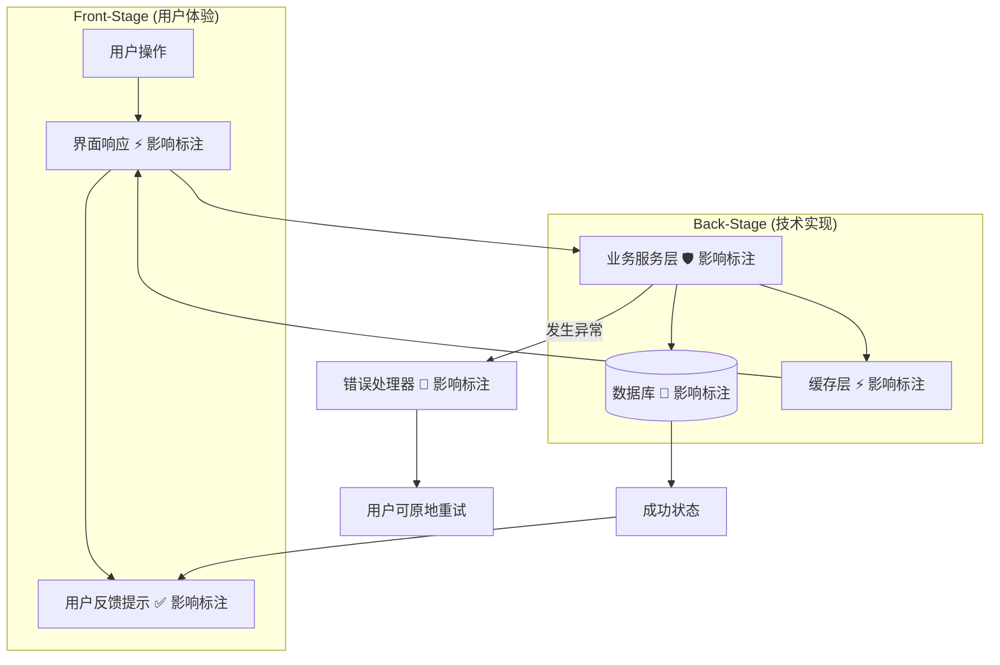
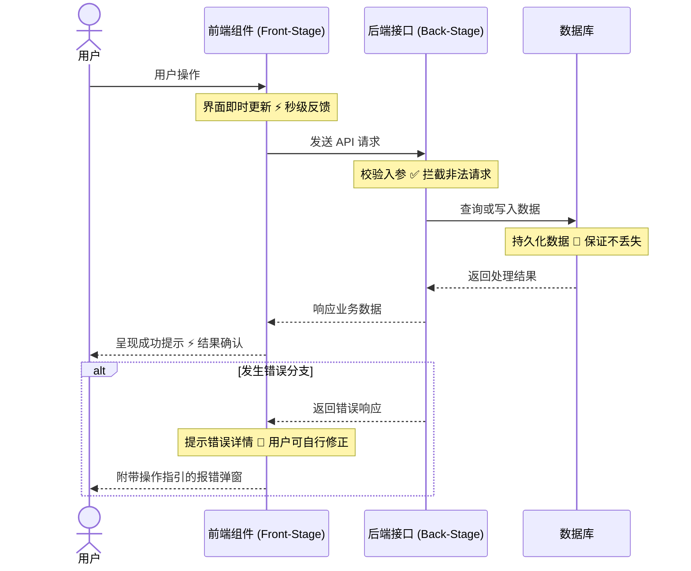
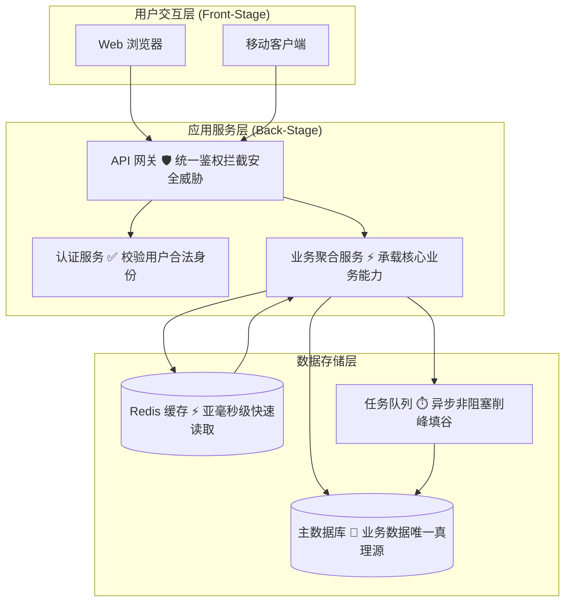
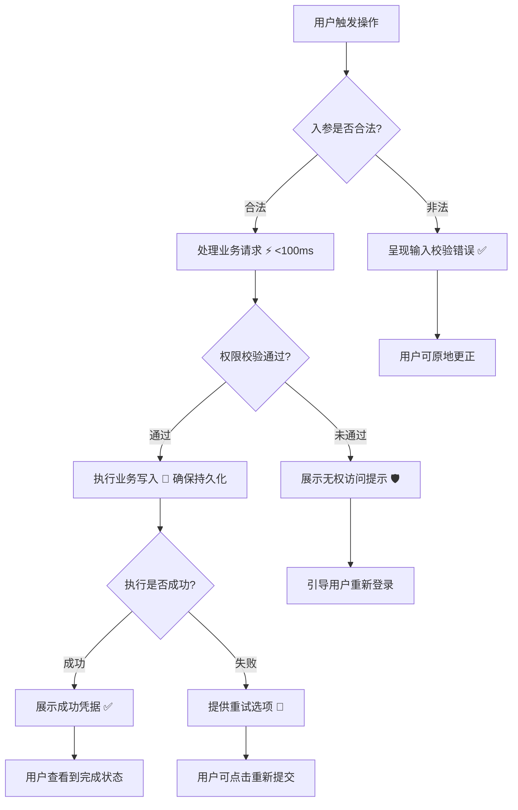
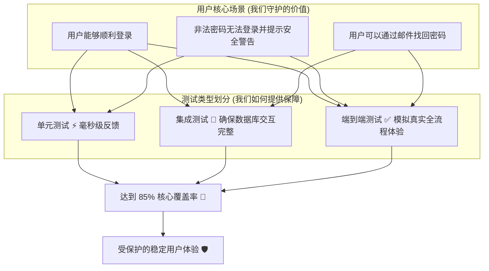
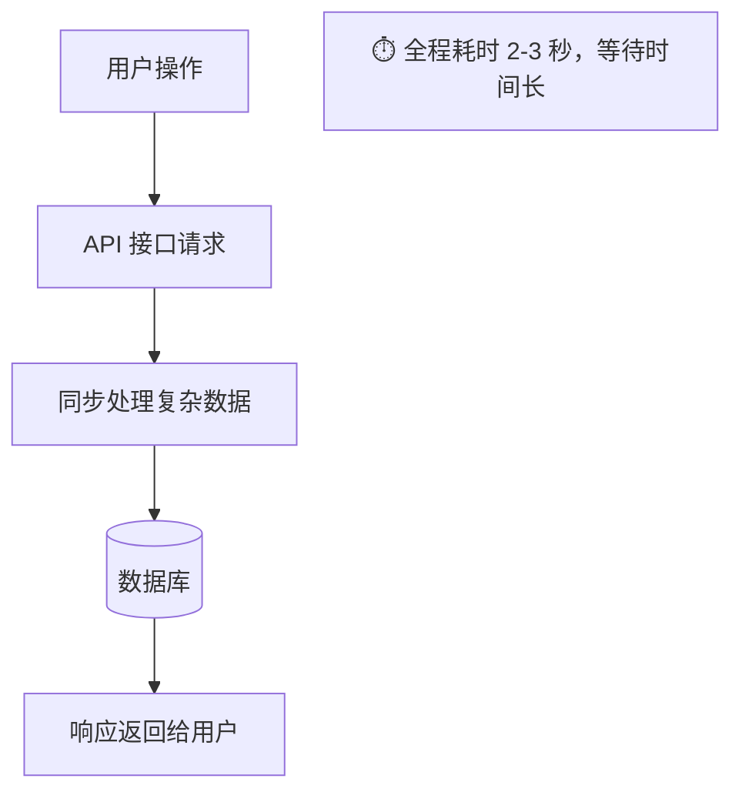
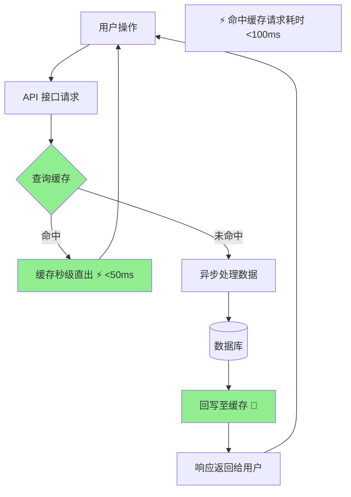
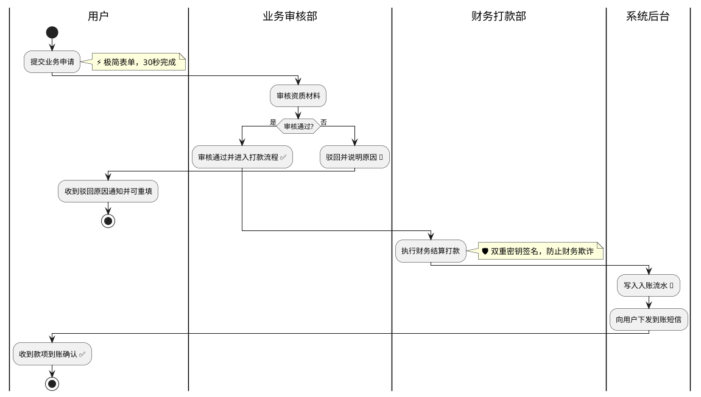
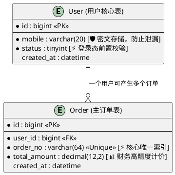

# 创建图表指南 (Creating Diagrams)

遵循 DDD 原则创建新图表的综合实操指南。

## 开始之前

**必须遵守**：在创建任何图表之前，请务必阅读 `DDD_PRINCIPLES.md`。深入理解 DDD 方法论是必不可少的前提。

## 创建流程

### 1. 理解用户需求

在编写任何 Mermaid 代码之前，请先回答以下问题：
- 这个图表解决了什么用户痛点？
- 它向用户交付了什么实际价值？
- 用户的什么操作触发了这一链路？
- 该流程为用户带来了什么最终结果？

### 2. 选择正确的图表类型

**功能图 (Feature Diagrams)** (`feature-*.md`)
- 适用场景：具体功能或用户工作流
- 展示内容：该功能如何交付用户价值
- 表现形式：包含前台/后台子图 (subgraphs) 的流程图

**时序图 (Sequence Diagrams)** (`sequence-*.md`)
- 适用场景：基于时间顺序的用户旅程
- 展示内容：跨时间的逐步交互过程
- 表现形式：以用户为主参与者 (actor) 的时序图

**架构图 (Architecture Diagrams)** (`arch-*.md`)
- 适用场景：系统级组织拓扑
- 展示内容：主要组件及其相互依赖关系
- 表现形式：带有影响标注的高层流程拓扑图

**流程图 (Flow Diagrams)** (`flow-*.md`)
- 适用场景：业务处理流程与复杂决策树
- 展示内容：分支判断逻辑与不同流向结果
- 表现形式：带有决策判断节点的流程图

**测试覆盖图 (Test Coverage Diagrams)** (`test-*.md`)
- 适用场景：记录测试策略与保障范围
- 展示内容：哪些用户核心场景受到了测试保护
- 表现形式：将各类测试与用户价值连接起来的流程图

**跨部门业务泳道图 (Swimlane Diagrams)** (`lane-*.md` 或 `flow-*.md`)
- 适用场景：跨团队、跨系统的复杂多角色流转
- 展示内容：不同部门职责边界、审批流向与异常分支
- 表现形式：PlantUML 泳道图（Swimlane Activity Diagram）

**数据模型 ER 图 (Entity-Relationship Diagrams)** (`er-*.md`)
- 适用场景：数据库结构设计、核心实体与依赖约束
- 展示内容：表结构、主外键、关键索引与字段级业务保护
- 表现形式：PlantUML 实体关系图（ER Diagram）

**重构对比图 (Refactoring Diagrams)** (存放在 `refactoring/` 目录下)
- 适用场景：重构前/后 (Before/After) 方案对比
- 展示内容：重构对用户体验带来的提升
- 表现形式：使用并排图表，变更部分用 `#90EE90` 高亮显示

### 3. 确定存放目录

```
ai/diagrams/
├── features/        # 具体功能的用户流程
├── architecture/    # 系统级架构图
├── journeys/        # 用户旅程时序图
├── tests/           # 测试覆盖与策略图
└── refactoring/     # 重构前后对比改进图
```

### 4. 创建标准文件结构

所有图表均须使用该模板：

```markdown
# [清晰、聚焦用户价值的标题]

**Type:** [Feature Diagram | Sequence Diagram | Architecture Diagram | Flow Diagram | Test Coverage]
**Last Updated:** [YYYY-MM-DD]
**Related Files:**
- `path/to/implementation.ts`
- `path/to/component.tsx`
- `path/to/test.spec.ts`

## Purpose

[用 1-2 句话阐述此图表说明了什么用户价值。重点关注用户收益，而非底层技术实现。]

## Diagram

\`\`\`mermaid
[此处填写 Mermaid 代码 - 参见下方模式]
\`\`\`

## Key Insights

- **User Impact 1:** [这对用户体验有何改善]
- **User Impact 2:** [这交付了什么核心价值]
- **Technical Enabler:** [哪些技术支撑使得上述价值得以实现]

## Change History

- **YYYY-MM-DD:** 初始创建
```

### 5. 编写 Mermaid 代码

根据图表类型选择以下标准模式：

## 图表设计模式

### 功能图设计模式



**关键要素：**
- 用户作为流程起点
- 严格分离前台与后台
- 每个后台技术组件都包含影响标注
- 包含具备恢复机制的异常路径
- 用户最终收益清晰可见

### 时序图设计模式



**关键要素：**
- 用户作为 actor 实体
- 交互环节带有影响标注的便签 (Note)
- 请求与响应一一对应
- 使用 alt 代码块展示异常处理
- 具备明确的处理结果

### 架构图设计模式



**关键要素：**
- 分层架构清晰
- 用户触点一目了然
- 影响标注解释各层存在的核心价值
- 数据流向清晰可循

### 流程图设计模式



**关键要素：**
- 使用菱形节点清晰表达分支判断
- 明确划分不同的终态
- 包含带挽救机制的异常分支
- 各项具体操作均附带影响标注

### 测试覆盖图设计模式



**关键要素：**
- 以用户真实场景作为核心输入
- 测试用例与用户场景紧密绑定
- 量化覆盖率指标
- 表达明确的安全与质量收益

### 重构对比图设计模式 (Before/After)

**重构前 (Before)：**


**重构后 (After)：**


**关键要素：**
- Before 展示当前痛点
- After 统一使用 `#90EE90` 高亮改进部分
- 影响标注直观呈现用户收益
- 量化重构带来的性能飞跃

### 跨部门业务泳道图模式 (PlantUML)



**关键要素：**
- 必须包含“用户”泳道，串联前后端
- 各部门职责与审核流向边界清晰
- 失败与驳回分支包含挽救出口
- 关键操作包含 DDD 收益标注

### 数据库实体关系 ER 图模式 (PlantUML)



**关键要素：**
- 标明主键 `<<PK>>` 与外键 `<<FK>>`
- 关键业务字段标注 DDD 价值（如 `[🛡️ 密文存储]`）
- 实体间关系线语义清晰（一对一、一对多等）

## 文件命名规范

命名遵循统一模式：`{type}-{descriptive-name}.md`

### 良好命名示例
- `feature-checkout-payment-flow.md`
- `sequence-user-authentication-journey.md`
- `arch-microservices-overview.md`
- `flow-error-recovery-process.md`
- `test-payment-security-coverage.md`

### 糟糕命名示例
- `diagram1.md`（缺乏描述性）
- `payment.md`（缺少类型前缀）
- `UserAuthenticationJourneySequenceDiagram.md`（大小写错误）
- `feature_checkout.md`（使用了下划线而非中划线）

## 影响标注使用手册

### 挑选正确的符号

**⚡ 速度 / 性能 (Speed/Performance)** - 适用场景：
- 降低响应延迟
- 提升接口响应速度
- 优化页面首屏加载
- 引入缓存实现快速读取

示例：
- `API Call ⚡ Responds in <100ms`
- `Image CDN ⚡ Loads 3x faster`
- `Cached Results ⚡ Instant search`

**💾 存储 / 持久化 (Storage/Persistence)** - 适用场景：
- 保存用户业务数据
- 保证数据不丢失
- 数据库底层事务操作
- 客户端状态持久化

示例：
- `Save to Database 💾 Preserves user work`
- `Session Storage 💾 Maintains login`
- `Auto-save 💾 Never lose progress`

**🛡️ 安全 / 防护 (Security/Safety)** - 适用场景：
- 用户身份认证与权限校验
- 数据加密传输
- 防止安全漏洞与注入
- 敏感数据防泄漏

示例：
- `Auth Check 🛡️ Protects user data`
- `Input Validation 🛡️ Prevents XSS`
- `HTTPS Only 🛡️ Encrypted connection`

**✅ 校验 / 正确性 (Validation/Correctness)** - 适用场景：
- 表单入参校验
- 业务数据有效性核查
- 确保数据逻辑正确
- 防止脏数据入库

示例：
- `Validate Form ✅ Prevents errors`
- `Check Inventory ✅ Accurate stock`
- `Verify Email ✅ Valid address`

**⏱️ 响应度 / 体验流畅性 (Responsiveness/UX)** - 适用场景：
- 保持前端界面不卡顿
- 异步非阻塞操作
- 大任务分批处理
- 滚动与输入防抖节流

示例：
- `Async Upload ⏱️ UI stays responsive`
- `Background Sync ⏱️ No blocking`
- `Debounce Input ⏱️ Smooth typing`

**🔄 可靠性 / 容错恢复 (Reliability/Recovery)** - 适用场景：
- 错误重试机制
- 失败兜底与优雅降级
- 断网自动重连
- 错误边界拦截崩溃

示例：
- `Retry Logic 🔄 Handles failures`
- `Fallback Content 🔄 Always shows something`
- `Error Boundary 🔄 Prevents crashes`

**📊 数据准确性 (Data Accuracy)** - 适用场景：
- 确保数据一致性
- 避免脏读与并发冲突
- 财务与数据对账
- 精准报表输出

示例：
- `Transaction 📊 Guarantees consistency`
- `Validation 📊 Clean data`
- `Reconciliation 📊 Accurate totals`

**🎯 核心功能使能 (Feature Enablement)** - 适用场景：
- 开启某项全新业务功能
- 支撑核心产品体验
- 核心基础设施搭建

示例：
- `WebSockets 🎯 Enables real-time chat`
- `Search Index 🎯 Powers instant search`
- `Payment Gateway 🎯 Accepts payments`

## 验证检查清单

保存前务必逐项核对：

### 结构检查
- [ ] 文件已存入对应子目录（features/、architecture/ 等）
- [ ] 文件命名符合 `{type}-{name}.md` 规范
- [ ] 模板所包含的各章节段落均已写全
- [ ] 关联的代码文件列表已补充完整

### DDD 合规检查
- [ ] 同时包含了前台 (Front-Stage) 与后台 (Back-Stage)
- [ ] 流程以用户行为作为起点入口
- [ ] 所有后台组件均带有明确的影响标注
- [ ] 包含了异常处理与错误路径
- [ ] 提供了供用户选择的恢复选项

### 内容质量检查
- [ ] Purpose 字段重点阐述用户价值（而非罗列技术实现）
- [ ] Key Insights 紧扣用户影响展开
- [ ] Mermaid 语法完全合法
- [ ] 未使用任何自定义颜色（重构对比图使用 #90EE90 除外）
- [ ] Last Updated 日期已更新为当前日期

### 以用户为中心检查
- [ ] 链路以用户行为开始
- [ ] 链路以用户获得结果结束
- [ ] 每个技术组件均与用户收益形成映射
- [ ] 错误分支清晰展示了用户的视角与出口

## 更新总索引文件

创建图表后，必须将其登记至 `ai/diagrams/README.md` 中：

```markdown
## [对应分类]

- [图表标题](category/filename.md) - 聚焦用户价值的简短说明
```

## 严禁踩雷的常见错误

### ❌ 脱离用户上下文
严禁绘制纯技术架构图。每个图表都必须展示出对用户的实际价值。

### ❌ 遗漏影响标注
切勿假设用户价值是不言自明的。必须通过显式标注让收益一清二楚。

### ❌ 仅画正常流程
不能忽略异常分支。发生故障时的应对方案必须在图中完整呈现。

### ❌ 目录存放错误
禁止将所有图表随意散落在根目录。必须规范放进对应的子目录。

### ❌ 随意命名文件
禁止使用诸如 "diagram1.md" 等无意义的文件名。必须具备清晰描述性。

### ❌ 元数据信息缺失
切勿遗漏“关联文件 (Related Files)”与“最后更新 (Last Updated)”字段。

### ❌ 在 Purpose 中堆砌技术黑话
错误示例：“基于 JWT 认证与 RESTful API 的微服务架构”
正确示例：“为用户提供安全防护的登录机制，守护用户账户资产”

## 实战示例

### 示例 1：电商结账功能图

**文件路径**：`features/feature-checkout-payment-flow.md`

```markdown
# 电商支付结账流程 (E-commerce Checkout Payment Flow)

**Type:** Feature Diagram
**Last Updated:** 2025-01-15
**Related Files:**
- `src/features/checkout/CheckoutPage.tsx`
- `src/services/payment/paymentService.ts`
- `src/services/order/orderService.ts`

## Purpose

允许用户安全快捷地完成支付购买，提供即时状态反馈与支付失败自愈重试机制，确保用户的购物车数据绝不丢失。

## Diagram

\`\`\`mermaid
graph TD
    subgraph "Front-Stage (用户体验)"
        User[用户点击“立即付款”] --> Loading[加载中动效 ⏱️ 明确展示处理进度]
        Loading --> Success[订单支付成功提示 ✅]
    end

    subgraph "Back-Stage (技术实现)"
        Loading --> Validate[校验购物车有效性 ✅ 拦截异常空单]
        Validate --> Payment[支付网关 🛡️ PCI 认证安全支付]
        Payment --> Order[创建正式订单 💾 确保最终履约交付]
        Order --> Email[发送收据邮件 ⚡ 订单即时确认凭证]
    end

    Payment -->|支付成功| Order
    Payment -->|支付失败| ErrorHandler[支付异常处理器 🔄]
    ErrorHandler --> RetryUI[展示重试界面并保留购物车选项]
    RetryUI --> User

    Order --> Success
    Email --> Success
\`\`\`

## Key Insights

- **安全支付保障**：严格符合 PCI 规范的支付网关，全面保护用户财务隐私
- **订单数据不丢失**：即使邮件推送异常，核心订单仍确保 100% 成功入库
- **失败自愈挽救**：支付受阻时提供明确的原地重试途径，完整保留已选商品
- **即时交互反馈**：加载动效与即刻推送的账单收据大幅消除用户等待焦虑

## Change History

- **2025-01-15:** 初始创建
```

### 示例 2：实时消息通知系统

**文件路径**：`features/feature-notification-system.md`

```markdown
# 实时通知推送系统 (Real-time Notification System)

**Type:** Feature Diagram
**Last Updated:** 2025-01-15
**Related Files:**
- `src/components/NotificationBell.tsx`
- `src/services/websocket/notificationService.ts`
- `src/hooks/useNotifications.ts`

## Purpose

让用户在不刷新网页的情况下，毫秒级获悉关键业务事件动态，提升用户粘性并确保重要提醒不被遗漏。

## Diagram

\`\`\`mermaid
sequenceDiagram
    actor User as 用户
    participant UI as 通知铃铛图标
    participant WS as WebSocket 客户端
    participant Server as 通知推送服务端
    participant DB as 数据库

    User->>UI: 打开应用页面
    Note over UI: 展示未读小红点 ⚡ 状态一目了然

    UI->>WS: 建立长连接
    Note over WS: 建立通信管道 🎯 开启实时数据通道

    WS->>Server: 订阅当前用户的通知频道

    Server->>DB: 查询当前未读数量
    DB-->>Server: 返回统计数值
    Server-->>WS: 推送初始化状态
    WS-->>UI: 刷新红点数字 ⚡
    UI-->>User: 呈现最新未读数

    loop 实时消息推送循环
        Server->>WS: 触发新业务通知事件
        Note over Server: 秒级主动下发 ⚡ <100ms 送达
        WS->>UI: 增量更新通知列表
        UI->>UI: 弹出浮窗提示 📣 提醒用户注意
        UI-->>User: 用户查看到最新通知
    end

    alt 网络波动长连接断开
        WS-->>UI: 触发连接中断
        Note over UI: 提示离线状态 🔄
        WS->>WS: 指数退避自动重连 ⏱️
        WS->>Server: 重连成功并同步差量
        Server->>DB: 捞取断线期间遗漏的消息
        DB-->>Server: 补齐遗漏消息
        Server-->>WS: 补发历史消息 💾
        WS-->>UI: 恢复实时状态 ✅
    end
\`\`\`

## Key Insights

- **极速实时触达**：借助 WebSocket 长连接技术，实现 <100ms 的超低延迟消息下发
- **消息零丢失保障**：断线自动重连结合服务端补发机制，确保断网期间通知不遗漏
- **直观视觉反馈**：红点角标与即时弹窗相辅相成，关键动态时刻尽在掌控
- **优秀的离线韧性**：针对弱网环境提供优雅降级与静默重连，用户无感知

## Change History

- **2025-01-15:** 初始创建
```

## 后续步骤

图表创建完成之后：
1. 对照 DDD 检查清单逐项核查合规性
2. 更新 `ai/diagrams/README.md` 索引
3. 提交 Git 变更并填写描述清晰的 Commit Message
4. 在相关的需求或架构文档中引用该图表
5. 在代码评审 (Code Review) 中借助图表向团队解释改动
