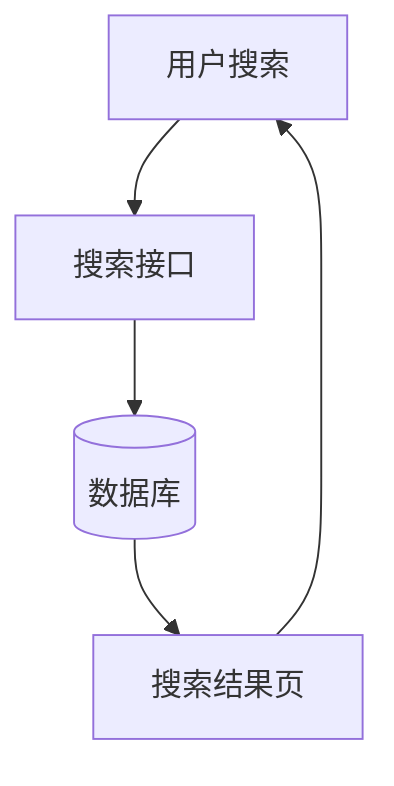
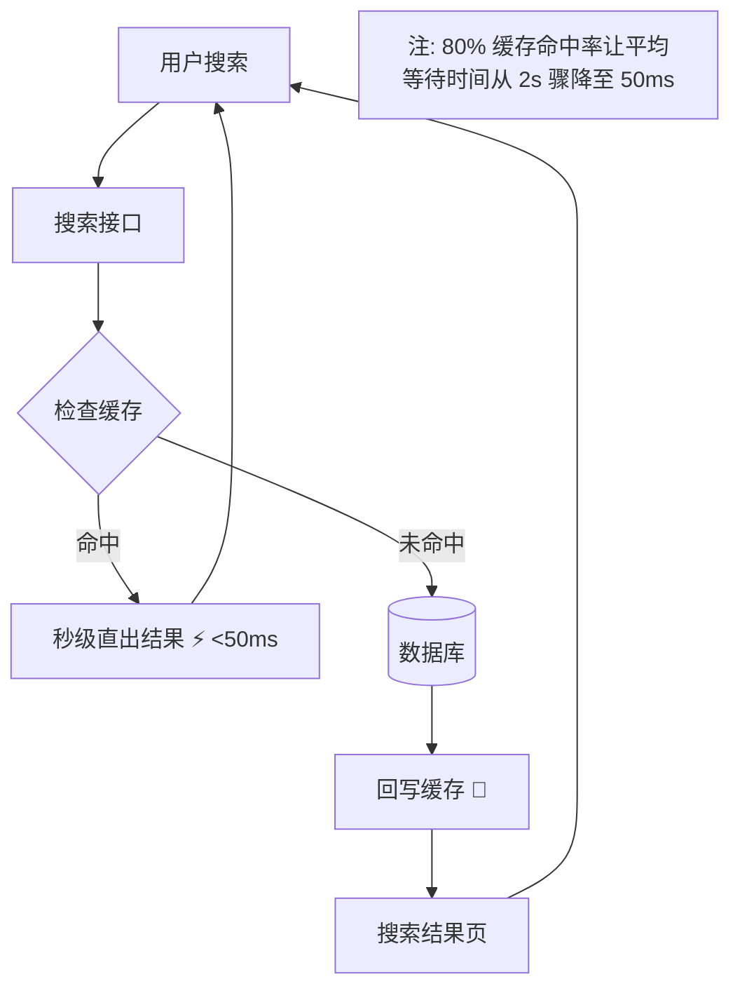
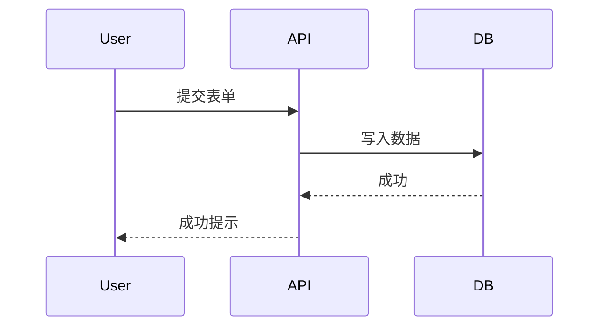
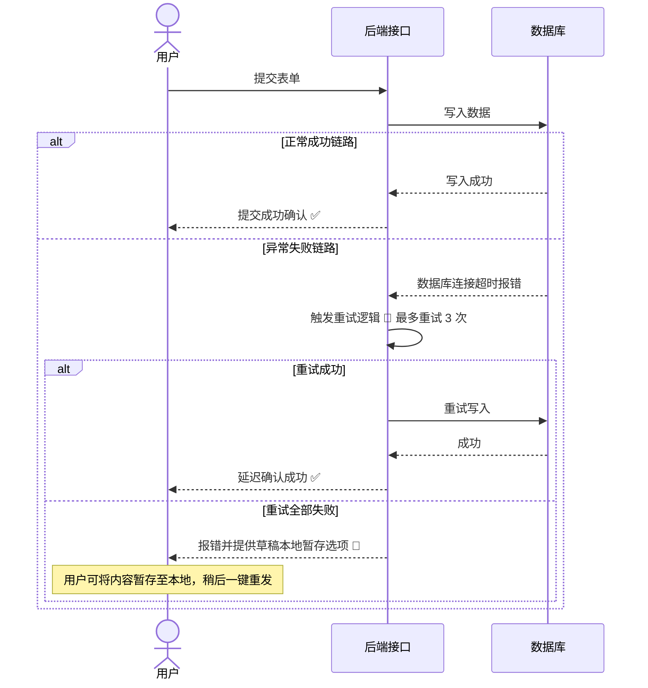
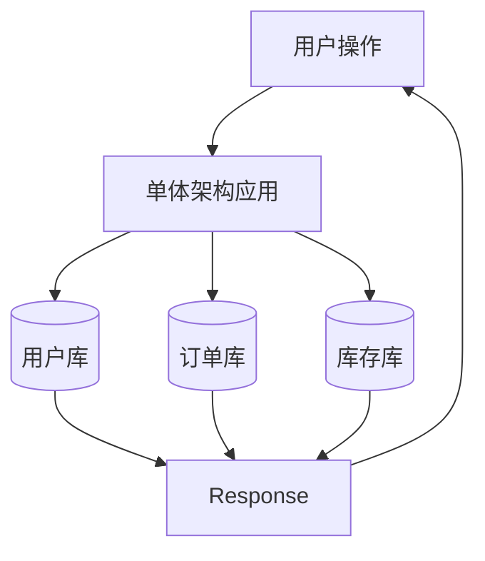
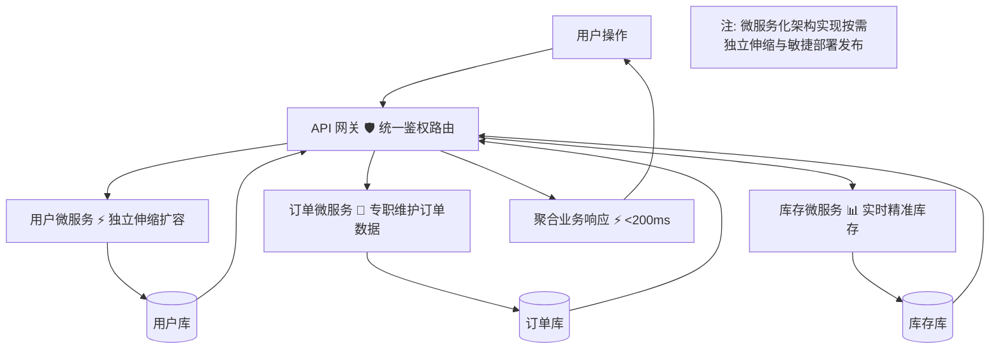
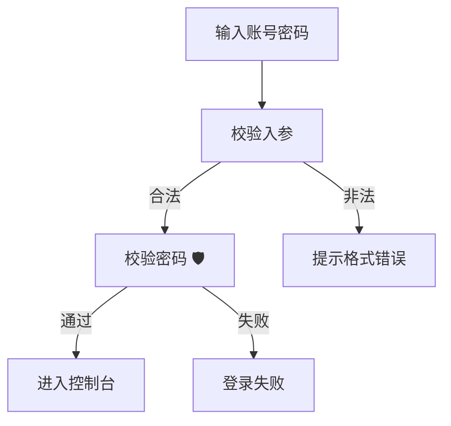
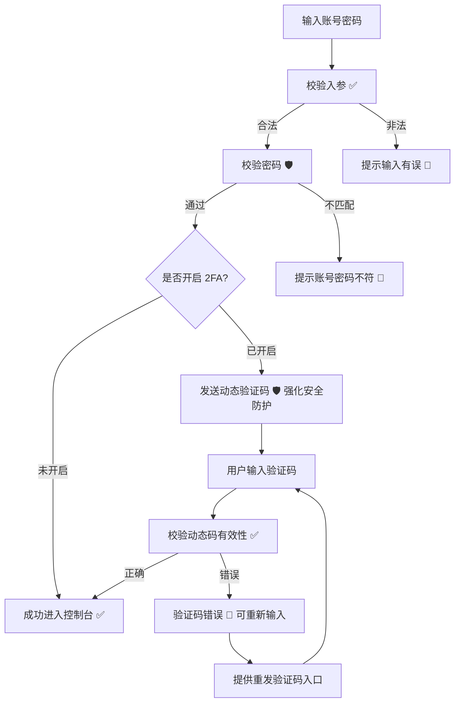

# 更新图表指南 (Updating Diagrams)

使图表与代码变更保持严格同步的实操指南。

## 何时需要更新图表

在出现以下情况时，请及时更新图表：
- 底层代码实现发生变动
- 用户交互流程被修改
- 在现有流程中增加了新特性
- 实施了性能优化提升
- 新增或调整了异常错误处理逻辑
- 外部依赖项发生变动
- 关联的文件被重命名或移动

## 更新标准流程

### 1. 识别受影响的图表

**借助 Git 提交历史：**
```bash
# 查找最近一周修改过的文件
git log --since="1 week ago" --name-only --pretty=format: | sort | uniq

# 对比图表元数据，查找引用了这些文件的图表
find ai/diagrams -name "*.md" -exec grep -l "path/to/changed/file" {} \;
```

**依据图表元数据：**
- 检查图表顶部的“关联文件 (Related Files)”段落
- 将代码变更路径与关联文件逐一比对
- 筛查“最后更新 (Last Updated)”日期已陈旧的图表

**人工核对：**
- 列出全部图表：`ls -R ai/diagrams/`
- 审查每个图表关联的代码范围
- 识别引用了已改动业务逻辑的图表

### 2. 深入理解代码改动

在动手更新图表前：
- 查看代码 Diff 详情 (`git diff`)
- 理解改动给用户带来的实际影响
- 识别新引入的异常处理链路或业务流向
- 记录实际的性能指标提升
- 检查是否引入了新的底层依赖

### 3. 更新图表主体内容

#### 更新 Mermaid 代码

**添加新组件：**
```mermaid
# 旧链路
User --> Service --> DB

# 新链路 (引入缓存层)
User --> Service --> Cache
Cache -->|命中| User
Cache -->|未命中| DB
DB --> Cache
```

**修改流向逻辑：**
```mermaid
# 旧链路
Service --> DB --> Response

# 新链路 (加入参数校验)
Service --> Validate[参数校验 ✅]
Validate -->|合法| DB
Validate -->|非法| Error[错误响应 🔄]
DB --> Response
```

**补充错误处理路径：**
```mermaid
# 旧链路
API --> Process --> Success

# 新链路 (补齐异常处理与重试)
API --> Process
Process -->|成功| Success
Process -->|失败| ErrorHandler[错误处理器 🔄]
ErrorHandler --> Retry[用户可原地重试]
```

#### 同步更新影响标注

当底层实现改动提升了用户体验时：

**更新前：**
```
API Call --> Database
```

**更新后（加入缓存）：**
```
API Call --> Cache[缓存层 ⚡ 页面加载耗时降至 <50ms]
Cache -->|未命中| Database
```

#### 更新关联代码文件路径

确保“Related Files”段落始终准确对应真实文件：

**更新前：**
```markdown
**Related Files:**
- `src/services/userService.ts`
- `src/components/UserProfile.tsx`
```

**更新后（文件重构重命名）：**
```markdown
**Related Files:**
- `src/services/user/userService.ts`
- `src/features/profile/UserProfilePage.tsx`
- `src/hooks/useUserData.ts` (新增)
```

### 4. 更新文档元数据

#### 更新最后修改日期
```markdown
**Last Updated:** 2025-01-16
```

#### 追加变更历史记录
```markdown
## Change History

- **2025-01-16:** 引入缓存层优化性能响应（由 2s 降至 50ms）
- **2025-01-10:** 为认证失败流程增加用户重试恢复选项
- **2025-01-05:** 初始创建
```

### 5. 更新核心洞察 (Key Insights)

如果改动对用户价值产生了影响，请同步修改洞察结论：

**更新前：**
```markdown
## Key Insights

- 安全身份认证有效守护用户账户资产
- 提供登录成功与失败的即时结果反馈
```

**更新后（增加了“记住我”功能）：**
```markdown
## Key Insights

- 安全身份认证有效守护用户账户资产
- 提供登录成功与失败的即时结果反馈
- **“记住我”功能为老用户节省二次登录时间**
- 30 天无操作自动登出，兼顾使用便捷性与安全性
```

### 6. DDD 质量再验证

对照 DDD 检查清单核验：
- [ ] 依然保持前台 (Front-Stage) 与后台 (Back-Stage) 双层视角
- [ ] 新加入的组件均附带了明确的影响标注
- [ ] 错误分支与异常恢复路径符合现状
- [ ] 用户操作准确反映了新的交互流向
- [ ] 关联文件路径真实准确无死链
- [ ] “最后更新”日期已更新为当前日期
- [ ] 变更历史清晰记录了改动的具体内容与原因

## 典型更新设计模式

### 模式 1：引入性能优化

**业务场景**：引入 Redis 缓存以减轻数据库查询压力

**更新前：**


**更新后：**


**更新核查清单：**
- ✅ 添加了带有影响标注的缓存层组件
- ✅ 明确展示了缓存命中与穿透两条路径
- ✅ 量化了性能提升具体指标
- ✅ 在关联文件中补充了缓存服务代码文件
- ✅ 追加了 Change History 记录条目
- ✅ 刷新了最后更新日期

### 模式 2：补齐异常错误处理

**业务场景**：为失败的 API 请求增加智能重试与草稿暂存机制

**更新前：**


**更新后：**


**更新核查清单：**
- ✅ 补齐了包含重试逻辑的异常路径
- ✅ 提供了供用户挽救数据的操作选项（保存草稿）
- ✅ 添加了体现系统高可靠性的影响标注
- ✅ 更新了关于稳定性的核心洞察条目
- ✅ 在关联文件中补充了错误拦截器代码

### 模式 3：架构重构演进

**业务场景**：将单体服务拆分为分布式微服务

**更新前：**


**更新后：**


**更新核查清单：**
- ✅ 根据全新架构重构拓扑结构
- ✅ 补充了带有安全与路由标注的 API 网关
- ✅ 细化划分服务职责边界
- ✅ 添加服务级别的专属影响标注
- ✅ 关联文件扩充为 3 个微服务的核心文件
- ✅ 核心洞察中体现关于高可用与可伸缩性的收益

### 模式 4：在已有流程中接入新特性

**业务场景**：在原有登录流程中引入双因素认证（2FA）

**更新前：**


**更新后：**


**更新核查清单：**
- ✅ 接入 2FA 分支流程
- ✅ 完好保留原有未开启 2FA 的普通用户路径
- ✅ 补充验证码输入错误的异常分支
- ✅ 提供重新发送验证码的自愈挽救出口
- ✅ 更新关于账户安全等级提升的核心洞察
- ✅ 关联文件中追加 2FA 认证模块源码

## 常见改动场景快速处理

### 场景：文件发生重命名

**操作**：更新“Related Files”段落路径

```markdown
# 修改前
**Related Files:**
- `src/utils/helpers.ts`

# 修改后
**Related Files:**
- `src/utils/stringHelpers.ts`
```

**更新变更历史：**
```markdown
- **2025-01-16:** 工具函数模块重构，同步更新关联代码文件路径
```

### 场景：性能大幅提升

**操作**：更新影响标注中的具体量化指标

```markdown
# 修改前
API Call [⚡ 响应迅速]

# 修改后
API Call [⚡ 接口响应 <100ms（相较于原本的 500ms 提升 5 倍）]
```

**更新变更历史：**
```markdown
- **2025-01-16:** 接口底层 SQL 深度优化，响应速度提升 5 倍
```

### 场景：新增错误防御机制

**操作**：在 Mermaid 图表中增加异常处理分支

```markdown
# 修改前（缺少异常处理）
Service --> DB --> Success

# 修改后（补全异常处理）
Service --> DB
DB -->|成功| Success
DB -->|失败| ErrorHandler[错误拦截器 🔄 保证数据零损坏]
ErrorHandler --> Retry
```

**更新变更历史：**
```markdown
- **2025-01-16:** 增加数据库熔断机制与全自动重试链路
```

### 场景：引入全新外部依赖

**操作**：在图表中新增组件节点

```markdown
# 修改前
API --> Database

# 修改后
API --> Cache[缓存组件 💾 新增 Redis 依赖]
Cache --> Database
```

**更新关联文件**（追加新文件）：
```markdown
- `src/services/cache/cacheService.ts` (新增)
```

**更新变更历史：**
```markdown
- **2025-01-16:** 引入 Redis 缓存组件以支撑高并发访问
```

## 批量更新处理方案

当一次大型重构涉及修改多个图表时：

### 1. 梳理待更新清单

```markdown
## 待更新图表清单

1. **feature-user-authentication.md**
   - 补充 2FA 交互流向
   - 更新关联代码文件路径

2. **sequence-login-journey.md**
   - 增加 2FA 时序交互步骤
   - 刷新时序耗时标注

3. **arch-system-overview.md**
   - 接入 2FA 鉴权独立组件
   - 更新系统组件拓扑依赖
```

### 2. 逐一系统化推进

按顺序逐个处理每个文件：
- 仔细通读当前图表
- 完成代码逻辑与 Mermaid 拓扑修改
- 对照 DDD 规范校验质量
- 刷新日期与变更历史
- 验证 Mermaid 语法渲染

### 3. 同步刷新总索引

全部修改完成后，在 `README.md` 中留下整体记录：

```markdown
## Last Updated

2025-01-16 - 更新认证体系全部图表，完整覆盖双因素认证 (2FA) 实现
```

## 更新后的验收核对

### Mermaid 语法有效性验证

验证图表可以正常渲染：
- 复制 Mermaid 代码块
- 粘贴至 [Mermaid 在线编辑器 (Mermaid Live Editor)](https://mermaid.live)
- 确认无语法报错
- 检查排版布局是否美观清晰

### DDD 规范合规性核对

- [ ] 依然保持前台与后台双层视角？
- [ ] 所有新加入的组件均有用户视角的收益标注？
- [ ] 包含了清晰的错误与恢复路径？
- [ ] 用户价值明确透出？

### 元数据完整性核对

- [ ] "Last Updated" 已刷新为当前日期？
- [ ] "Related Files" 路径准确真实？
- [ ] "Change History" 追加了准确的变动记录？
- [ ] "Key Insights" 反映了最新收益？

### 真实代码一致性核对

- [ ] 图表流向与现有实际代码完全一致？
- [ ] 量化指标客观真实？
- [ ] 分支逻辑全覆盖？
- [ ] 清理掉了所有已经废弃的老旧组件？

## 常见疑难排解

### 更新后图表过于复杂臃肿

**问题表现**：图表中堆积了过多节点，阅读困难。

**解决方案：**
1. 拆分成多个独立图表（如：总览图 `auth-overview` + 2FA 详情图 `auth-2fa-detail`）
2. 合理使用子图 (subgraphs) 归类模块
3. 将重构部分单独剥离为重构对比图
4. 将复杂交互流向转由专门的时序图承载

### 无法提炼出对用户的价值影响

**问题表现**：纯粹的底层代码改动，不知道对用户有什么好处。

**解决方案：**
1. 自问核心问题：“这项改动解决了用户的什么痛苦？”
2. 从性能维度切入（是否变得更快、首屏更短）
3. 从稳定性维度切入（是否减少了报错崩溃、防范了丢单）
4. 从安全维度切入（是否增强了隐私与资产保障）
5. 如果完全找不出任何用户收益，需重新审视这项技术改造是否有必要

### 改动牵扯了过多图表

**问题表现**：一处代码变更导致需要修改大量图表。

**解决方案：**
1. 明确优先级：先更新最重要的主干图表
2. 列出清单，按部就班逐项更新，避免遗漏
3. 评估图表粒度是否过细，必要时进行合理合并

### 遗忘了具体的代码改动细节

**问题表现**：记不清代码究竟改了哪些地方。

**解决方案：**
```bash
# 查看近期的提交摘要
git log --since="1 week ago" --oneline

# 检查指定文件的具体变更代码
git diff HEAD~5 path/to/file

# 对比图表最后更新日期至今的代码提交
# 假如图表上次更新于 2025-01-10：
git log --since="2025-01-10" --name-only path/to/related/files
```

## 最佳实践准则

1. **改完代码立即同步更新** - 绝不拖延，防止图表失效
2. **变更历史务必详细具体** - 记录清晰的变动原因，便于后续回溯
3. **及时更新影响标注指标** - 性能提升后务必更新具体数值
4. **提交前测试 Mermaid 语法** - 确保渲染无误
5. **精准维护关联代码路径** - 绝不遗留失效的旧路径
6. **始终坚持以用户为中心** - 任何更新都不能退化为纯技术死板图表
7. **严格执行质量检查清单** - 确保每次修改都符合 DDD 规范
8. **批量改动集中维护** - 协同更新所有相关联图表

## 后续步骤

完成图表更新之后：
1. 提交 Git 变更并撰写清晰的提交信息
2. 按需刷新 `README.md` 索引
3. 在 Pull Request 的描述中引用图表说明改动影响
4. 在团队代码评审 (Code Review) 中借助图表展示架构调整
5. 将图表同步给团队其他协作成员
