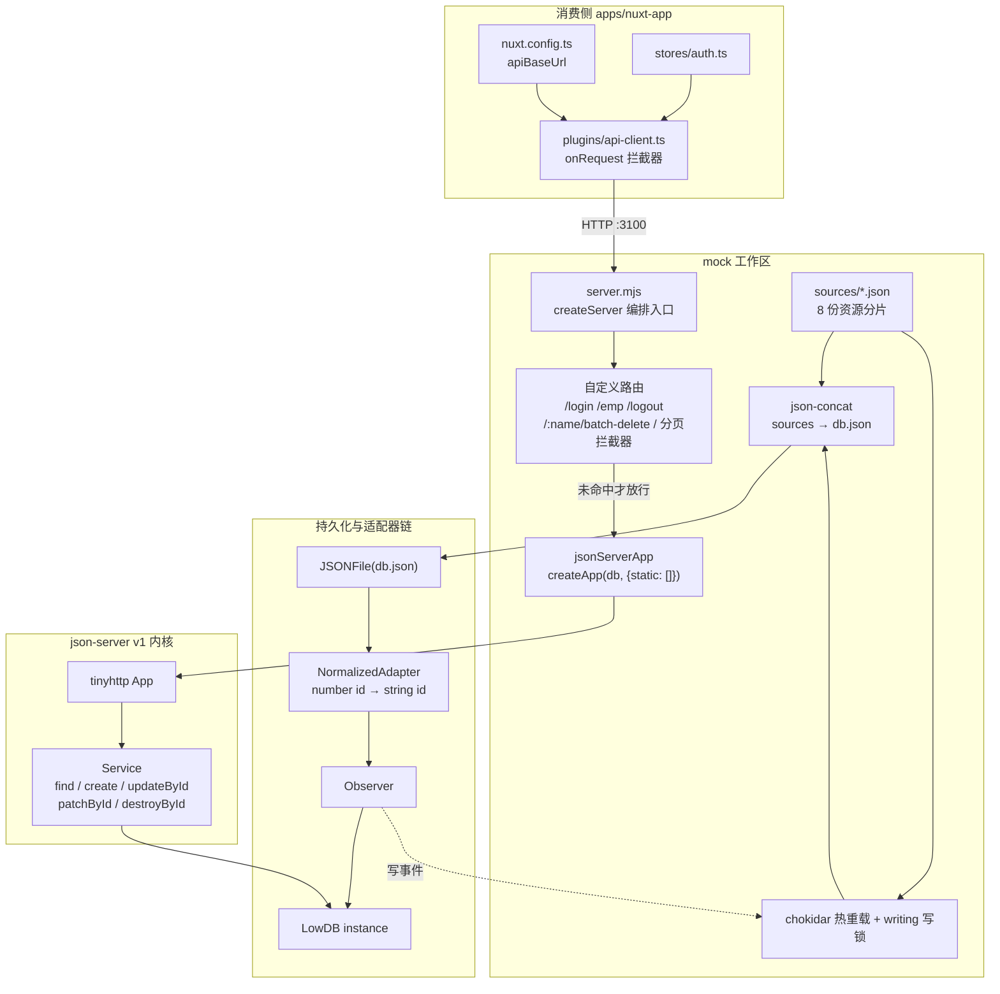
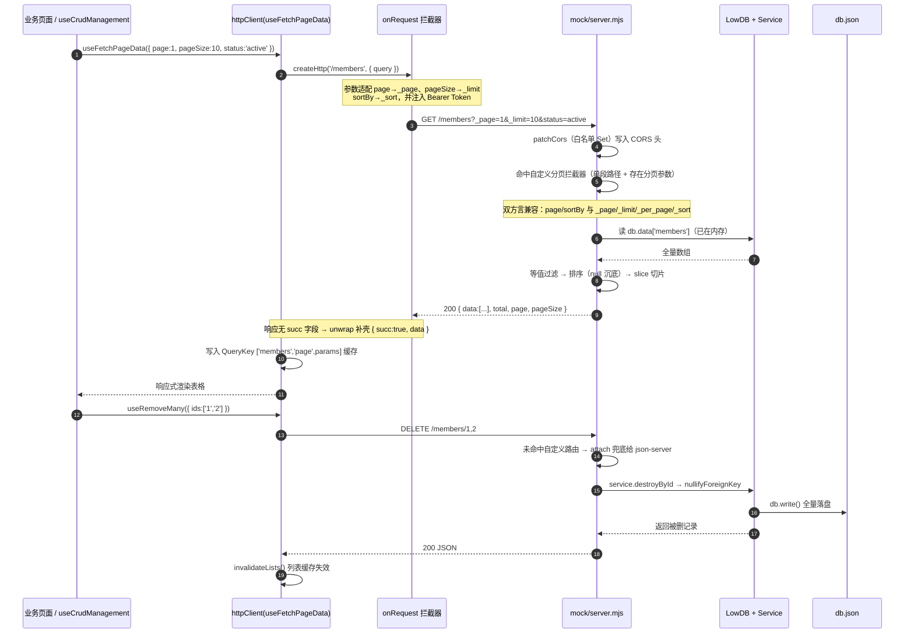

# 实战-json-server 配置使用设计

> **工程类型判定**：前端工程（pnpm workspace Monorepo：Nuxt 4 + Vue Query + Pinia，附带独立 `mock` 工作区做后端仿真）
> **代码基线**：`d:/mywork/myDev/frontDev/ai-nuxt/pnpm-mono`
> **主题版本**：`json-server@^1.0.0-beta.15`（**不是** 老牌 v0.x CLI 版，本项目全程走**编程式 API**，没有 `json-server --watch`）
> **文档定位**：这是一份**使用规范（SOP）**。主线是「装什么包 → 配哪些东西 → 数据放哪 → 怎么起 → 怎么访问」，架构图与机制剖析作为理解与排障的支撑材料。
> **全部访问示例均在本工程真实启动 `mock/server.mjs` 后实测产出**（端口 3100）。

---

## 一、先建立全局认知：它在架构里的位置

### 1.1 分层拓扑

```text
┌──────────────────────────────────────────────────────────────────────────────┐
│ A. 消费侧  apps/nuxt-app                                                      │
│    nuxt.config.ts        : apiBaseUrl = API_BASE_URL || http://localhost:3100 │
│    plugins/api-client.ts : onRequest → page→_page / pageSize→_limit / Bearer  │
│    stores/auth.ts        : login → POST /login，token 存 localStorage(带 TTL) │
└───────────────────────────────────┬──────────────────────────────────────────┘
                                    │ HTTP :3100
┌───────────────────────────────────▼──────────────────────────────────────────┐
│ B. 路由编排层  mock/server.mjs（node:http createServer 单入口）                │
│    ① OPTIONS 预检                     → 204                                   │
│    ② POST /login · GET /emp · POST /logout   （鉴权类自定义路由）              │
│    ③ POST /:name/batch-delete                （批量删除资源路由）              │
│    ④ GET /:name?page/pageSize/sortBy         （标准分页契约拦截器）            │
│    ⑤ 兜底 → jsonServerApp.attach(req,res)    （json-server REST 引擎）         │
└──────────┬────────────────────────────────────────────────────┬──────────────┘
           │ 读写数据                                            │ 改写 req.url
┌──────────▼──────────────────────────────┐   ┌──────────────────▼─────────────┐
│ C. 数据装配层                             │   │ D. REST 引擎层                  │
│   sources/*.json --json-concat--> 合并    │   │   createApp(db, { static: [] })│
│   chokidar 热监听 + Observer 写锁          │   │   tinyhttp App.attach(req,res) │
│   LowDB + NormalizedAdapter(id 归一化)     │   │   Service: find/create/...      │
└──────────┬──────────────────────────────┘   └──────────────────┬─────────────┘
           │                                                      │
┌──────────▼──────────────────────────────────────────────────────▼─────────────┐
│ E. 持久化  mock/db.json（运行时真源，$schema 由适配器自动增删）                  │
└───────────────────────────────────────────────────────────────────────────────┘
```

### 1.2 装配流向图



### 1.3 一次分页请求的生命周期



---

## 二、使用规范 SOP

### 2.1 Step 1 · 装依赖：装哪些包、装到哪

**依赖全部装在 `mock` 这个私有工作区包里**（不是装到根、也不是装到 `apps/nuxt-app`），因为它是独立进程、不参与前端构建产物。

| 包 | 版本 | 作用 | 是否必需 |
|---|---|---|---|
| `json-server` | `^1.0.0-beta.15` | REST 引擎本体：`createApp()` 提供 `/:name` 全套 CRUD、`Service` 提供增删改查与关系处理 | ✅ 必需 |
| `lowdb` | `^7.0.1` | JSON 文件数据库。自建 `Low` 实例并注入 `createApp`，让自定义路由与 REST 路由共享同一内存态 | ✅ 必需 |
| `json-concat` | `^0.0.1` | 把 `sources/*.json` 多份分片合并成单文件 `db.json` | ✅ 必需（多文件分片方案下） |
| `chokidar` | `^5.0.0` | 监听 `sources/` 变更，热重载数据 | ➖ 可选（去掉就要手动重启） |
| `chalk` | `^6.0.0` | 启动横幅彩色输出 | ➖ 可选 |

> 真实清单：`mock/package.json`

```json
{
  "name": "mock",
  "private": true,
  "type": "module",
  "scripts": {
    "dev": "node server.mjs"
  },
  "dependencies": {
    "chalk": "catalog:server",
    "chokidar": "catalog:server",
    "json-concat": "catalog:server",
    "json-server": "catalog:server",
    "lowdb": "catalog:server"
  }
}
```

**版本统一走 pnpm catalogs**（在根 `pnpm-workspace.yaml` 声明一次，`mock` 里写 `catalog:server` 引用，杜绝多包版本漂移）：

```yaml
packages:
  - "apps/*"
  - "packages/*"
  - "mock"          # ← mock 必须注册为工作区成员

catalogs:
  server:
    chalk: ^6.0.0
    chokidar: ^5.0.0
    json-concat: ^0.0.1
    json-server: ^1.0.0-beta.15
    lowdb: ^7.0.1
```

**安装命令**

```bash
# 首次安装（含 mock 工作区）
pnpm install

# 往 mock 里追加依赖（版本会走 catalog，无需手写版本号）
pnpm --filter mock add json-server

# 只装 mock 一个包
pnpm install --filter mock
```

---

### 2.2 Step 2 · 做配置：一共 4 个配置点

| # | 配置文件 | 配置项 | 默认值 | 作用 |
|---|---|---|---|---|
| 1 | `pnpm-workspace.yaml` | `packages` 含 `mock`；`catalogs.server` | — | 工作区注册 + 版本集中管控 |
| 2 | `mock/package.json` | `"type": "module"`、`scripts.dev` | — | ESM 运行 + 启动脚本 |
| 3 | `mock/server.mjs` | `PORT`、`dbFile`、`srcDir`、`ALLOWED_ORIGINS` | 3100 / db.json / sources / 4 个 localhost 域名 | 服务端行为 |
| 4 | `apps/nuxt-app/nuxt.config.ts` | `runtimeConfig.public.apiBaseUrl` | `http://localhost:3100` | 前端指向 Mock |

#### 配置点 3：服务端常量

```js
const __dirname = dirname(fileURLToPath(import.meta.url))
const port = parseInt(process.env.PORT || '3100')
const dbFile = join(__dirname, 'db.json')
const srcDir = join(__dirname, 'sources')
```

```js
const ALLOWED_ORIGINS = new Set(
    (process.env.ALLOWED_ORIGINS ||
        'http://localhost:3000,http://localhost:3001,http://127.0.0.1:3000,http://127.0.0.1:3001')
        .split(',')
        .map(s => s.trim())
        .filter(Boolean)
)
```

#### 配置点 4：前端指向

```ts
runtimeConfig: {
    public: {
      apiBaseUrl: process.env.API_BASE_URL || 'http://localhost:3100'
    }
}
```

```ts
// apps/nuxt-app/app/plugins/api-client.ts
const query = ctx.options.query || ctx.options.params
if (query) {
    if ('sortBy' in query) { if (query.sortBy) { query._sort = query.sortBy } delete query.sortBy }
    if ('sortOrder' in query) { if (query.sortOrder) { query._order = query.sortOrder } delete query.sortOrder }
    if ('page' in query) { query._page = query.page; delete query.page }
    if ('pageSize' in query) { query._limit = query.pageSize; delete query.pageSize }
}
```

#### 环境变量速查

| 变量 | 读取方 | 默认 | 说明 |
|---|---|---|---|
| `PORT` | `mock/server.mjs` | `3100` | Mock 监听端口 |
| `ALLOWED_ORIGINS` | `mock/server.mjs` | 4 个 localhost | 逗号分隔的 CORS 白名单 |
| `NODE_ENV` | `mock/server.mjs` | — | 设为 `production` 会**关闭**文件热监听 |
| `API_BASE_URL` | `apps/nuxt-app/nuxt.config.ts` | `http://localhost:3100` | 切真实后端时改成后端地址即可 |

Windows 下临时改端口：`$env:PORT=3200; pnpm --filter mock dev`

---

### 2.3 Step 3 · 添加 JSON 数据

#### 目录约定

```text
mock/
├─ server.mjs                 # 服务编排（一般不动）
├─ db.json                    # 合并产物 + 运行时真源（不要手改、不要提交依赖）
└─ sources/                   # ← 你要加数据，就往这里加
   ├─ cities.json             # cities
   ├─ comments.json           # comments
   ├─ dicts.json              # dicts
   ├─ members.json            # members
   ├─ posts.json              # posts
   ├─ products.json           # products
   ├─ provinces.json          # provinces
   └─ users.json              # users（登录账号，含 password/token）
```

#### 文件模板

一个资源 = 一个文件 = 一个顶层 key（**复数名词，且与端点路径一致**）：

```json
{
  "members": [
    {
      "id": "1",
      "createdAt": "2024-01-15 09:20:00",
      "updatedAt": "2024-08-10 14:30:00",
      "name": "王小明",
      "phone": "13800138001",
      "level": "gold",
      "status": "active",
      "points": 5680,
      "province": "440000",
      "city": "440100",
      "tags": ["svip", "数码控"]
    }
  ]
}
```

登录账号单独放 `users.json`，多两个私有字段：

```json
{
  "users": [
    {
      "id": 1,
      "username": "admin",
      "name": "管理员",
      "status": "active",
      "password": "123456",
      "token": "mock-token-admin-1",
      "createdAt": "2024-01-01 08:00:00"
    }
  ]
}
```

#### 合并规则（由 `json-concat` 决定，务必知道）

`json-concat` 的实现是**递归扫描 `src` 目录下所有 `.json` → 把文件文本拼成一长串 → 用正则把 `}{` 缝成 `},` → `JSON.parse`**。由此推出四条硬规则：

1. **递归生效**：`sources/` 下再建子目录也会被收集，可按业务域再分层。
2. **只认 `.json` 后缀**：写 `members.jsonc` / `members.txt` 会被静默忽略。
3. **顶层 key 必须全局唯一**：两个文件都写 `"members"`，**后者覆盖前者**（`result[key] = value`），不报错、不合并数组——这是最容易踩的静默丢数据坑。
4. **合并顺序 = `fs.readdir` 顺序（不保证稳定）**：所以重复 key 的结果是不可预测的，必须从源头避免重复。

#### 数据规范（6 条）

| # | 规范 | 原因 |
|---|---|---|
| 1 | 顶层 key 用**复数名词**，且与 URL 端点同名 | `db.data[name]` 直接按路径取，key 即端点 |
| 2 | 顶层 key 在 `sources/` 内**全局唯一** | json-concat 同名覆盖，静默丢数据 |
| 3 | `id` 写数字或字符串都行，会被归一化成**字符串** | `NormalizedAdapter` 读取时统一 `.toString()` |
| 4 | 外键字段命名遵循 `<单数资源>Id`（如 `postId`、`provinceCode`） | 内核 `embed/nullifyForeignKey` 按 `singularize(name)+'Id'` 推导 |
| 5 | 时间统一用 `"YYYY-MM-DD HH:mm:ss"` 字符串 | 排序走字符串比较也能正确工作 |
| 6 | 敏感字段（`password`、`token`）**只放在 `users.json`** | `/login`、`/emp` 响应里已做解构脱敏，其它资源别掺敏感字段 |

#### 反例清单

```jsonc
// ✗ 两个文件都用 "members" → 后合并的覆盖先合并的，数据静默丢失
// ✗ { "member": [...] } 单数 → 端点变成 /member，与前端 resource 名不一致
// ✗ 文件名 members.json 但顶层写 { "users": [...] } → 端点由顶层 key 决定，文件名只影响合并顺序
// ✗ 一条记录没有 id → 读取时会被兜一个 base64url 随机 id（能跑，但每次合并可能变）
```

---

### 2.4 Step 4 · 启动

```bash
# 推荐：从仓库任意位置启动（走 pnpm filter）
pnpm --filter mock dev

# 等价写法
cd mock && pnpm dev
cd mock && node server.mjs
```

**启动后你会看到**（真实输出格式）：

```text
JSON Server started on PORT :3100
Press CTRL-C to stop
Source files: mock/sources/

Endpoints:
http://localhost:3100/cities
http://localhost:3100/comments
http://localhost:3100/dicts
http://localhost:3100/members
http://localhost:3100/posts
http://localhost:3100/products
http://localhost:3100/provinces
http://localhost:3100/users
http://localhost:3100/login  (POST)
```

**启动期行为要点**

| 场景 | 行为 |
|---|---|
| **首次启动**（无 `db.json`） | 自动 `mergeSources()` 合并 `sources/` → 生成 `db.json` |
| **非首次启动** | 直接复用现有 `db.json`（**保留上一次运行时的增删改**） |
| **改了 `sources/*.json`** | chokidar 触发 → 重新合并 → `db.read()` 热重载，**秒级生效、无需重启** |
| **想恢复初始数据** | 删掉 `db.json` 再启动（⚠️ 会丢弃运行期写入的数据） |
| **同时跑前端** | 另开一个终端 `pnpm --filter nuxt-app dev`（Mock 与前端是两个独立进程） |

**端口占用排查**

```powershell
netstat -ano | findstr :3100
# 换端口启动
$env:PORT=3200; pnpm --filter mock dev
```

---

### 2.5 Step 5 · 访问

#### 端点总表

| 方法 | 路径 | 说明 | 由谁处理 |
|---|---|---|---|
| `GET` | `/` | json-server 首页（eta 渲染，列出全部资源） | json-server |
| `POST` | `/login` | 登录，返回 `{ token, userInfo }` | 自定义 |
| `GET` | `/emp` | 当前登录用户，需 `Authorization: Bearer <token>` | 自定义 |
| `POST` | `/logout` | 登出（无状态，恒返回 `{ success: true }`） | 自定义 |
| `POST` | `/:name/batch-delete` | 批量删除，body `{ ids: [...] }` | 自定义 |
| `GET` | `/:name` | 列表（带分页时返回 `PageResult`） | 自定义拦截器 → 否则 json-server |
| `GET` | `/:name/:id` | 单条详情 | json-server |
| `POST` | `/:name` | 新增（id 自动生成，返回 201） | json-server |
| `PUT` | `/:name/:id` | **全量替换** | json-server |
| `PATCH` | `/:name/:id` | 局部更新 | json-server |
| `DELETE` | `/:name/:id` | 删除单条 | json-server |

#### 参数矩阵

| 参数 | 归属 | 说明 |
|---|---|---|
| `page` / `pageSize` | 自研拦截器 | SpringBoot 方言，返回 `PageResult` |
| `_page` / `_limit` / `_per_page` | 自研拦截器 | json-server 方言，**同样返回 `PageResult`** |
| `sortBy` / `sortOrder` | 自研拦截器 | 也支持 `_sort=-field` 简写（负号即 desc） |
| `_sort` / `_order` | 双方 | 有分页参数时自研接管，否则交给内核 |
| 任意业务字段（如 `level=gold`） | **自研 FK 过滤器** | 等值精确匹配（含字符串化比较） |
| `_embed` | json-server | 关联嵌入（⚠️ 见踩坑 3） |
| `_dependent` | json-server | 级联删除，如 `DELETE /posts/1?_dependent=comments` |

#### 实测：列表分页（标准 `PageResult` 契约）

```bash
curl "http://localhost:3100/members?page=1&pageSize=2"
```

```json
{"data":[{"id":"1","name":"王小明","level":"gold","status":"active","points":5680},
         {"id":"2","name":"李静","level":"silver","status":"active","points":1200}],
 "total":6,"page":1,"pageSize":2}
```

#### 实测：带过滤的分页（total 为过滤后总数）

```bash
curl "http://localhost:3100/members?status=active&page=1&pageSize=2"
# {"data":[...],"total":4,"page":1,"pageSize":2}     ← 6 条里筛出 4 条 active
```

#### 实测：排序（空值沉底，`-` 前缀即倒序）

```bash
curl "http://localhost:3100/members?sortBy=points&sortOrder=desc&page=1&pageSize=2"
# {"data":[{"id":"4","name":"陈丽华","points":99999},{"id":"1","name":"王小明","points":5680}],
#  "total":6,"page":1,"pageSize":2}
```

#### 实测：单条详情

```bash
curl "http://localhost:3100/members/1"
# {"id":"1","createdAt":"2024-01-15 09:20:00","name":"王小明","points":5680, ...}
```

#### 实测：登录 / 鉴权 / 登出

```bash
# 登录
curl -X POST http://localhost:3100/login -H "Content-Type: application/json" \
     -d '{"username":"admin","password":"123456"}'
```

```json
{"token":"mock-token-admin-1",
 "userInfo":{"id":"1","username":"admin","name":"管理员","phone":"13800138000",
             "email":"admin@example.com","status":"active","createdAt":"2024-01-01 08:00:00"}}
```

```bash
# 密码错误 → 401 {"message":"用户名或密码错误"}
# 带 token 取当前用户（响应已剔除 password / token）
curl http://localhost:3100/emp -H "Authorization: Bearer mock-token-admin-1"
# {"id":"1","username":"admin","name":"管理员","phone":"13800138000", ...}

# 登出
curl -X POST http://localhost:3100/logout
# {"success":true}
```

#### 前端侧怎么调（三类入口）

```ts
// 1) 标准 REST 资源：httpClient 成套 CRUD（自动缓存失效）
const memberApi = httpClient<Member>('/members', { staleTime: 1000 * 60 * 5 })
const pageQuery = memberApi.useFetchPageData({ page: 1, pageSize: 10, status: 'active' })
const createMutation = memberApi.useCreate()

// 2) 任意自由接口：原子 Query
const { data } = useApiQuery<Dict[]>('/dicts')

// 3) 登录：auth store 直连
const result = await createHttp<LoginResponse>(`${baseURL}/login`, { method: 'POST', body: credentials })
```

---

## 三、核心职责边界与设计哲学

| 维度 | Mock 服务负责 | 宿主前端负责 | 为什么这样划分 |
|---|---|---|---|
| **数据真源** | `sources/` 分片 + 合并产物 `db.json` | 只读消费，不反向修改 | 分片便于按领域维护与多人协作；产物是运行时状态，不进 review |
| **路由** | 自定义路由**优先**，json-server 兜底 | 只认 `/members`、`/login` 等契约路径 | 内核的 `/:name/:id` 会吞掉 `members/batch-delete`，业务子路由必须抢先匹配 |
| **分页契约** | 输出标准 `PageResult{data,total,page,pageSize}` | `httpClient` 按此契约渲染 | 真实后端 SpringBoot 同契约，Mock 与后端可零改动互换 |
| **参数方言** | 同时接收 `page/pageSize` 与 `_page/_limit` | 拦截器统一转成 `_page/_limit` | 双向兜底：拦截器缺位时 Mock 仍能理解 Spring 方言 |
| **鉴权** | 签发/校验静态 token，返回脱敏 `userInfo` | 存 token（含 TTL）、注入 `Authorization` | Mock 只做「像不像」，JWT 签发与续期留给真后端 |
| **加载态 / Toast** | 不参与（HTTP 层天生沉默） | `mitt` 事件 + `useCrudManagement` | 网络层掺 UI 副作用会引发「双 Toast 重叠」经典事故 |

---

## 四、核心机制与真实代码切片

### 4.1 机制一：多源分片 → 归一化落库（含热重载写锁）

```102:114:mock/server.mjs
if (!existsSync(dbFile)) {
    await mergeSources()
}

// ---- database ----
const adapter = new JSONFile(dbFile)
const observer = new Observer(new NormalizedAdapter(adapter))
const db = new Low(observer, {})
await db.read()

// ---- json-server app ----
const jsonServerApp = createApp(db, { logger: false, static: [] })
```

```328:350:mock/server.mjs
if (process.env['NODE_ENV'] !== 'production') {
    let writing = false
    observer.onWriteStart = () => {
        writing = true
    }
    observer.onWriteEnd = () => {
        writing = false
    }

    watch(srcDir, {
        ignoreInitial: true
    }).on('change', async (changedFile) => {
        if (writing) return
        console.log(chalk.yellow(`Source changed: ${changedFile}`))
        try {
            await mergeSources()
            await db.read()
            console.log(chalk.green('Reloaded merged data'))
        } catch (e) {
            console.log(chalk.red(`Merge failed: ${e.message}`))
        }
    })
}
```

**设计要点**

1. **三层装饰器（Adapter Chain）**：`Observer(NormalizedAdapter(JSONFile))`。文件读写 / 契约净化 / 生命周期钩子三者职责正交，可插拔。
2. **ID 归一化的战略价值**：后端 long/bigint 序列化为 string 是铁律，`sources` 里却必然混写（`posts.json` 写 `"id": 1`，`members.json` 写 `"id": "1"`）。`NormalizedAdapter.read()` 统一 `toString()`，**让「随便写」的源产出「严格一致」的契约**，根治 `1 === '1'` 隐性坑。
3. **`Observer` 写锁是热重载护栏**：源变更会重写 `db.json`，Service 写操作也写同一文件，布尔写锁避免两者互相覆盖。

> 内核原文（`.../json-server/lib/adapters/normalized-adapter.js`）：

```js
async read() {
    const data = await this.#adapter.read();
    if (data === null) { return null; }
    delete data['$schema'];
    for (const value of Object.values(data)) {
        if (Array.isArray(value)) {
            for (const item of value) {
                if (typeof item['id'] === 'number') { item['id'] = item['id'].toString(); }
                if (item['id'] === undefined) { item['id'] = randomId(); }
            }
        }
    }
    return data;
}
```

### 4.2 机制二：把 json-server 降级为「兜底中间件」

```150:226:mock/server.mjs
const server = createServer((req, res) => {
    patchCors(req, res)

    if (req.method === 'OPTIONS') {
        setCorsHeaders(req, res)
        res.writeHead(204)
        res.end()
        return
    }

    // POST /login
    if (req.method === 'POST' && req.url === '/login') { /* 省略 */ return }

    // GET /emp
    if (req.method === 'GET' && req.url === '/emp') {
        const user = getAuthUser(req)
        if (!user) {
            jsonResponse(req, res, 401, { message: '未登录或 token 无效' })
            return
        }
        const { password: _pwd, token: _t, ...userInfo } = user
        jsonResponse(req, res, 200, userInfo)
        return
    }

    // POST /logout
    if (req.method === 'POST' && req.url === '/logout') {
        jsonResponse(req, res, 200, { success: true })
        return
    }

    // POST /:name/batch-delete
    if (req.method === 'POST' && req.url) {
        const batchDeleteMatch = req.url.match(/^\/([^/?]+)\/batch-delete$/)
        if (batchDeleteMatch) { /* 省略 */ return }
    }
```

**设计要点**

1. **路由优先级即架构意图**：`OPTIONS → 鉴权类 → 批量删 → 分页 → json-server`。内核注册了 `/:name/:id`，任何 `/members/xxx` 都会被当成「按 id 查详情」吞掉，所以 `batch-delete` 必须在到达内核前被截胡。
2. **共享同一内存态 `db`**：手动造 `Low` 实例再注入 `createApp`，自定义路由与 REST 路由读写同一份 `db.data`，无需跨进程同步。
3. **REST 全能力白拿**：`GET /:name`、`GET /:name/:id`、`POST`、`PUT/PATCH`、`DELETE` 全部由内核提供。
4. **Rest 解构脱敏**：`const { password: _pwd, token: _t, ...userInfo } = user`，比手写 `delete` 更不易漏（实测 `/emp` 响应确实不含这两个字段）。

### 4.3 机制三：标准分页契约拦截器（双方言兼容）

```228:295:mock/server.mjs
const rawPage = pageParams.get('page') || pageParams.get('_page')
const rawPageSize = pageParams.get('pageSize') || pageParams.get('_limit') || pageParams.get('_per_page')

if ((rawPage || rawPageSize) && Array.isArray(db.data[pName])) {
    const pNum = Math.max(1, parseInt(rawPage) || 1)
    const pSize = Math.max(1, parseInt(rawPageSize) || 10)

    const reservedKeys = new Set([
        'page', 'pageSize', 'sortBy', 'sortOrder',
        '_page', '_limit', '_per_page', '_sort', '_order'
    ])

    let filtered = db.data[pName]
    for (const [k, v] of pageParams.entries()) {
        if (reservedKeys.has(k)) continue
        filtered = filtered.filter((item) => String(item[k]) === v)
    }

    const pTotal = filtered.length

    let sortBy = pageParams.get('sortBy') || pageParams.get('_sort')
    let sortOrder = pageParams.get('sortOrder') || pageParams.get('_order') || 'asc'
    if (sortBy && sortBy.startsWith('-')) {
        sortBy = sortBy.slice(1)
        sortOrder = 'desc'
    }

    if (sortBy) {
        filtered = [...filtered].sort((a, b) => {
            const valA = a[sortBy]
            const valB = b[sortBy]
            if (valA === valB) return 0
            if (valA === undefined || valA === null) return 1
            if (valB === undefined || valB === null) return -1
            const result = valA > valB ? 1 : -1
            return sortOrder.toLowerCase() === 'desc' ? -result : result
        })
    }

    const pStart = (pNum - 1) * pSize
    jsonResponse(req, res, 200, {
        data: filtered.slice(pStart, pStart + pSize),
        total: pTotal,
        page: pNum,
        pageSize: pSize
    })
    return
}
```

**设计要点**

1. **方言兼容层（Anti-Corruption Layer）**：两侧方言 `||` 收敛成内部变量，Mock 是「契约翻译器」而非「契约施加者」。
2. **`[...filtered].sort()` 的不可变纪律**：先浅拷贝再排序，否则排序结果会被写进 `db.json`（就地污染落盘内容）。
3. **空值沉底**：`undefined/null → return 1`，保证升序时空值恒在末尾，避免 `undefined > x` 的 `NaN` 不稳定排序。
4. **下界防御**：`page=0`、`pageSize=-5`、`page=abc` 全部收敛为合法值。
5. **统计口径正确**：`pTotal` 在**切片之前**取过滤后长度，而不是返回过滤前总数。

### 4.4 机制四：外键过滤 + `try/finally` 现场还原

```117:147:mock/server.mjs
function applyForeignKeyFilter(req) {
    if (req.method !== 'GET' || !req.url) return null
    // ... 解析 pathOnly / params ...
    const name = pathOnly.slice(1)
    const items = db.data[name]
    if (!Array.isArray(items)) return null

    const foreignFilters = []
    for (const [k, v] of params.entries()) {
        if (k.startsWith('_')) continue
        foreignFilters.push([k, v])
    }
    if (foreignFilters.length === 0) return null

    const matched = items.filter((item) =>
        foreignFilters.every(([k, v]) => String(item[k]) === v)
    )

    foreignFilters.forEach(([k]) => params.delete(k))
    const remaining = params.toString()
    req.url = remaining ? `${pathOnly}?${remaining}` : pathOnly

    db.data[name] = matched
    Object.defineProperty(items, '__fkName', { value: name, enumerable: false })
    return items
}
```

```297:309:mock/server.mjs
const originalItems = applyForeignKeyFilter(req)
try {
    jsonServerApp.attach(req, res)
} finally {
    if (originalItems) {
        const fkName = originalItems.__fkName
        if (fkName) {
            const lenBefore = db.data[fkName]?.length
            db.data[fkName] = originalItems
            console.log(`[FK-FILTER] restore ${fkName}: ${lenBefore} -> ${db.data[fkName]?.length}`)
        }
    }
}
```

**设计要点**

1. **「傀儡替换」技巧**：无法把过滤条件塞进第三方内核，就临时把 `db.data[name]` 换成已过滤子集，让 `Service` 天然只看到目标数据，用完还原。
2. **`enumerable: false` 是关键细节**：`__fkName` 不可枚举，`JSON.stringify` 不会把它写进 `db.json`，也不会污染响应。若写成 `items.__fkName = name`，脏字段会随落盘持久化、腐蚀数据源。
3. **`try/finally` 而非 `try/catch`**：还原与异常无关，只关乎「一定要执行」。
4. **只在 GET 生效**：有意为之的安全边界。写路径的 Service 内有 `await this.#db.write()`，若在写路径替换 `db.data`，`finally` 会在落盘前还原指针 → 残缺数组被持久化。
5. **`String(item[k]) === v`**：URL 参数恒为字符串，而源里存在数值字段（如 `postId: 1`），统一字符串化消除类型壁。实测 `GET /comments?postId=1` 正确返回 2 条。

### 4.5 机制五：前端侧的协同改造

```16:29:packages/http-client/src/client/utils.ts
export function unwrap<R>(result: unknown): ApiResult<R> {
    if (result && typeof result === 'object' && 'succ' in result) {
        const apiResult = result as ApiResult<R>;
        if (!apiResult.succ) throw apiResult as ApiError;
        return apiResult;
    }
    return {
        succ: true,
        code: "200",
        ts: Date.now(),
        data: result as R,
        msg: 'ok',
    };
}
```

**设计要点**：Mock 响应不含 `succ`（真后端才有）。`unwrap` 检测不到就**补壳**，使 `ApiResult` 契约在 Mock 与真后端之间无缝切换——这是「一个 `.env` 切换后端」能力的关键拼图。

---

## 五、边界防御与现状缺口分析

| 防御维度 | 当前实现 | 评价与建议 |
|---|---|---|
| **CORS 白名单** | `ALLOWED_ORIGINS` Set + 猴子补丁 `res.writeHead` | ✅ 良好。⚠️ 建议抽到 `.env`，避免改代码才能加域名 |
| **预检 OPTIONS** | 手动拦截返回 204 | ✅ 良好 |
| **请求体异常** | `parseBody` try/catch → 400 `{message:'请求格式错误'}` | ⚠️ 无 body 体积上限（dev 环境可接受） |
| **鉴权覆盖面** | 仅 `GET /emp` 校验 Bearer token | ❌ **缺口**：`POST/PUT/PATCH/DELETE` 全部裸奔（Mock 尚可，切勿上真环境） |
| **Token 强度** | `users.json` 静态串 `mock-token-admin-1` | ❌ 明文口令入库 + 无过期。建议 env 注入默认账号 |
| **并发写入** | 无队列，LowDB 全量覆盖写 | ❌ **缺口**：并发写存在 last-write-wins 丢数据风险 |
| **请求隔离（FK 替换）** | 依赖 `attach` 同步执行完再 `finally` 还原 | ⚠️ **脆弱**：内核一旦改为延迟求值，或路由混入 `await`，就会还原过早导致串数据 |
| **热重载数据安全** | `Observer` 写锁 + chokidar | ⚠️ **半缺口**：改 `sources` 会 `mergeSources()` **整体覆盖** `db.json`，运行期增删改丢失 |
| **高级查询操作符** | `points:gte` 等被等值过滤器吃掉 | ❌ **不可用**（实测返回空，见踩坑 4） |
| **错误契约** | `{ message: 'xxx' }` | ❌ 与后端 `ApiResult{succ,code,msg}` 不一致，前端 `extractErrorMessage` 能兜但不精确 |
| **日志** | 每次 FK 还原都 `console.log` | ⚠️ 建议加 `DEBUG` 开关，否则刷屏 |
| **无效参数** | `createApp(db, { logger: false, ... })` | ⚠️ v1 内核 `createApp` **只读 `options.static`**，`logger` 是历史遗留无效项 |
| **契约一致性** | 8 份资源 `id`/字段风格混用 | ✅ 由 `NormalizedAdapter` 兜住；长期建议统一字符串 id |

---

## 六、亮点与踩坑经验总结

### 6.1 相比传统方案的优势

1. **零侵入获得完整 REST CRUD**：一个 `createApp(db)` 换来 GET/POST/PUT/PATCH/DELETE 全套，自研成本从「几百行」降到「一行」。
2. **Mock 强制输出生产级契约**：不是「能跑就行」的假接口，而是与 SpringBoot 完全一致的 `PageResult`，前端表格、分页器、Vue Query 缓存**联调前后零改动**。
3. **数据源可分片协作**：`sources/` 按领域拆 8 个文件，多人并行编辑不冲突；`json-concat` 合并 + chokidar 秒级热重载，改 JSON 不重启。
4. **ID 契约自动净化**：散落的 `number id` 被统一成 `string`，与后端 bigint→string 纪律对齐。
5. **Mock 可替换性**：`unwrap` 双兼容 + `API_BASE_URL` 环境变量，一个变量从 Mock 切真后端。

### 6.2 踩坑记录（全部实测或源码级验证）

1. **v1 的 `paginate()` 不返回 `X-Total-Count` 头**。老经验里「json-server 分页返回数组 + `X-Total-Count` 响应头」是 **v0.x** 行为；v1 beta.15 的 `paginate()` 返回的是 `{first,prev,next,last,pages,items,data}` 对象。本项目靠自研拦截器在内核之前接管，才拿到标准 `PageResult`。**别照抄网上 v0 的资料。**
2. **`_limit` 在 v1 不是保留字**：`RESERVED_QUERY_KEYS = ['_sort','_page','_per_page','_embed','_where']`。裸用 v1 传 `_limit=10` 会被当普通过滤字段。本项目里 `_limit` 之所以能用，是因为自研拦截器先消化了它。
3. **`_embed` 会因 id 类型不一致静默失效**：实测 `GET /posts?_embed=comments` 返回 `"comments": []`。原因是内核用 `relatedItem['postId'] === item['id']` 严格比较，而 `posts.id` 已被归一化为 `"1"`、`comments.postId` 仍是数字 `1`。**要么把外键也写成字符串，要么别依赖 `_embed`。**
4. **高级查询操作符不可用**：实测 `GET /members?points:gte=5000` 返回 `[]`（无论是否带分页）。因为自研 FK 过滤器把非 `_` 前缀参数全当等值字段名，`points:gte` 被当成真字段名 → 恒空。另外 v1 内核 `matches-where.js` 对标量等值也直接 `return false`（上游 bug），所以**等值过滤实际只能靠本项目的 FK 过滤器**。
5. **`POST /members` 的 id 是随机串不是自增数字**：`randomId()` = `randomBytes(8).toString('base64url')`。若前端假设「按 id 倒序 = 最新创建」，排序会全乱；业务排序请始终用 `createdAt`。
6. **`PUT` 是全量替换不是合并**：内核 `#updateOrPatchById` 里 `isPatch ? {...item,...body,id} : {...body,id}`。只传部分字段会把其它字段抹掉——这正是 `httpClient` 提供 `isPrototype`（先合并缓存再提交）的原因。
7. **删除会强制清空外键**：`destroyById` 无条件 `nullifyForeignKey()`，把其它资源指向该 id 的外键置 `null`。真级联需要显式 `?_dependent=comments`。
8. **别在写路径上替换 `db.data`**：`await this.#db.write()` 有异步窗口，`finally` 会先还原指针 → 残缺数据落盘。
9. **`db.json` 是运行时态**：首次启动才 merge，之后一直复用；一旦编辑 `sources` 就重新 merge 并**丢弃运行期写库的数据**。演示前建议先删 `db.json`。
10. **前端参数转换缺环境开关**：`api-client.ts` 无条件把 `sortBy/page` 转成 `_sort/_page`（注释写「只在开发/Mock 阶段」但代码无判断）。联调真 SpringBoot 后端时会收到它不认识的 `_sort`，需加 `import.meta.dev` 或按 baseURL 判定。
11. **CORS 未命中白名单时静默失败**：非白名单 origin 会拿到一个「没有任何 CORS 头」的响应，控制台只显示 CORS error，容易误判为服务没起来。

---

## 七、演进路线图

```text
实战-json-server 配置使用  Roadmap
│
├─ P0 · Mock 阶段（✅ 已完成）
│   ├─ 五步 SOP 成型：装依赖 → 配置 → 加数据 → 启动 → 访问
│   ├─ 多源分片合并 + chokidar 热重载
│   ├─ json-server 编程式嵌入 + 自定义路由前置
│   ├─ 标准 PageResult 分页/排序契约
│   ├─ FK 过滤 + try/finally 现场还原
│   └─ CORS 白名单 + /login /emp /logout /batch-delete
│
├─ P1 · 补齐边界（🔜 近期）
│   ├─ 写操作纳入鉴权中间件（除 /login 外全量 Bearer 校验）
│   ├─ 账号口令改 env 注入，仓库内 users.json 去明文
│   ├─ 统一错误契约为 { succ:false, code, msg }，对齐后端 ApiResult
│   ├─ 前端参数转换加环境开关（dev 才转 _page/_sort）
│   ├─ 修复高级操作符（reservedKeys 放行含 ':' 的键，或改走 _where）
│   ├─ 外键统一写字符串，恢复 _embed 能力
│   └─ 移除无效参数 logger:false；FK 还原日志加 DEBUG 开关
│
├─ P2 · 开发体验（🚀 中期）
│   ├─ 引入 routes.json 路由重写，替代手写业务路由分支
│   ├─ faker.js 批量造数，替代手写 JSON
│   ├─ 热重载前自动快照备份 db.json，防止运行期数据被抹
│   ├─ 支持 _dependent 级联删除
│   └─ 一键并行：pnpm dev 同时拉起 Nuxt + Mock
│
└─ P3 · 生产级高可用（⚡ 远期）
    ├─ LowDB 写入串行队列（写锁升级为 Promise Chain）
    ├─ SQLite / Postgres 适配器替换 JSONFile
    ├─ 双令牌无感续期：accessToken(短) + refreshToken(长) + 滑动过期
    ├─ 401 自动刷新 + 失败重放请求（并发去重队列）
    ├─ 用 OpenAPI schema 校验 Mock 响应，保证切后端零差异
    └─ Mock-as-a-Service：容器化 + 多场景数据快照切换（正常/空/异常/慢网）
```

---

## 附录：关键文件清单

| 文件 | 作用 |
|---|---|
| `mock/package.json` | 依赖清单 + `dev: node server.mjs` |
| `mock/server.mjs` | 全部编排：源合并、CORS、自定义路由、分页拦截器、FK 过滤、热重载 |
| `mock/sources/*.json` | 8 份资源分片（cities / comments / dicts / members / posts / products / provinces / users） |
| `mock/db.json` | 合并 + 归一化后的运行时真源（非首次勿手改） |
| `pnpm-workspace.yaml` | 注册 `mock` 工作区 + `catalogs.server` 版本集中管控 |
| `apps/nuxt-app/nuxt.config.ts` | `apiBaseUrl` 默认指向 `:3100` |
| `apps/nuxt-app/app/plugins/api-client.ts` | 参数方言转换 + Bearer 注入 + 加载态广播 |
| `apps/nuxt-app/app/stores/auth.ts` | 登录、token 存储与 TTL 过期清理 |
| `packages/http-client/src/client/utils.ts` | `unwrap` 兼容 Mock 裸数据与后端 `ApiResult` |
