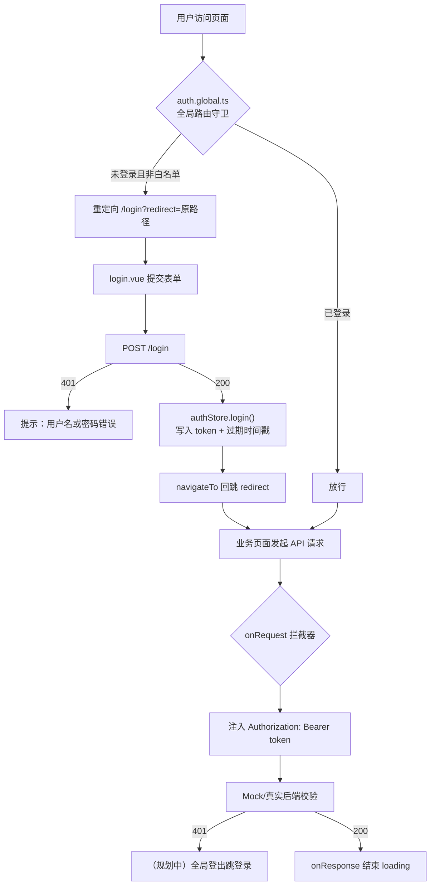
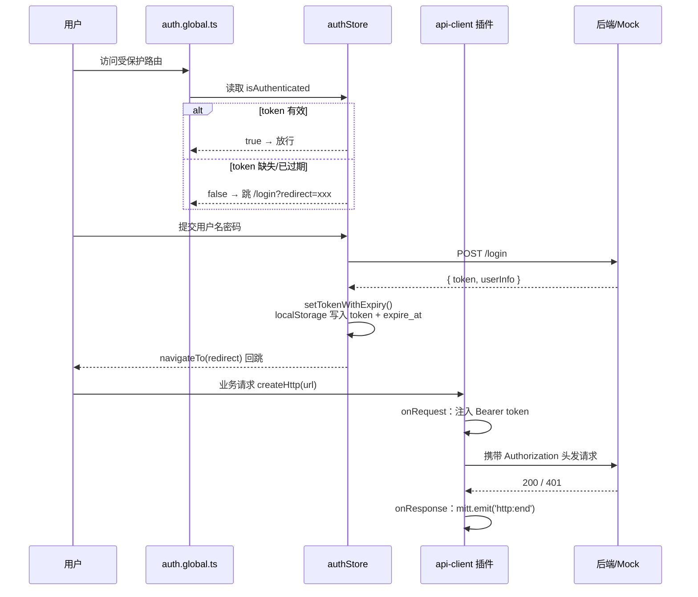

# 实战：优秀登录架构设计（Nuxt 4 + pnpm Monorepo 鉴权体系复盘）

> 来源项目：`pnpm-mono`（Nuxt 4 + Vue 3 + Pinia + ofetch + TanStack Vue Query 的 pnpm 单体仓库）
> 复盘视角：一个中小型中后台项目「登录与鉴权」模块的完整实现链路，包括分层解耦、Token 生命周期、路由守卫、拦截器注册机制与边界防御。

---

## 一、架构全景

### 1.1 整体分层

```
┌─────────────────────────────────────────────────────────────┐
│  apps/nuxt-app（应用层：环境配置与业务特化）                  │
│  ├─ app/stores/auth.ts          Pinia 鉴权状态（token 生命周期）│
│  ├─ app/plugins/api-client.ts   全局拦截器注册（注入 Token）   │
│  ├─ app/middleware/auth.global.ts 全局路由守卫                │
│  ├─ app/pages/login.vue         登录页（表单/校验/错误映射）   │
│  └─ app/components/UserMenu.vue 登出入口                     │
├─────────────────────────────────────────────────────────────┤
│  packages/http-client（传输底座层：纯净 HTTP 管道）            │
│  ├─ create-http.ts              $fetch.create + 拦截器队列    │
│  ├─ http-client.ts              RESTful CRUD + Query 缓存治理 │
│  └─ api-query.ts                原子级 Query/Mutation Hook    │
├─────────────────────────────────────────────────────────────┤
│  packages/utils（底层契约：ApiResult / PageResult / mitt）    │
├─────────────────────────────────────────────────────────────┤
│  mock/server.mjs（Mock 后端：POST /login + Bearer 校验）      │
└─────────────────────────────────────────────────────────────┘
```

**核心设计哲学：底层网络库 100% 纯净，鉴权等横切关注点全部通过「注册式拦截器」在应用层注入。**

传输底座 `@proj/http-client` 不引入 Vue / Nuxt / Pinia 任何依赖，只提供 `onRequest` / `onResponse` / `onResponseError` 三个注册函数。BaseURL、Token 注入、401 跳转等逻辑全部住在 `apps/nuxt-app` 的插件里。

### 1.2 完整鉴权链路



---

## 二、Token 生命周期设计

### 2.1 存储策略：Token + 过期时间戳「成对存储」

本项目采用 **单 Token + 客户端过期时间戳** 方案（Mock 阶段），TTL 为 20 分钟：

```ts
// app/stores/auth.ts
const TOKEN_TTL = 20 * 60 * 1000
const TOKEN_KEY = 'token'
const TOKEN_EXPIRE_KEY = 'token_expire_at'

/** 写入 token 同时记录过期时间戳 */
function setTokenWithExpiry(t: string) {
    localStorage.setItem(TOKEN_KEY, t)
    localStorage.setItem(TOKEN_EXPIRE_KEY, String(Date.now() + TOKEN_TTL))
}

/** 读取未过期的 token；如果已过期则清除并返回 null */
function getValidToken(): string | null {
    const t = localStorage.getItem(TOKEN_KEY)
    // 防御性编程：localStorage 可能残留字面量 'undefined' / 'null'
    if (!t || t === 'undefined' || t === 'null') return null
    const expireAt = Number(localStorage.getItem(TOKEN_EXPIRE_KEY) || 0)
    if (!expireAt || Date.now() > expireAt) {
        // 已过期，惰性清除
        localStorage.removeItem(TOKEN_KEY)
        localStorage.removeItem(TOKEN_EXPIRE_KEY)
        return null
    }
    return t
}
```

**设计要点：**

1. **惰性过期检测（Lazy Expiry）**：不在后台跑定时器，而是在 Store 初始化读取时一次性判定。过期即清除，`isAuthenticated` 自然转为 `false`，路由守卫接管跳转。简单、无泄漏、无竞态。
2. **时间戳成对存储**：后端不下发 `expires_in` 也能工作；即使后端返回过期时间，替换 `TOKEN_TTL` 为服务端值即可。
3. **`'undefined' / 'null'` 字符串防御**：这是 localStorage 的经典坑——`localStorage.setItem('token', undefined)` 会写入字符串 `"undefined"`，后续 `if (token)` 永远为真。这里在读取侧做了归一化拒绝。

### 2.2 登录写入与登出清理

```ts
// app/stores/auth.ts（Pinia Setup Store）
async function login(credentials: LoginRequest) {
    const config = useRuntimeConfig()
    const baseURL = config.public.apiBaseUrl || '/api'
    const result = await createHttp<LoginResponse>(`${baseURL}/login`, {
        method: 'POST',
        body: credentials,
    })
    token.value = result.token
    userInfo.value = result.userInfo
    setTokenWithExpiry(result.token)                          // token + 过期时间戳
    localStorage.setItem('userInfo', JSON.stringify(result.userInfo))
}

function logout() {
    token.value = null
    userInfo.value = null
    localStorage.removeItem(TOKEN_KEY)
    localStorage.removeItem(TOKEN_EXPIRE_KEY)
    localStorage.removeItem('userInfo')
}
```

登出入口（`UserMenu.vue` / `UserDropdown.vue`）：

```ts
{
    label: '退出登录',
    icon: 'i-lucide-log-out',
    color: 'error',
    async onSelect() {
        authStore.logout()
        await navigateTo('/login')
    }
}
```

### 2.3 生命周期全景图



---

## 三、核心代码切片

### 3.1 传输底座：模块单例 + 注册式拦截器（架构亮点）

```ts
// packages/http-client/src/client/create-http.ts
type Interceptor = (ctx: FetchContext) => void | Promise<void>;

// 全局拦截器队列：ES Module 单例，应用生命周期内仅一份内存引用
const requestInterceptors: Interceptor[] = [];
const responseInterceptors: Interceptor[] = [];
const responseErrorInterceptors: Interceptor[] = [];

export const createHttp = $fetch.create({
    async onRequest(ctx) {
        for (const fn of requestInterceptors) await fn(ctx);
    },
    async onResponse(ctx) {
        for (const fn of responseInterceptors) await fn(ctx);
    },
    async onResponseError(ctx) {
        for (const fn of responseErrorInterceptors) await fn(ctx);
    },
});

export function onRequest(fn: Interceptor): () => void {
    requestInterceptors.push(fn);
    return () => { /* 返回取消注册函数，支持热卸载 */ };
}
```

**为什么这是「优秀设计」：**

- **零框架侵入**：底座不 import 任何 Vue/Nuxt/Pinia，可移植到任何前端栈；
- **注册与发布模式**：Nuxt 插件在启动时调用 `onRequest(fn)` 把回调推入闭包队列；请求发生时 ofetch 钩子自动遍历执行队列；
- **引用传递装饰**：拦截器内直接修改 `ctx.options`（baseURL / headers），ofetch 携带装饰后的配置真正发请求；
- **可逆**：`onRequest` 返回取消注册函数，插件卸载时不残留副作用。

### 3.2 应用层插件：鉴权头注入 + 生命周期感知

```ts
// apps/nuxt-app/app/plugins/api-client.ts
export default defineNuxtPlugin(() => {
  const config = useRuntimeConfig()
  const baseURL = config.public.apiBaseUrl as string | undefined
  const authStore = useAuthStore()

  // ── 1. 全局请求拦截：BaseURL、鉴权头、参数适配、loading 通知 ──
  onRequest((ctx) => {
    if (baseURL) ctx.options.baseURL = baseURL

    // 已登录时注入 Authorization: Bearer <token>
    if (authStore.isAuthenticated && authStore.token) {
      const headers = new Headers(ctx.options.headers)
      headers.set('Authorization', `Bearer ${authStore.token}`)
      ctx.options.headers = headers
    }

    // json-server 参数兼容（sortBy→_sort、page→_page……）
    // ……

    // 应用层网络状态感知：silent: true 的静默请求跳过全局 loading
    if (!(ctx.options as any)?.silent) {
      mitt.emit<HttpEventPayload>('http:start', { url: ctx.request.toString() })
    }
  })

  onResponse((ctx) => {
    if (!(ctx.options as any)?.silent) {
      mitt.emit<HttpEventPayload>('http:end', { url: ctx.request.toString() })
    }
  })

  onResponseError((ctx) => {
    if (!(ctx.options as any)?.silent) {
      mitt.emit<HttpEventPayload>('http:end', { url: ctx.request.toString() })
    }
  })
})
```

**亮点：**

1. **Token 注入与请求同帧**：每次请求都从 Pinia store 实时读取，token 更新后无需重建实例；
2. **`silent: true` 静默请求约定**：后台轮询、缓存预热类请求不触发全局 loading 条，细节体验到位；
3. **`mitt` 事件总线解耦 loading UI**：网络层不直接操作任何 UI 组件，只发事件。

### 3.3 全局路由守卫：白名单防无限重定向

```ts
// apps/nuxt-app/app/middleware/auth.global.ts
export default defineNuxtRouteMiddleware((to) => {
    const authStore = useAuthStore()

    // 已登录访问登录页 → 直接跳回首页
    if (to.path === '/login' && authStore.isAuthenticated) {
        return navigateTo('/posts')
    }

    // 公开路由白名单：必须放行 /login，
    // 否则未登录访问登录页会被再次重定向回 /login → 无限重定向白屏
    const publicRoutes = ['/login']
    if (publicRoutes.includes(to.path)) return

    if (authStore.isAuthenticated) return

    return navigateTo({
        path: '/login',
        query: { redirect: to.fullPath },  // 携带原路径，登录后回跳
    })
})
```

### 3.4 登录页：错误信息映射与开放重定向防御

```ts
// apps/nuxt-app/app/pages/login.vue

/** 从 ofetch FetchError 中提取可展示的错误文案 */
function resolveErrorMessage(err: unknown): string {
  const e = (err ?? {}) as { data?: unknown, statusCode?: number, message?: string }
  if (typeof e.data === 'string' && e.data.trim()) return e.data
  if (e.data && typeof e.data === 'object') {
    const message = (e.data as { message?: unknown }).message
    if (typeof message === 'string' && message.trim()) return message
  }
  if (!e.statusCode) return '网络异常，请确认后端服务已启动'  // 请求没到后端
  if (e.statusCode === 401) return '用户名或密码错误'
  if (e.statusCode === 403) return '账号已被禁用，请联系管理员'
  if (e.statusCode >= 500) return '服务异常，请稍后重试'
  return e.message || '登录失败，请稍后重试'
}

/** 登录后回跳地址：只接受站内相对路径，避免 //evil.com 开放重定向 */
function resolveRedirect(): string {
  const raw = route.query.redirect
  const target = Array.isArray(raw) ? raw[0] : raw
  if (typeof target === 'string' && target.startsWith('/') && !target.startsWith('//')) {
    return target
  }
  return '/posts'
}
```

**两个安全细节：**

- **开放重定向防御**：`startsWith('/') && !startsWith('//')`——`//evil.com` 是协议相对 URL，浏览器会当外部域名跳转，是钓鱼常用手法；
- **无 statusCode 即网络层错误**：区分「请求没到后端」（服务未启动/断网/CORS 失败）与「后端业务拒绝」，给用户的提示完全不同的排障方向。

### 3.5 Mock 后端契约（前后端对接基准）

```js
// mock/server.mjs
function getAuthUser(req) {
    const auth = req.headers['authorization'] || ''
    const token = auth.replace(/^Bearer\s+/i, '').replace(/\s+/g, '').trim()
    if (!token) return null
    return (db.data.users || []).find(u => u.token === token) || null
}

// POST /login → { token, userInfo }（剥掉 password）
// 任意需鉴权接口 → getAuthUser 为空则 401 { message: '未登录或 token 无效' }
```

---

## 四、交互与边界防御：现状与缺口分析

| 防御维度 | 当前实现 | 评价 |
|---|---|---|
| Token 过期检测 | 惰性时间戳比对，过期即清 | 简单可靠，够用于 20min TTL |
| 无感刷新 / Refresh Token | **未实现**（单 Token，过期需重新登录） | Mock 阶段可接受，生产必须补 |
| 401 并发请求排队重试 | **未实现**（无 refresh 则无重试基础） | 生产需补：刷新令牌 + 请求队列 + 失败重放 |
| 跨标签页状态同步 | **未实现**（无 `storage` 事件 / `BroadcastChannel` 监听） | A 标签页登出，B 标签页仍"已登录"直到 token 过期 |
| 全局 401 统一处理 | 仅在 `README` 有示例代码，插件中**未实际接线** | 建议在 `onResponseError` 落地：401 → 清 store → 跳登录 |
| 登出清理 | store 三清 + localStorage 三删 + 跳登录 | 前端侧完整；但未调用 `POST /logout`（mock 有该端点） |
| 开放重定向 | `resolveRedirect()` 严格校验 | 到位 |
| 敏感数据存储 | `localStorage` 存 token + userInfo | 有 XSS 暴露面，见下方讨论 |
| 登录态 UI 反馈 | `isLoading` 防重复提交 + 错误分级文案 | 到位 |

### 4.1 敏感数据存储安全性讨论

当前 token 存 `localStorage`，利弊：

- **利**：实现简单、无 CSRF 风险、跨标签页天然共享；
- **弊**：XSS 可直接读取。缓解手段：严格 CSP、不渲染用户可控 HTML、依赖 `@nuxt/ui` 自动转义；
- **升级路径（生产建议）**：`httpOnly + Secure + SameSite` Cookie 承载 token，前端完全摸不到 token；代价是要处理 CSRF（`SameSite=Lax` + 校验 Origin/Referer）与 SSR 场景下的首次注水。若坚持 Bearer 方案，至少把 TTL 缩短并配合 Refresh Token 轮换。

### 4.2 已知缺口清单（技术债）

1. **无 Refresh Token 无感续期**：20 分钟静默过期对中后台体验伤害大；标准解法是 Access(短) + Refresh(长) 双令牌，401 时静默刷新并重放原请求；
2. **无跨标签页同步**：建议监听 `window.addEventListener('storage')`，检测 `token` 被移除即 `location.reload()` 或跳登录；
3. **全局 401 拦截未接线**：`onResponseError` 里补 `if (ctx.response?.status === 401) { authStore.logout(); navigateTo('/login') }`，注意排除登录接口本身；
4. **登出未调后端**：`POST /logout` 已存在于 mock，前端补上以支持服务端令牌失效（如黑名单/JWT 短过期兜底）。

---

## 五、亮点与踩坑经验总结

### 5.1 相比传统实现的优势

1. **分层解耦彻底**：网络底座零业务副作用，鉴权逻辑全部上浮到应用层插件，换框架（Vue → React）只需重写插件层；
2. **拦截器注册模式**：ES Module 单例闭包队列 + `for...of` 顺序执行，天然支持多拦截器叠加与运行时注销；
3. **Token「惰性过期」**：不用定时器、不用心跳，读时判定、过时即清，无资源泄漏；
4. **防御细节成体系**：`'undefined'` 字符串防御、开放重定向防御、`silent` 静默请求、错误分级文案，每个坑都提前埋了解法；
5. **守卫白名单意识**：全局中间件最容易踩的无限重定向，用注释显式固化了解法。

### 5.2 踩坑记录（血泪经验）

1. **`.global.ts` 中间件必须放行 `/login`**：否则未登录访问登录页 → 守卫重定向 `/login` → 又触发守卫 → 死循环，页面白屏无任何反馈；
2. **`UAuthForm` 没有 `state` prop**：它内部自建 state 并通过 `defineExpose({ formRef, state })` 暴露。从外部传 `:state` 会经 `$attrs` 覆盖 `UForm` 的 state，导致「输入框绑内部 state、校验用外部 state」，提交永远报空值。正确做法：`ref` 拿实例，直接写 `authFormRef.value?.state`；
3. **zod 校验的 undefined vs 空串**：未输入时值是 `undefined`，`.min(1)` 报 `invalid_type` 而非 `too_small`，错误信息文案难统一。用 `.default('')` 归一化，让「首聚焦即失焦」和「输入后清空」命中同一种校验；
4. **localStorage 的 `'undefined'` 字面量**：任何 `setItem(k, undefined)` 都会写入字符串 `"undefined"`，读取端 `if (token)` 失效，读取函数必须做字符串级防御；
5. **无 statusCode 才是网络错误**：ofetch 的 `FetchError` 在断网/CORS 失败时没有 `statusCode`，提示文案要区分「网络异常」与「后端拒绝」；
6. **json-server 参数名差异**：`sortBy/page/pageSize` 需在请求拦截器统一适配为 `_sort/_page/_limit`，适配逻辑放在拦截器而不是散落各页面；
7. **Bearer 注入要用 `new Headers()`**：直接展开 `ctx.options.headers` 可能丢失多值/大小写规范，`Headers` 对象操作最稳。

---

## 六、演进建议路线图

```
当前（Mock 阶段）
  ├─ 单 Token + 20min 客户端 TTL + 惰性过期          ✅ 已实现
  ├─ 拦截器注入 Bearer                                ✅ 已实现
  ├─ 全局路由守卫 + 白名单                             ✅ 已实现
  ├─ 开放重定向防御 / 错误分级文案                      ✅ 已实现
  └─ silent 静默请求 + mitt loading 事件               ✅ 已实现
        │
        ▼ 第一步：补边界（改动小、收益大）
  ├─ onResponseError 全局 401 → logout + 跳登录
  ├─ storage 事件跨标签页登出同步
  └─ 登出调用 POST /logout
        │
        ▼ 第二步：上双令牌（生产必需）
  ├─ Access Token（短，如 15min）+ Refresh Token（长，如 7d）
  ├─ 401 拦截器：静默 refresh → 请求队列 → 失败重放
  └─ refresh 失败（refresh 也过期）才真正跳登录
        │
        ▼ 第三步：存储升级（按安全等级选型）
  ├─ 方案 A：httpOnly Cookie + CSRF 防护（推荐，SSR 友好）
  └─ 方案 B：Bearer + localStorage + 严格 CSP + 短 TTL
```

---

*本文由源码实战复盘提炼，涉及文件：*
- `apps/nuxt-app/app/stores/auth.ts`
- `apps/nuxt-app/app/plugins/api-client.ts`
- `apps/nuxt-app/app/middleware/auth.global.ts`
- `apps/nuxt-app/app/pages/login.vue`
- `apps/nuxt-app/app/components/UserMenu.vue` / `UserDropdown.vue`
- `packages/http-client/src/client/create-http.ts`
- `mock/server.mjs`
