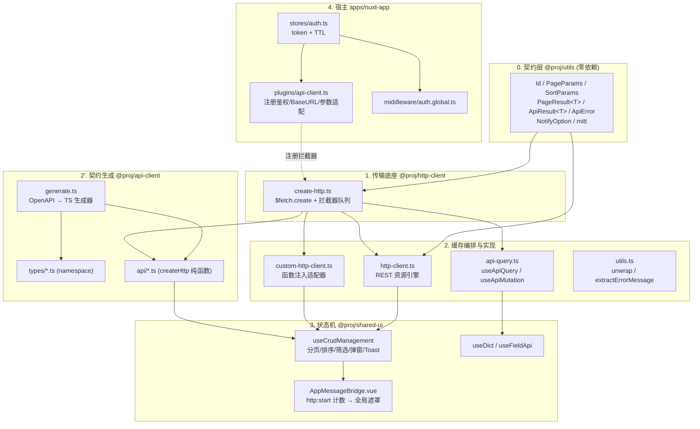

# 实战-前后端数据交互规范设计

> **工程类型判定**：前端工程（pnpm workspace Monorepo，Nuxt 4 + Vue Query + Pinia + json-server Mock）
> **代码基线**：`d:/mywork/myDev/frontDev/ai-nuxt/pnpm-mono`
> **核心链路**：`业务页面 → useCrudManagement → customHttpClient/api-client → createHttp(ofetch) → 拦截器管道 → Mock/后端 → unwrap → Vue Query 缓存 → 表格渲染`
> **贯穿包**：`@proj/utils`（契约） → `@proj/http-client`（传输/缓存） → `@proj/api-client`（契约生成） → `@proj/shared-ui`（状态机） → `apps/nuxt-app`（宿主装配） ↔ `mock/`（后端仿真）

---

## 一、架构全景

### 1.1 分层拓扑（依赖严格单向，自底向上）

```text
┌──────────────────────────────────────────────────────────────────────────────┐
│ 4. 宿主装配层  apps/nuxt-app                                                  │
│    plugins/api-client.ts   plugins/vue-query.client.ts                        │
│    stores/auth.ts          middleware/auth.global.ts       pages/login.vue     │
└───────────────┬──────────────────────────────────────────────┬───────────────┘
                │ 注册拦截器 / 注入 QueryClient                 │ 消费 Hook
┌───────────────▼──────────────────────────────────────────────▼───────────────┐
│ 3. 状态机与 UI 编排层  @proj/shared-ui                                         │
│    useCrudManagement(分页/排序/筛选/勾选/弹窗/Toast)                            │
│    useApi(URL 模式桥接)  useDict  useFieldApi  useMitt  AppMessageBridge.vue   │
└───────────────┬──────────────────────────────────────────────┬───────────────┘
                │ useApi(resource)                             │ api 函数注入
┌───────────────▼───────────────┐            ┌─────────────────▼───────────────┐
│ 2. 缓存编排层  @proj/http-client│            │ 2'. 契约层  @proj/api-client     │
│   http-client.ts (REST 引擎)   │            │   generate.ts (自研 OpenAPI→TS) │
│   custom-http-client.ts(函数注入)│           │   types/*.ts   api/*.ts(纯函数)  │
│   api-query.ts(原子 Query/Mutation)│         └─────────────────┬───────────────┘
│   utils.ts(unwrap)  types.ts   │◄─────────────────────────────┘ createHttp
└───────────────┬───────────────┘
                │
┌───────────────▼──────────────────────────────────────────────────────────────┐
│ 1. 传输底座层  create-http.ts  ($fetch.create + 三个拦截器队列, 零 UI 副作用)  │
└───────────────┬──────────────────────────────────────────────────────────────┘
                │ 依赖契约
┌───────────────▼──────────────────────────────────────────────────────────────┐
│ 0. 零依赖契约层  @proj/utils                                                  │
│    Id / PageParams / SortParams / PageResult<T> / ApiResult<T> / ApiError     │
│    NotifyOption / mitt 事件总线 (HttpEventPayload, UiNotifyPayload)            │
└──────────────────────────────────────────────────────────────────────────────┘
                                    ▲
                                    │ 复用同一套契约（服务端仿真）
┌───────────────────────────────────┴──────────────────────────────────────────┐
│ 后端仿真层  mock/server.mjs (json-server + LowDB + CORS + 分页/排序拦截器)     │
└──────────────────────────────────────────────────────────────────────────────┘
```

对应的 Mermaid 依赖视图：



### 1.2 动态链路图（强制：端到端生命周期时序）

以「会员列表分页加载 + 表格行内编辑保存」为例，真实端到端流转：

```mermaid
sequenceDiagram
    autonumber
    participant Page as 页面 index.vue
    participant Crud as useCrudManagement
    participant Fn as customHttpClient
    participant API as memberApi (api-client)
    participant Http as createHttp (ofetch)
    participant IC as 拦截器队列 (插件注册)
    participant Mock as mock/server.mjs
    participant QC as TanStack Query Cache

    Page->>Crud: useMemberManagement({ api: memberApi.*, syncUrl: true })
    Crud->>Fn: customHttpClient({ queryKey:'members', api })
    Note over Crud: page/pageSize/sorting/filterParams 响应式状态
    Crud->>Crud: computed queryQueryParams()<br/>剔除 undefined/null/''/all 哨兵值
    Crud->>Fn: api.useFetchPageData(queryQueryParams)
    Fn->>API: memberApi.list(params)
    API->>Http: createHttp('/members', { query: params })
    Http->>IC: onRequest(ctx) 顺序执行队列
    Note over IC: 1. ctx.options.baseURL = runtimeConfig<br/>2. headers.set(Authorization, Bearer token)<br/>3. page→_page, pageSize→_limit, sortBy→_sort<br/>4. mitt.emit('http:start') 触发全局遮罩
    IC->>Http: 引用传递，options 已被装饰
    Http->>Mock: GET /members?_page=1&_limit=10&_sort=createdAt
    Note over Mock: CORS 白名单校验 + patch writeHead<br/>通用分页拦截器解析双版本参数<br/>过滤→排序→切片
    Mock-->>Http: { data, total, page, pageSize }
    Http-->>Fn: unwrap(raw) → 无 succ 字段则包装为 ApiResult
    Note over Fn: 'data' in raw && Array.isArray(raw.data)<br/>→ 直接作为 PageResult&lt;T&gt;
    Fn-->>QC: queryKey ['members','page',{...}] 写入缓存
    QC-->>Crud: data / isLoading / isFetching
    Crud-->>Page: tableData / total 驱动 TableEngine 渲染

    Note over Page,Mock: ── 行内编辑保存（写链路）──
    Page->>Crud: handleFormSubmit(payload)（或 updateMutation 直调）
    Crud->>Crud: beforeSubmit 前置加工（trim 等）
    Crud->>Fn: updateMutation.mutateAsync({ id, data })
    Fn->>API: memberApi.update(id, data)
    API->>Http: createHttp(`/members/${id}`, { method:'PUT', body })
    Http->>Mock: PUT /members/1
    Mock-->>Http: 更新后的实体
    Http-->>Fn: unwrap → ApiResult&lt;T&gt;
    Fn->>QC: invalidateOne(id, data) 原地 setQueriesData
    Note over QC: 精准替换列表与详情缓存中的该条记录<br/>不整页重拉 → 无闪烁
    Fn-->>Crud: onSuccess 合并执行（内置缓存治理 + 用户回调）
    Crud-->>Page: Toast「保存成功」
```

---

## 二、核心职责边界与设计哲学

| 关注点 | 归属方（该层负责什么） | 宿主业务负责什么 | 为什么这样划分 |
| :--- | :--- | :--- | :--- |
| HTTP 传输 | `create-http.ts` 只做管道：注册/执行拦截器队列，绝不硬编码 Token、BaseURL、Toast | 在 Nuxt 插件中注册 `onRequest/onResponse/onResponseError` | 底座零框架依赖（不引 Vue/Nuxt/Pinia），可移植性最大化；横切关注点由宿主按需装配 |
| 拦截器内容 | 只提供 `Interceptor = (ctx: FetchContext) => void \| Promise<void>` 契约与取消注册能力 | BaseURL 读取、Token 注入、Mock 参数适配、全局 Loading 广播 | 「注册与发布」模式解耦：底座不知道谁注册了什么，宿主不需要改底座 |
| 数据契约 | `@proj/utils` 沉淀 `ApiResult<T>` / `PageResult<T>` / `ApiError` | 后端按契约返回；前端 `mapPageResult` 兜底非标分页 | 契约是跨包共享物，下沉到零依赖包，避免 `shared-ui → http-client → shared-ui` 循环依赖 |
| 接口方法定义 | `@proj/api-client` 由 OpenAPI 自动生成强类型纯函数 | 只维护 Swagger 文档 + `TAG_NAME_MAP` 映射表 | 单一真实来源（SSOT），杜绝手写 URL 拼写错误与类型漂移 |
| 缓存治理 | `http-client.ts` / `custom-http-client.ts` 内建 `invalidateLists` / `invalidateOne` / `cacheFirst` | 仅在需要覆盖时传入 `queryOptions` / `onSuccess` | 缓存失效是「变更操作」的必然结果，属于框架级不变量，不该反复手写 |
| UI 提示（Toast） | 网络层**绝对沉默**；由 `useCrudManagement` 状态机统一开关（`enableToast` / `NotifyOption`） | 特化业务可直调 `mutateAsync` 并自控文案 | 曾出现「网络层自动 Toast + 业务自写 Toast」双弹重叠闪烁，此后把控制权上收 |
| 全局 Loading | `AppMessageBridge.vue` 用 `activeRequests` 计数器消费 `http:start/http:end` | 可用 `{ silent: true }` 让某请求跳过遮罩 | 并发计数避免「多请求并行时提前关闭遮罩」的闪烁 |
| 登录态 | `stores/auth.ts` 负责 token + TTL + localStorage 持久化 | 页面负责表单校验、错误文案映射、回跳安全校验 | 认证是全局单例状态，不适合放在页面局部 |
| 后端仿真 | `mock/server.mjs` 仿真分页/排序/CORS/鉴权/BatchDelete | 前端只依赖契约，不依赖 json-server 特性 | 契约先行，Mock 可随时替换为真实 SpringBoot |

---

## 三、核心机制与真实代码切片

### 3.1 传输底座：ES Module 单例闭包 + 三拦截器队列（注册与发布）

`packages/http-client/src/client/create-http.ts` —— 整个前端网络通信的咽喉：

```ts
// packages/http-client/src/client/create-http.ts
import { $fetch, type FetchContext } from 'ofetch';

type Interceptor = (ctx: FetchContext) => void | Promise<void>;

// 全局拦截器队列：应用层通过 onRequest / onResponse / onResponseError 注册鉴权、日志、状态通知等逻辑
const requestInterceptors: Interceptor[] = [];
const responseInterceptors: Interceptor[] = [];
const responseErrorInterceptors: Interceptor[] = [];

export const createHttp = $fetch.create({
    async onRequest(ctx) {
        for (const fn of requestInterceptors) {
            await fn(ctx);
        }
    },
    async onResponse(ctx) {
        for (const fn of responseInterceptors) {
            await fn(ctx);
        }
    },
    async onResponseError(ctx) {
        for (const fn of responseErrorInterceptors) {
            await fn(ctx);
        }
    },
});

export function onRequest(fn: Interceptor): () => void {
    requestInterceptors.push(fn);
    return () => {
        const i = requestInterceptors.indexOf(fn);
        if (i >= 0) requestInterceptors.splice(i, 1);
    };
}
```

宿主装配端 `apps/nuxt-app/app/plugins/api-client.ts`（节选真实实现）：

```ts
// apps/nuxt-app/app/plugins/api-client.ts
export default defineNuxtPlugin(() => {
  const config = useRuntimeConfig()
  const baseURL = config.public.apiBaseUrl as string | undefined
  const authStore = useAuthStore()

  onRequest((ctx) => {
    // 1.1 设置 BaseURL
    if (baseURL) {
      ctx.options.baseURL = baseURL
    }

    // 1.2 已登录时注入 Authorization: Bearer <token>
    if (authStore.isAuthenticated && authStore.token) {
      const headers = new Headers(ctx.options.headers)
      headers.set('Authorization', `Bearer ${authStore.token}`)
      ctx.options.headers = headers
    }

    // 1.3 json-server 参数兼容适配 (只在开发/Mock 阶段或者针对特定 baseURL 开启)
    const query = ctx.options.query || ctx.options.params
    if (query) {
      if ('sortBy' in query) {
        if (query.sortBy) {
          query._sort = query.sortBy
        }
        delete query.sortBy
      }
      if ('sortOrder' in query) {
        if (query.sortOrder) {
          query._order = query.sortOrder
        }
        delete query.sortOrder
      }
      if ('page' in query) {
        query._page = query.page
        delete query.page
      }
      if ('pageSize' in query) {
        query._limit = query.pageSize
        delete query.pageSize
      }
    }

    // 1.4 应用层网络状态感知：向 UI 发送 http:start（支持 silent: true 静默请求跳过）
    if (!(ctx.options as any)?.silent) {
      mitt.emit<HttpEventPayload>('http:start', { url: ctx.request.toString() })
    }
  })
})
```

**设计要点 / 为什么这是优秀设计**

1. **模块单例闭包即注册表**：`const requestInterceptors: Interceptor[] = []` 位于模块顶层，ES Module 单例加载保证全应用只有一份队列引用。宿主调用 `onRequest(fn)` 时只把函数「压栈」而不执行；等到任意业务发起请求，ofetch 触发钩子时统一 drain。这就是典型的「注册与发布 + 依赖倒置」。
2. **零框架侵入**：底座文件里没有任何 `import vue/nuxt/pinia`，`Interceptor` 只依赖 `FetchContext`。它因此可以在 Node 脚本、CLI、单元测试中直接复用。
3. **对象引用传递实现「装饰生效」**：拦截器修改的是同一个 `ctx.options` 对象引用（`ctx.options.headers = new Headers(...)`），改动无需返回，直接作用于后续真实 I/O。
4. **可注销（防泄漏）**：`onRequest` 返回 `() => splice` 的 disposer，HMR 或动态模块场景下可精准解绑，避免监听器堆积。
5. **横切关注点的「三段式」分治**：`onRequest` 管装饰（鉴权/BaseURL/参数翻译），`onResponse` 管成功埋点，`onResponseError` 管异常上报 —— 异常路径与成功路径彻底分离，`http:end` 在两者中都会发出，所以 Loading 遮罩永远不会因为请求失败而卡死。

### 3.2 统一契约解包：`unwrap` 的双契约嗅探

`packages/http-client/src/client/utils.ts`：

```ts
// packages/http-client/src/client/utils.ts
import type { ApiError, ApiResult } from "@proj/utils";

export function extractErrorMessage(error: unknown): string {
    const e = error as { msg?: string; data?: { message?: string }; message?: string };
    return e.msg || e.data?.message || e.message || '请求失败，请稍后重试';
}

/**
 * 后端响应通用解包函数
 * 统一将底层 API 响应转化为标准 ApiResult 结构；若响应中 succ 为 false 则抛出 ApiError
 */
export function unwrap<R>(result: unknown): ApiResult<R> {
    if (result && typeof result === 'object' && 'succ' in result) {
        const apiResult = result as ApiResult<R>;
        if (!apiResult.succ) throw apiResult as ApiError;
        return apiResult;
    }
    return {
        succ: true,
        code: "200",
        ts: Date.now(),
        data: result as R,
        msg: 'ok',
    };
}
```

配套契约定义 `packages/utils/src/types/http.ts`：

```ts
// packages/utils/src/types/http.ts
export interface ApiResult<T = unknown> {
    succ: boolean;   // 业务是否成功
    code: string;    // 业务状态码
    ts: number;      // 服务器时间戳
    data: T | null;  // 业务数据
    msg: string;     // 提示信息
}

export type ValidationError = ApiResult<ErrorDetail[]>; // 422 表单验证失败
export type AuthError = ApiResult<null>;                // 401 / 403 认证鉴权失败
export type ServerError = ApiResult<string>;            // 500 服务器错误
export type ApiError = ValidationError | AuthError | ServerError;
```

**设计要点 / 为什么这是优秀设计**

1. **「有则解包，无则兜底」的渐进式契约**：真实 SpringBoot 后端返回 `{ succ, code, ts, data, msg }` 时按契约解析并在 `succ === false` 时抛出；而 json-server Mock 返回裸 `{ data, total, page, pageSize }`（无 `succ`）时自动包装成成功态。同一份上层代码在 Mock 阶段与真实后端阶段**零改动切换**，这是"渐进式落地规范"的关键技巧。
2. **`'succ' in result` 而非 truthy 判断**：用 `in` 运算符嗅探字段存在性，避免 `succ: false` 被当成"不是标准响应"而误判成功。
3. **业务失败即抛异常**：把 `succ: false` 转成 `throw`，让 TanStack Query 的 `onError`、`isError`、`retry` 全链路天然生效，无需在每个调用点写 `if (!res.succ)` 分支。
4. **`ApiError` 是联合类型而非 `Error` 子类**：后端错误体（`ApiResult`）本身就是完整的错误上下文（`code` / `msg` / `data`），直接透传比包一层 `new Error()` 丢失信息更优。

### 3.3 缓存一致性编排：`invalidateLists` / `invalidateOne` / `cacheFirst`

`packages/http-client/src/client/http-client.ts` 中的缓存 Key 规范与原地更新：

```ts
// packages/http-client/src/client/http-client.ts（节选）
const allKey = (params?: TFilter) => (params ? [resource, 'all', params] : [resource, 'all']);
const pageKey = (params: TFilter & PageParams) => [resource, 'page', params];
const detailKey = (id: string | number) => [resource, 'detail', String(id)];

function invalidateLists() {
    queryClient.invalidateQueries({ queryKey: [resource, 'all'] });
    queryClient.invalidateQueries({ queryKey: [resource, 'page'] });
}

function findItemInCache(id: string | number): T | null {
    const queries = queryClient.getQueriesData({ queryKey: [resource] });
    const targetId = String(id);
    for (const [, qData] of queries) {
        if (!qData) continue;
        const data = (qData as any).data;
        if (Array.isArray(data)) {
            const found = data.find((item: any) => String(item.id) === targetId);
            if (found) return found as T;
        } else if (data && String((data as any).id) === targetId) {
            return data as T;
        }
    }
    return null;
}

function invalidateOne(id: string | number, data: T) {
    queryClient.setQueriesData({ queryKey: [resource] }, (old: any) => {
        if (!old) return old;
        const list = old.data;
        const targetId = String(id);
        if (Array.isArray(list)) {
            return {
                ...old,
                data: list.map((item: any) => (String(item.id) === targetId ? { ...item, ...data } : item)),
            };
        } else if (list && String((list as any).id) === targetId) {
            return { ...old, data: { ...list, ...data } };
        }
        return old;
    });
}
```

`useUpdate` 与 `cacheFirst` 详情秒显（节选）：

```ts
// packages/http-client/src/client/http-client.ts（节选）
function useUpdate() {
    return useMutation<ApiResult<T>, ApiError, UpdateVars<TUpdate>>({
        mutationFn: ({ id, data }) => {
            let body: any = data;
            // 若开启原型 Mock 模式，自动合并已有缓存数据再提交
            if (isPrototype) {
                const cached = findItemInCache(id);
                if (cached) body = { ...cached, ...data };
            }
            return createHttp<ApiResult<T>>(endpoint(id), { method: 'PUT', body })
                .then((r) => unwrap<T>(r));
        },
        ...updateOptions,
        onSuccess: mergeOnSuccess(
            (result, vars) => {
                // 更新成功后：精准原地更新对应 ID 的缓存数据，避免整页重新请求
                if (result.data) invalidateOne(vars.id, result.data as T);
            },
            updateOptions?.onSuccess,
        ),
    });
}

function useFetchOne(id: MaybeRef<string | number>, extra?: ExtraQueryOptions<ApiResult<T>>) {
    const { cacheFirst = true, ...queryOpts } = (extra ?? {}) as any;
    return useQuery<ApiResult<T>, ApiError>({
        queryKey: computed(() => detailKey(toValue(id))),
        queryFn: () => createHttp<ApiResult<T>>(endpoint(toValue(id))).then((r) => unwrap<T>(r)),
        initialData: cacheFirst
            ? () => {
                const cached = findItemInCache(toValue(id));
                if (!cached) return undefined;
                return unwrap(cached);
            }
            : undefined,
        ...baseQueryOptions,
        ...queryOpts,
    });
}
```

**设计要点 / 为什么这是优秀设计**

1. **可预测的三段式 QueryKey 规范**：`[resource, 'all'|'page'|'detail', payload]`。前缀式结构让 `invalidateQueries({ queryKey: [resource, 'page'] })` 天然做「前缀模糊匹配」，一次调用清空该资源所有分页组合，无需枚举每个参数组合。
2. **写后策略按「数据形态」分流**：
   - `create` / `remove` / `removeMany` → **改变列表总数** → `invalidateLists()`（列表失效 + 静默重拉）；
   - `update` → **只改单条内容** → `invalidateOne()`（`setQueriesData` 原地 patch）。
   这是一条非常值得沉淀的判定法则，避免了"改一个字段就整页转圈"的体验灾难。
3. **`String(id)` 统一比对**：后端 bigint 序列化为 string，而前端某些地方可能是 number，统一 `String()` 归一化规避 `1 !== '1'` 的经典缓存失配坑。
4. **`cacheFirst` + `initialData` 惰性求值**：`initialData` 传入函数形式，才具备"秒级回显列表已有数据，同时后台静默拉取完整详情"的能力；若是直接传值会让 Query 认为数据已新鲜而不发请求。
5. **`isPrototype` 原型模式合并**：针对 Mock PUT 语义（整量替换）与真实后端 PATCH 语义（局部更新）的差异，提交前合并缓存，做到「前端只传变更字段，Mock 也不丢字段」。
6. **`removeQueries` 精准清理**：删除后不只失效列表，还彻底销毁 `detailKey(id)`，避免"删除后从详情页返回仍能读到幽灵数据"。

### 3.4 函数注入适配器 `customHttpClient` + `mergeOnSuccess` 回调合并

`packages/http-client/src/client/custom-http-client.ts`（节选真实实现）：

```ts
// packages/http-client/src/client/custom-http-client.ts（节选）
function mergeOnSuccess<TData, TVars>(
    internal: (data: TData, vars: TVars) => void,
    external?: (...args: any[]) => unknown,
) {
    return (data: TData, vars: TVars, _onMutateResult: unknown, _context: MutationFunctionContext) => {
        internal(data, vars);
        external?.(data, vars, _onMutateResult, _context);
    };
}

export function customHttpClient<...>(options: CustomCrudOptions<T, TCreate, TUpdate, TFilter>) {
    const { queryKey: resourceKey, api, staleTime = 1000 * 60 * 5, retry = 2, mapPageResult } = options;
    const queryClient = useQueryClient();

    /** 使当前资源所有列表缓存失效 */
    function invalidateLists() {
        queryClient.invalidateQueries({
            predicate: (query) => {
                const k = query.queryKey;
                return Array.isArray(k) && k[0] === resourceKey && (k[1] === 'all' || k[1] === 'page');
            },
        });
    }

    // ── 2. useFetchPageData ──
    function useFetchPageData(params: MaybeRef<TFilter & PageParams>, extra?: ExtraQueryOptions<PageResult<T>>) {
        return useQuery<PageResult<T>, ApiError>({
            queryKey: computed(() => pageKey(toValue(params))),
            queryFn: async () => {
                const raw = await api.fetchPage(toValue(params));
                if (mapPageResult) {
                    return mapPageResult(raw);
                }
                // 兼容标准 PageResult 结构 { data, total, page, pageSize } 或带有 code/data 包装的结构
                if (raw && typeof raw === 'object' && 'data' in raw && Array.isArray(raw.data)) {
                    return raw as PageResult<T>;
                }
                if (Array.isArray(raw)) {
                    return { data: raw, total: raw.length, page: 1, pageSize: raw.length } as PageResult<T>;
                }
                return (raw?.data ?? raw) as PageResult<T>;
            },
            ...baseQueryOptions,
            ...extra,
        });
    }

    // ── 7. useRemoveMany ──
    function useRemoveMany(removeManyOptions?: any) {
        return useMutation<ApiResult<null>, ApiError, RemoveManyVars>({
            mutationFn: async (vars) => {
                if (!api.removeMany) {
                    // 降级支持：若未提供批量删除函数，并发循环调用单条删除
                    if (api.remove) {
                        await Promise.all(vars.ids.map((id) => api.remove!(id)));
                        return { data: null } as ApiResult<null>;
                    }
                    throw new Error(`[customHttpClient] ${resourceKey} 未实现 removeMany 方法`);
                }
                await api.removeMany(vars.ids);
                return { data: null } as ApiResult<null>;
            },
            ...removeManyOptions,
            onSuccess: mergeOnSuccess((_result, vars) => {
                invalidateLists();
                vars.ids.forEach((id) => queryClient.removeQueries({ queryKey: detailKey(id) }));
            }, removeManyOptions?.onSuccess),
            onError: mergeOnError(() => {}, removeManyOptions?.onError),
        });
    }
}
```

消费端 `apps/nuxt-app/app/composables/useMemberManagement.ts`：

```ts
// apps/nuxt-app/app/composables/useMemberManagement.ts（节选）
const crud = useCrudManagement<Member.ListItem, Member.Create, Member.Update, Member.Filter>({
  resource: 'members',
  // 💡 注入强类型 API-Client 方法集：摆脱对传统 RESTful URL 路径的硬性假设
  api: {
    fetchPage: (params) => memberApi.list(params),
    getById: (id) => memberApi.getById(id),
    create: (data) => memberApi.create(data),
    update: (id, data) => memberApi.update(id, data as Member.Update),
    remove: (id) => memberApi.delete(id),
    removeMany: (ids) => memberApi.batchDelete({ ids })
  },
  defaultPageSize: 10,
  initialSorting: initialSorting || [{ id: 'createdAt', desc: true }],
  syncUrl: true,
  ...restOptions
})
```

**设计要点 / 为什么这是优秀设计**

1. **依赖注入取代 URL 猜测**：`httpClient(resource)` 模式隐含假设"后端必须是标准 RESTful 路径"，一旦后端是 `POST /api/v1/xxx/page` 或带复杂前缀就崩。`customHttpClient` 把「怎么发请求」的决策权交给 `api-client` 生成的函数集，适配器只负责「状态编排」，做到 **DIP（依赖倒置）**。
2. **回调合并（Decorator 语义）而非覆盖**：`mergeOnSuccess(internal, external)` 保证框架内置的缓存治理**必定执行**，同时不吞掉业务自定义 `onSuccess`。如果直接 `onSuccess: createOptions?.onSuccess`，业务一传就静默丢掉缓存失效，列表不刷新且极难排查 —— 这是典型的"框架级不变量必须不可覆盖"。
3. **`never` 抛错的 fail-fast**：`api.fetchAll` / `getById` / `create` 等可选方法缺失时立刻抛明确文案（含 `resourceKey`），把运行期误用变成显式错误，而不是静默请求 `undefined` 路径。
4. **分页结果多形态归一**：`mapPageResult` 显式映射（SpringBoot `{ total, pages, current, size, items }`）→ 裸 `PageResult` 直通 → 数组自动包装 → 兜底 `raw.data`，四段式降级让适配不同后端零成本。
5. **批量删除降级策略**：未实现 `removeMany` 时用 `Promise.all` 并发单删，保证功能可用，同时保留错误抛出保证可观测。

### 3.5 参数双向兼容适配：前端契约 ↔ json-server 方言

服务端侧 `mock/server.mjs` 的通用分页/排序拦截器（真实实现）：

```js
// mock/server.mjs（节选）
// 💡 GET /:name —— 通用标准分页与排序拦截器（支持多版本参数兼容）
if (req.method === 'GET' && req.url) {
    const pqIdx = req.url.indexOf('?')
    const pPath = pqIdx === -1 ? req.url : req.url.slice(0, pqIdx)
    const pSegs = pPath.split('/').filter(Boolean)

    if (pSegs.length === 1) {
        const pName = pSegs[0]
        const pageParams = new URLSearchParams(pqIdx === -1 ? '' : req.url.slice(pqIdx + 1))

        // 1. 提取分页参数：兼照顾 SpringBoot 规范 (page/pageSize) 与 json-server 转换后规范 (_page/_limit/_per_page)
        const rawPage = pageParams.get('page') || pageParams.get('_page')
        const rawPageSize = pageParams.get('pageSize') || pageParams.get('_limit') || pageParams.get('_per_page')

        if ((rawPage || rawPageSize) && Array.isArray(db.data[pName])) {
            const pNum = Math.max(1, parseInt(rawPage) || 1)
            const pSize = Math.max(1, parseInt(rawPageSize) || 10)

            // 2. 准备过滤：跳过保留的分页/排序 key，将其余键值对作为实体精确过滤条件
            const reservedKeys = new Set([
                'page', 'pageSize', 'sortBy', 'sortOrder',
                '_page', '_limit', '_per_page', '_sort', '_order'
            ])

            let filtered = db.data[pName]
            for (const [k, v] of pageParams.entries()) {
                if (reservedKeys.has(k)) continue
                filtered = filtered.filter((item) => String(item[k]) === v)
            }

            // 过滤后的真实总条数
            const pTotal = filtered.length

            // 3. 提取排序参数：兼容 sortBy/sortOrder 与 _sort/_order (包含 _sort=-createdAt 语法)
            let sortBy = pageParams.get('sortBy') || pageParams.get('_sort')
            let sortOrder = pageParams.get('sortOrder') || pageParams.get('_order') || 'asc'

            if (sortBy && sortBy.startsWith('-')) {
                sortBy = sortBy.slice(1)
                sortOrder = 'desc'
            }
            // ... 排序略 ...
            // 4. 切片并按照后端统一标准契约（PageResult<T>）输出响应
            const pStart = (pNum - 1) * pSize
            jsonResponse(req, res, 200, {
                data: filtered.slice(pStart, pStart + pSize),
                total: pTotal,
                page: pNum,
                pageSize: pSize
            })
            return
        }
    }
}
```

前端查询参数组装侧 `packages/shared-ui/composables/useCrudManagement.ts`：

```ts
// packages/shared-ui/composables/useCrudManagement.ts（节选）
const queryQueryParams = computed<TFilter & PageParams & SortParams>(() => {
    // 1. 过滤无效筛选条件：剔除 undefined、null、空字符串以及 'all' 这类前端"全部"哨兵值
    const effectiveFilter = Object.fromEntries(
        Object.entries(filterParams.value).filter(
            ([, v]) => v !== undefined && v !== null && v !== '' && v !== 'all'
        )
    ) as Partial<TFilter>

    // 2. 将前端的 sorting 状态提取并转换为与 SpringBoot / @proj/utils 对应的 SortParams 字段
    const currentSort = sorting.value[0]
    const sortParams: SortParams = currentSort
        ? {
            sortBy: currentSort.id,                        // 传给 SpringBoot 的排序字段，如 'createdAt'
            sortOrder: currentSort.desc ? 'desc' : 'asc'    // 排序方向：'desc' 或 'asc'
        }
        : {}

    // 3. 拼装成统一的 Query 参数对象发给后端
    return {
        ...effectiveFilter,
        ...sortParams,
        page: page.value,
        pageSize: pageSize.value
    } as TFilter & PageParams & SortParams
})
```

**设计要点 / 为什么这是优秀设计**

1. **前端只认一套「标准契约」**：`page/pageSize/sortBy/sortOrder` 是 `@proj/utils` 里定义的唯一方言（与 SpringBoot 对齐）。所有"历史包袱方言"（`_page/_limit/_sort`）都在边界处被翻译，业务代码永远不出现下划线参数。
2. **翻译点被刻意限制在两处**：请求拦截器（出站翻译）+ Mock 拦截器（入站兼容）。这形成 **双保险**：即便某次请求绕过拦截器（比如直接 `$fetch`），Mock 侧仍能正确分页；反过来，若后端换成真实 SpringBoot，Mock 侧的兼容逻辑自然失效也无影响。
3. **「保留键集合」式解析**：用 `reservedKeys` 显式列出分页/排序保留字，**其余 query 参数一律视为实体精确过滤条件**（`String(item[k]) === v`）。这让筛选条件的扩展**零改动** —— 新增一个筛选字段不需要改 Mock 服务端一行代码。
4. **`_sort=-createdAt` 语法识别**：`if (sortBy.startsWith('-'))` 把 json-server 的负号降序语法归一化，避免出现"排序方向传反"的隐蔽 bug。
5. **`'all'` 哨兵值过滤**：下拉框「全部」选项常绑定为 `'all'` 或 `''`，在参数组装阶段集中剔除，避免把 `status=all` 当成真实筛选条件发给后端导致零结果。
6. **分页响应结构由 Mock 主动对齐契约**：Mock 输出 `{ data, total, page, pageSize }` 而非 json-server 原生的 `X-Total-Count` 响应头 + 裸数组，让前端 `PageResult<T>` 契约从第一天就是真实可验证的。

### 3.6 全局 Loading 并发计数（事件总线消费端）

`packages/shared-ui/components/global/AppMessageBridge.vue`（节选）：

```vue
<!-- packages/shared-ui/components/global/AppMessageBridge.vue（节选） -->
<script setup lang="ts">
const isLoading = ref(false)
let activeRequests = 0

// 监听 HTTP 请求开始
useMitt<HttpEventPayload>('http:start', () => {
  activeRequests++
  if (activeRequests > 0) {
    isLoading.value = true
  }
})
// 监听 HTTP 请求结束
useMitt<HttpEventPayload>('http:end', () => {
  activeRequests = Math.max(0, activeRequests - 1)
  if (activeRequests === 0) {
    isLoading.value = false
  }
})
</script>
```

配套自动解绑的 `useMitt`：

```ts
// packages/shared-ui/composables/useMitt.ts
export function useMitt<T = void>(event: string, handler: (payload: T) => void) {
    mitt.on<T>(event, handler)
    onUnmounted(() => {
        mitt.off<T>(event, handler)
    })
}
```

**设计要点 / 为什么这是优秀设计**

1. **计数器而非布尔开关**：并行 3 个请求时，任一先返回不应关闭遮罩。`activeRequests++/--` + `Math.max(0, ...)` 双保险（防止 `http:end` 多于 `http:start` 时计数变负，导致下次请求遮罩不出现）。
2. **网络层与 UI 层通过事件总线解耦**：`http-client` 不知道 Nuxt UI Toast / 遮罩的存在，宿主插件只负责 `mitt.emit`，UI 由 `AppMessageBridge` 消费。三方互不引用。
3. **生命周期自动清理**：`useMitt` 内部 `onUnmounted` 自动 `off`，根治"忘记解绑导致的内存泄漏 / HMR 重复触发 / 单测状态污染"三连坑。
4. **`silent: true` 逃生舱**：伪装成 `ctx.options.silent` 的自定义字段可让轮询/心跳类请求跳过遮罩，避免长时间遮罩闪烁。

---

## 四、边界防御与现状缺口分析

| 防御维度 | 当前实现 | 评价与建议 |
| :--- | :--- | :--- |
| **大数 ID 精度** | 后端 bigint 序列化为 string，前端 `Id = string \| number` 直传，注释明确「不需要任何前端转换」；缓存比对统一 `String(id)` | ✅ 方案正确，避免 JS `Number.MAX_SAFE_INTEGER` 截断。建议补一条：禁止在业务层做 `Number(id)` 转换 |
| **跨域 CORS** | `mock/server.mjs` 用 `ALLOWED_ORIGINS` 白名单 + `Vary: Origin` + `credentials: true`，并 **patch `res.writeHead`** 防止下游 json-server 覆盖响应头 | ✅ 意识到「响应头被下游库覆盖」这一隐蔽问题。⚠️ 建议把 `ALLOWED_ORIGINS` 支持通配子域，并补 `Access-Control-Max-Age` 减少预检开销 |
| **OPTIONS 预检** | 独立分支处理并返回 `204`，显式声明 `Allow-Methods / Allow-Headers` | ✅ 完整。建议补 `Access-Control-Expose-Headers`（若前端需读自定义响应头） |
| **认证鉴权** | `getAuthUser` 解析 `Authorization: Bearer`，`GET /emp` 无 token 返回 401；前端拦截器统一注入 Bearer | ✅ 收发闭环。⚠️ `/members` 等业务资源**未做鉴权校验**，Mock 阶段不拦截 |
| **Token 过期** | `stores/auth.ts` 用 `TOKEN_TTL = 20 分钟` + `token_expire_at` 时间戳，`getValidToken()` 读取时校验并清理过期值；同时防御 `'undefined' / 'null'` 字符串 | ⚠️ **半成品**：`token` ref 初始化后不会自动失效，运行期已过期 token 仍会被注入请求头；也没有 401 拦截器兜底。建议接入 401 → 清 store → 跳登录，或引入 refresh token 无感续期 |
| **401 统一处理** | `http-client` 提供 `onResponseError` 注册能力；`README` 有示例，但 `apps/nuxt-app/app/plugins/api-client.ts` **实际只用于关闭 Loading** | 🔴 **缺口（技术债）**：缺少「401 → 登出 + 跳转登录页（带 redirect）」的全局拦截，用户会卡在报错页 |
| **重复提交防抖** | `useCrudManagement.isSubmitting` 聚合 `createMutation.isPending \|\| updateMutation.isPending`；`login.vue` 用 `if (isLoading.value) return` 早退 | ✅ 双端都有。建议在 `useCrudManagement.handleDelete/handleBatchDelete` 中也加 `isPending` 早退 |
| **并发 Loading** | `activeRequests` 计数器 + `Math.max(0, ...)` 下界保护 | ✅ 健全。建议补「超时兜底」：若某请求 `http:end` 因异常丢失，遮罩会永久悬挂 |
| **错误文案提取** | `extractErrorMessage()` 已实现（`msg → data.message → message → 兜底文案`） | 🔴 **死代码**：全仓库无调用方；而 `useCrudManagement` 的 catch 用 `err?.message`，但抛出的 `ApiError` 是 `{ succ, code, ts, data, msg }` 结构**没有 `message` 字段** → Toast `description` 实际为 `undefined`。**建议：把 catch 改为 `extractErrorMessage(err)`** |
| **分页结果多形态** | `mapPageResult` 显式映射 + 裸 `PageResult` 直通 + 数组自动包装 + 兜底 `raw.data` 四段降级 | ✅ 健壮。⚠️ 静默降级可能掩盖后端契约变更，建议降级时 `console.warn` |
| **筛选参数污染** | `queryQueryParams` 集中剔除 `undefined/null/''/'all'` | ✅ 有效。⚠️ `false` 与 `0` 会被误剔除（`v !== ''` 通过，但 `false !== undefined` 也通过，实际安全）；注意后续若改为 truthy 判断会踩坑 |
| **URL 状态同步** | `syncUrl` 开启后 `page/pageSize/sorting/filterParams` 防抖 120ms 写回 `router.replace`，并支持从 URL 反向初始化 | ✅ 完整。⚠️ 防抖期间用户刷新页面会丢最新状态；`router.replace().catch(() => {})` 吞掉导航异常（防 abort 报错）但也不可观测 |
| **外键过滤恢复** | `applyForeignKeyFilter` 临时改写 `db.data[name]`，在 `finally` 中恢复（`__fkName` 挂载于数组非枚举属性） | ⚠️ **竞态风险**：LowDB 数据被临时替换的整体期间，其他并发请求可能读到"被过滤后的全局数据"。建议改为请求级局部视图而非全局改写 |
| **请求参数适配环境开关** | 拦截器 1.3 节把 `page/pageSize/sortBy/sortOrder` 翻译为 `_page/_limit/_sort/_order` | 🔴 **技术债**：注释写「只在开发/Mock 阶段开启」，但**代码没有任何环境判断**。一旦切换到真实后端，`_page` 等参数会被后端忽略 → 退化为全量返回。**必须加 `import.meta.dev` / baseURL 判定或独立 Mock 开关** |
| **代码生成器属性名映射** | `generate.ts` 有 `TAG_NAME_MAP`（文件名/namespace）与 `SCHEMA_NAME_MAP`（interface 名） | ⚠️ **缺口**：未映射**属性名**，Swagger 里中文属性（`是否成功` / `状态code` / `成功数据`）被原样生成为中文标识符（见 `types/common.ts` 的 `ApiResponse`），无法与前端 `ApiResult` 对齐。建议增加 `PROPERTY_NAME_MAP` |
| **生成器不破坏手写文件** | 生成前不 `rm -rf` 输出目录，且 `generateIndex` 扫描既有文件自动纳入导出 | ✅ 避免"重新生成吃掉手写 `member.ts`"的经典事故，非常细致 |

---

## 五、亮点与踩坑经验总结

### 5.1 相比传统方案的优势

1. **「沉默的网络层」**：`@proj/http-client` 彻底剔除 Toast / 弹窗 / 路由跳转等 UI 副作用，只做 I/O 与缓存编排。修掉了历史上「网络层自动 Toast + 业务自写 Toast」双弹重叠闪烁的问题，把提示控制权收敛到 `useCrudManagement` 的 `enableToast` / `NotifyOption` 一处。
2. **契约先行 + SSOT**：自研 `generate.ts` 从 OpenAPI 直出 `types/`（namespace 聚合防命名冲突）+ `api/`（调用项目既有 `createHttp`，不引入第二套 HTTP 客户端），接口类型、方法名、路径三者永不漂移。
3. **双引擎弹性适配**：URL 约定型（`httpClient`）与服务注入型（`customHttpClient`）并存且共用同一套缓存治理与 `mergeOnSuccess` 合并语义，标准 RESTful 与非标接口都能落在同一状态机里。
4. **写后缓存策略分流**：`invalidateLists()`（增删 → 列表失效）vs `invalidateOne()`（改 → 原地 patch）vs `removeQueries(detailKey)`（删 → 销毁详情）。这一法则让中后台表格交互"既不闪烁也不脏"。
5. **零框架侵入的拦截器**：底座只暴露 `(ctx) => void | Promise<void>` 契约与 disposer，宿主在插件中装配 BaseURL / Bearer / 参数翻译 / Loading 广播，底座可脱离 Nuxt 单独复用。
6. **渐进式契约（`unwrap` 双契约嗅探）**：Mock 裸结构与真实 `ApiResult` 包装结构可在同一份上层代码下无缝切换，为"前后端并行开发"提供了工程化落点。

### 5.2 踩坑记录（血泪经验）

1. **`undefined` / `null` 字符串污染 token**：`localStorage.getItem` 返回的是字符串，若历史写入过 `String(undefined)` 会得到字面量 `"undefined"`（truthy！）。
   `getValidToken()` 里的 `if (!t || t === 'undefined' || t === 'null') return null` 是**必须的防御**，否则会带着一个假的合法 token 发请求，后端 401 而前端毫无察觉。
2. **token 过期与 401 的双重缺口**：TTL 只在**读取时**校验（刷新页面才生效），运行期 token 过期后 `isAuthenticated` 仍为 `true`，中间件放行、请求头照带旧 token。又因为宿主插件未注册 401 拦截处理，用户表现为"页面能进、接口全红、不会自动登出"。**修法：补 `onResponseError` 中 `status === 401` → `authStore.logout()` + `navigateTo('/login?redirect=...')`**。
3. **全局中间件的无限重定向**：`auth.global.ts` 若不放行公开路由，未登录访问 `/login` 会被再次 `navigateTo('/login')`，形成无限重定向 → **白屏且无任何报错**。代码注释中已明确记录此坑，必须保留 `publicRoutes` 白名单与"已登录访问 /login 直接跳回"两条分支。
4. **错误对象取错字段导致 Toast 空白**：`useCrudManagement` catch 中写的是 `err?.message`，但 `unwrap` 抛出的是 **`ApiError`（`{ succ, code, ts, data, msg }`）**，没有 `message` 字段 → 错误提示永远显示 `undefined` 或走到兜底文案。**修法：统一使用 `extractErrorMessage(err)`**（现成的函数恰好在吃灰）。
5. **Mock 参数适配写在全局拦截器里没开关**：把 `page → _page` 的翻译放在 `onRequest` 且无条件执行，切到真实 SpringBoot 后端时会因参数名不识别而**静默退化为全量查询**（前端看起来"能返回"，只是分页失效、数据量爆掉）。必须加环境/域名判定。
6. **响应头被下游库覆盖（CORS 失效）**：直接 `res.setHeader` 后，json-server 内部再执行 `res.writeHead(...)` 会重建响应头，导致 CORS 头丢失、浏览器报跨域。
   `patchCors()` 通过劫持 `res.writeHead` 并在其执行前重新 setHeader 解决 —— 这类"中间件库覆盖响应头"的问题在 express/koa 生态同样常见。
7. **`useApiQuery` 重载参数嗅探有歧义**：函数驱动模式下，第 2 个参数是 `params` 还是 `options`，靠 `'queryKey' in maybeOptions || 'enabled' in ... || 'select' in ...` 判定。若业务筛选对象恰好含 `enabled` / `select` / `staleTime` 这类字段名，会被**误判为 options**，导致筛选条件被吞。**建议：显式区分签名或增加 `{ params, options }` 结构化入参**。
8. **`initialData` 必须传函数才能"秒显 + 后台刷新"**：`useFetchOne` 的 `cacheFirst` 用 `() => unwrap(cached)` 惰性求值。若写成直接传值，TanStack Query 会认为数据已新鲜（配合 `staleTime`）而**不再发请求**，用户永远看到列表里的过期数据。
9. **`layout` / `field.columns` 之类 Schema 不是响应式**：`useCrudManagement` 监听 `modalState.open` 关闭后用 `setTimeout(..., 200)` 延迟清空 `formData`，是为了**等关闭动画结束后再清理**，避免"动画未结束字段闪空"。若去掉这个延迟，会看到表单内容在关闭瞬间闪烁重置。
10. **Mock 分页拦截器只认「单段路径」**：`pSegs.length === 1` 限定只处理 `/members` 这类单段路径；`/api/v1/members` 不会走通用分页逻辑而落到 json-server 原生处理（返回裸数组 + `X-Total-Count` 响应头），与 `PageResult<T>` 契约不符。**跨前缀资源必须显式配 `mapPageResult`**。
11. **`beforeSubmit` 里别忘 trim 防御**：`memberCrud` 的 `beforeSubmit` 用 `payload.name ? payload.name.trim() : payload.name` 而非 `payload.name.trim()` —— 因为可选字段可能是 `undefined`，直接 `.trim()` 会抛 `Cannot read properties of undefined`。
12. **删除类操作必须"失效列表 + 销毁详情"**：只 `invalidateLists()` 不 `removeQueries(detailKey)`，会出现"删完从详情抽屉返回，列表没了但详情缓存还在"的幽灵态。

---

## 六、演进路线图（Roadmap）

```text
前后端数据交互规范演进
│
├── 阶段 0：Mock 仿真阶段（当前）
│   ├── [x] 零依赖契约层 @proj/utils（ApiResult / PageResult / ApiError）
│   ├── [x] 拦截器底座 create-http（注册与发布、可注销）
│   ├── [x] json-server Mock：CORS 白名单 + 分页排序拦截器 + BatchDelete + 登录鉴权
│   ├── [x] 缓存治理：invalidateLists / invalidateOne / cacheFirst
│   ├── [x] 事件总线驱动全局 Loading（并发计数）
│   └── [x] 自研 OpenAPI → TS 生成器（types + api + index 自动导出）
│
├── 阶段 1：补齐边界防御（近期待办，优先级高）
│   ├── [ ] 【P0】注册 401 拦截器：清 store + 跳登录（带 redirect 安全校验）
│   ├── [ ] 【P0】Mock 参数翻译加环境开关（import.meta.dev / baseURL 判定）
│   ├── [ ] 【P1】useCrudManagement 错误文案改用 extractErrorMessage()（修 undefined）
│   ├── [ ] 【P1】login 之外的删除/提交动作补 isPending 早退，防重复提交
│   ├── [ ] 【P1】Loading 遮罩超时兜底（防止 http:end 丢失导致永久悬挂）
│   ├── [ ] 【P2】generate.ts 增加 PROPERTY_NAME_MAP，消除中文属性名
│   └── [ ] 【P2】useApiQuery 参数嗅探歧义：改结构化入参或显式 options 标记
│
├── 阶段 2：契约与生成器增强
│   ├── [ ] 生成产物输出 DTO 派生类型（Entity / Create / Update / Filter / ListItem）
│   ├── [ ] Swagger 拉取加入 schema 校验（必填、格式、枚举），生成 Zod 骨架
│   ├── [ ] 生成器支持 oneOf / allOf / nullable / additionalProperties
│   └── [ ] CI 增加 gen 后 git diff 校验（契约变更必须提交生成产物）
│
├── 阶段 3：生产级高可用
│   ├── [ ] 双令牌体系：accessToken + refreshToken，静默无感续期（并发请求排队重放）
│   ├── [ ] 请求去重与并发排队（同一 queryKey in-flight 合并）
│   ├── [ ] 重试策略分级（GET 幂等重试 / 写操作绝不自动重试）
│   ├── [ ] 乐观更新（onMutate 写缓存 + onError 回滚快照）
│   ├── [ ] 请求链路追踪（TraceId 透传、耗时分位统计、慢请求上报）
│   └── [ ] 离线/弱网降级：缓存优先渲染 + 队列化写入重放
│
└── 阶段 4：工程化与可观测
    ├── [ ] 统一 HTTP 错误码字典（业务 code → 用户可读文案映射表）
    ├── [ ] Mock 与真实后端契约一致性测试（Pact 风格或 schema diff）
    └── [ ] 数据层单测：拦截器队列、unwrap 分支、缓存失效策略全覆盖
```

---

## 附：核心文件索引

| 分层 | 文件 | 职责 |
| :--- | :--- | :--- |
| 契约 | `packages/utils/src/types/http.ts` | `Id / PageParams / SortParams / PageResult<T> / ApiResult<T> / ApiError` |
| 契约 | `packages/utils/src/types/notify.ts` | `NotifyOption` 通知协议 |
| 契约 | `packages/utils/src/event/mitt.ts` | 强类型事件总线 + `HttpEventPayload` / `UiNotifyPayload` |
| 传输 | `packages/http-client/src/client/create-http.ts` | `$fetch.create` + 三拦截器队列 + disposer |
| 编排 | `packages/http-client/src/client/http-client.ts` | REST 资源引擎（URL 约定模式） |
| 编排 | `packages/http-client/src/client/custom-http-client.ts` | 函数注入适配器（api-client 模式） |
| 编排 | `packages/http-client/src/client/api-query.ts` | `useApiQuery` / `useApiMutation` 原子 Hook（双模版） |
| 工具 | `packages/http-client/src/client/utils.ts` | `unwrap` 契约解包 / `extractErrorMessage` |
| 生成 | `packages/api-client/generate.ts` | 自研 OpenAPI → TS 生成器（tag 分组 + namespace 聚合） |
| 契约产物 | `packages/api-client/src/types/member.ts` | `Entity / Create / Update / ListItem / Filter / QueryParams / PageResult` |
| 接口产物 | `packages/api-client/src/api/member.ts` | `memberApi.list / getById / create / update / patch / delete / batchDelete` |
| 状态机 | `packages/shared-ui/composables/useCrudManagement.ts` | 分页/排序/筛选/勾选/弹窗/Toast 中央状态机 |
| 状态机 | `packages/shared-ui/composables/useApi.ts` | `httpClient` 桥接入口 |
| 字典 | `packages/shared-ui/composables/useDict.ts` | 字典缓存（`staleTime: Infinity`）+ `getLabel` 双重重载 |
| 字典 | `packages/shared-ui/composables/useFieldApi.ts` | 动态 URL 占位符解析 + 依赖门控 + 残留占位符校验 |
| UI 桥 | `packages/shared-ui/components/global/AppMessageBridge.vue` | Toast 映射 + 全局 Loading 并发计数遮罩 |
| 宿主 | `apps/nuxt-app/app/plugins/api-client.ts` | 注册 BaseURL / Bearer / 参数翻译 / Loading 广播 |
| 宿主 | `apps/nuxt-app/app/plugins/vue-query.client.ts` | QueryClient 默认配置（`staleTime 5min`、`refetchOnWindowFocus: false`） |
| 宿主 | `apps/nuxt-app/app/stores/auth.ts` | token + TTL(20min) + localStorage 持久化与防御 |
| 宿主 | `apps/nuxt-app/app/middleware/auth.global.ts` | 全局登录守卫 + 公开路由白名单 + 回跳 |
| 后端仿真 | `mock/server.mjs` | json-server + LowDB + CORS 白名单 + 分页/排序拦截器 + 鉴权 + BatchDelete |