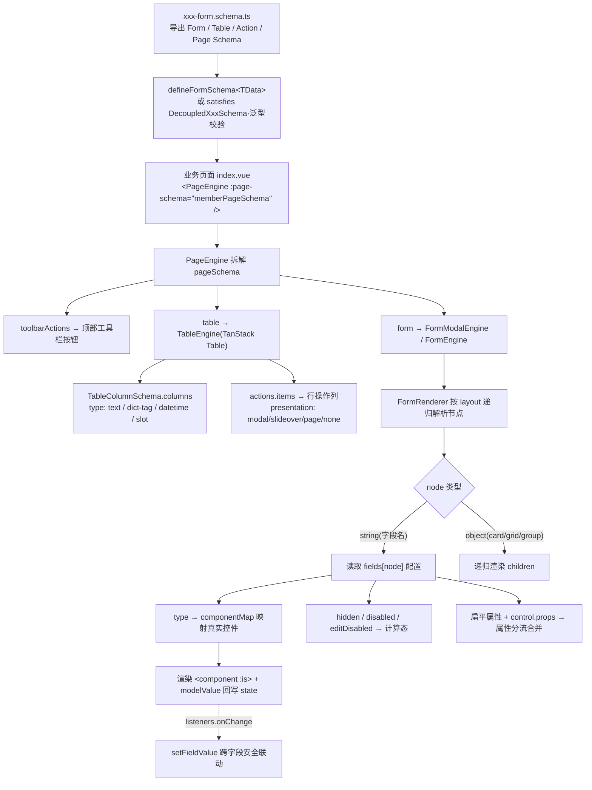
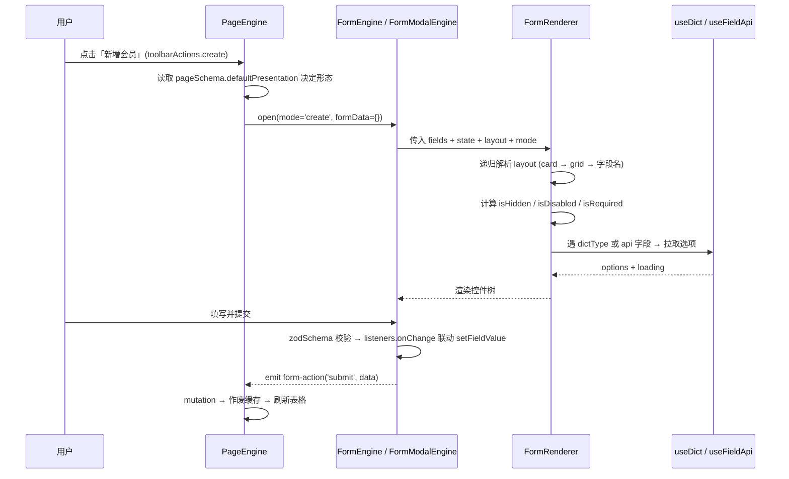

# 实战-组件创建规范设计

> **工程类型判定**：前端工程（pnpm workspace Monorepo，Nuxt 4 `compatibilityVersion:4` + Nuxt UI v4 + TanStack Table/Form + Zod）
> **代码基线**：`d:/mywork/myDev/frontDev/ai-nuxt/pnpm-mono`
> **核心主题**：**用 JSON/Schema 描述并创建组件**的规范——不写模板、不写状态，只用一份强类型元数据（Decoupled Schema）声明出完整的 CRUD 表单、表格、动作与页面
> **契约四件套**：`DecoupledFormSchema` / `DecoupledTableSchema` / `ActionSchema` / `DecoupledPageSchema`
> **贯穿包**：`apps/nuxt-app/app/components/*/*.schema.ts`（声明） → `@proj/shared-ui/types/*`（契约） → `@proj/shared-ui/components/*`（引擎消费）

---

## 一、架构全景

### 1.1 分层拓扑（声明层与执行层严格分离）

```text
┌──────────────────────────────────────────────────────────────────────────────┐
│ L4 业务声明层  apps/nuxt-app/app/components/{member,product}/*.schema.ts      │
│    memberUiSchema       (DecoupledFormSchema  → 表单由 JSON 描述)             │
│    memberTableSchema    (DecoupledTableSchema → 表格由 JSON 描述)             │
│    memberToolbarActions (ActionSchema[]       → 按钮由 JSON 描述)             │
│    memberPageSchema     (DecoupledPageSchema  → 页面由 JSON 描述)             │
│    memberZodSchema      (Zod 校验规则，与 Schema 正交)                         │
└───────────────┬──────────────────────────────────────────────────────────────┘
                │ ① defineFormSchema<TData> / satisfies 泛型强校验
                │ ② :page-schema 传入 <PageEngine>
┌───────────────▼──────────────────────────────────────────────────────────────┐
│ L3 契约类型层  @proj/shared-ui/types                                          │
│    form-schema.ts   FieldConfig / LayoutNode / FormActionSchema / defineFormSchema │
│    table-schema.ts  TableColumnSchema / TableActionColumnSchema / ColumnKey   │
│    action-schema.ts ActionSchema / ActionContext                              │
│    page-schema.ts   DecoupledPageSchema (table + form + toolbarActions 聚合)   │
│    components.d.ts  自定义控件 Props 汇总（DictSelectProps / DatePickerProps）  │
└───────────────┬──────────────────────────────────────────────────────────────┘
                │ 消费 Schema
┌───────────────▼──────────────────────────────────────────────────────────────┐
│ L2 引擎执行层  @proj/shared-ui/components                                     │
│    page/PageEngine.vue        总调度：拆 pageSchema → toolbar/table/form       │
│    table/TableEngine.vue      TableColumnSchema → TanStack Table 列            │
│    form/FormRenderer.vue      逐字段解析：type→componentMap / 属性分流 / 联动   │
│    form/FormEngine.vue        layout 递归 + 校验 + 提交                        │
│    form/controls/*.vue        DictSelect / DatePicker 可插拔控件               │
└───────────────┬──────────────────────────────────────────────────────────────┘
                │ 动态数据源注入
┌───────────────▼──────────────────────────────────────────────────────────────┐
│ L1 数据与缓存层  composables/useDict · useFieldApi · useCrudManagement         │
│                  @proj/http-client (Vue Query 缓存) · @proj/api-client         │
└──────────────────────────────────────────────────────────────────────────────┘
```

### 1.2 JSON Schema「声明 → 渲染」端到端链路



### 1.3 一次「打开新增表单并提交」的解析时序



---

## 二、核心职责边界与设计哲学

| 关注点 | Schema（声明层）负责什么 | 引擎（shared-ui）负责什么 | 业务页面负责什么 | 为什么这样划分 |
| :--- | :--- | :--- | :--- | :--- |
| 表单结构 | 用 `fields` KV 表 + `layout` 树声明字段与排版 | 递归解析 `LayoutNode`、渲染控件、处理校验 | 只声明 `:page-schema` 与 `:zod-schema` | 结构是数据、渲染是能力，二者正交 |
| 控件选型 | 填 `type: 'dict-select'` 等字符串 | `componentMap[type]` 映射到真实组件 | 无 | 让「换控件」只改一个字面量 |
| 字段权限 | 声明 `hidden` / `disabled` / `editDisabled`（支持函数） | 按 `mode` 计算最终态并注入 `disabled` | 无（或仅传 `mode`） | 权限规则随 Schema 走，引擎统一执行 |
| 联动逻辑 | 声明 `listeners.onChange` 闭包 / `dependsOn` | 触发闭包并注入 `setFieldValue` | 无（复杂场景可 `@form-action` 接管） | 纯闭包联动，无 `eval` 风险 |
| 数据源 | 声明 `api: { url, dependencies }` 或 `dictType` | `useFieldApi`/`useDict` 自动拉取注入 `items/options` | 无 | 数据获取是通用能力，不应写进业务 |
| 校验规则 | `zodSchema`（`satisfies z.ZodType<Entity.Create>`） | 提交时调用校验并回显错误 | 无 | 校验与 UI 解耦，可独立测试 |
| 交互形态 | 声明 `presentation: 'modal'\|'slideover'\|'page'\|'none'` | 按声明切换弹窗/抽屉/路由 | 无 | 形态是配置项而非代码分支 |
| 动态改造 | 基准 Schema（静态 JSON） | `useFormSchema` 提供深克隆 + 路径覆盖 | 按页面状态覆盖字段 | 静态基线 + 运行时补丁分层 |

---

## 三、核心机制与真实代码切片

### 3.1 机制一：泛型穿透的 Schema 定义（`defineFormSchema<TData>` + `satisfies`）

```ts
// packages/shared-ui/types/form-schema.ts（片段）
export interface DecoupledFormSchema<TData = Record<string, any>> {
    id?: string
    title?: string
    description?: string
    /**
     * 字段注册表：KV Map 结构，Key 严格受 TData 约束，提供编译期防呆
     */
    fields: Partial<Record<keyof TData, FieldConfig<TData, keyof TData>>> | Record<string, FieldConfig<TData, any>>
    /**
     * 布局配置树（可选！未提供时引擎自动采用自适应网格自然流式排版，实现零配置布局）
     */
    layout?: LayoutNode<keyof TData> | LayoutNode<keyof TData>[]
    /** 强类型初始默认值（TanStack 风格） */
    initialValues?: Partial<TData>
    /** 声明式表单底部操作按钮组配置 */
    formActions?: FormActionSchema<TData>[]
    [key: string]: any
}

/**
 * 💡 辅助函数：定义强类型表单 Schema
 * 赋予 Schema 100% 的 TypeScript 编译期检查与智能提示
 */
export function defineFormSchema<TData = Record<string, any>>(
    schema: DecoupledFormSchema<TData>
): DecoupledFormSchema<TData> {
    return schema
}
```
```ts
// apps/nuxt-app/app/components/member/member-form.schema.ts（片段）
import { defineFormSchema } from '@proj/shared-ui/types'
import type { Member } from '@proj/api-client'

export const memberUiSchema = defineFormSchema<Member.Create>({
  id: 'member-crud-schema',
  title: '会员信息',
  fields: { /* ... */ }
})
```
```ts
// apps/nuxt-app/app/components/product/product-form.schema.ts（片段·另一种校验姿势）
export const productUiSchema = {
  id: 'product-form-schema',
  fields: { /* ... */ }
} satisfies DecoupledFormSchema

export const productZodSchema = z.object({
  name: z.string().trim().min(1, '商品名称不能为空').max(60, '商品名称不能超过60字'),
  price: z.number().min(0.01, '商品售价必须大于0')
}) satisfies z.ZodType<Product.Create> // 💡 TS 4.9+ satisfies：强校验字段是否漏写或类型不匹配
```

**设计要点 / 为什么这是优秀设计**
- **`defineFormSchema<TData>` 是「恒等函数 + 泛型锚点」**：运行时不做事，只在编译期把 `TData` 的字段名灌进 `fields` 的 Key 约束。写错 `key` 立刻红线，F2 重命名实体字段可全局联动。
- **`satisfies` 而非 `as`**：`satisfies DecoupledFormSchema` 保留字面量推断（`type: 'dict-select'` 仍是字面量而非 `string`），同时强校验结构完整。这是「既要校验又要保留类型」的标准答案。
- **`zodSchema satisfies z.ZodType<Entity.Create>`**：让校验器与实体契约同源，漏写字段/类型不符在编译期就报错。

### 3.2 机制二：字段的「双范式声明」与引擎向下兼容

工程中同时存在**新版扁平化**与**旧版嵌套**两套写法，`FormRenderer` 通过属性分流同时消费二者：

```ts
// ✅ 范式 A·扁平化（member-form.schema.ts，推荐）
level: {
  label: '会员等级',
  required: true,
  type: 'dict-select',
  dictType: 'member_level',
  placeholder: '请选择会员等级',
  listeners: {
    onChange: ({ value, setFieldValue }) => {
      if (value === 'diamond') {
        setFieldValue('points', 888)   // 强类型安全设值
      }
    }
  }
},
remark: {
  label: '备注',
  type: 'textarea',
  placeholder: '请输入备注信息',
  rows: 3,
  colSpan: 2 // 💡 字段级栅格跨列：跨整行，免写嵌套 grid
}
```
```ts
// ⚠️ 范式 B·嵌套（product-form.schema.ts，兼容保留）
price: {
  label: '售价 (元)',
  required: true,
  control: {
    type: 'input-number',
    props: { placeholder: '0.00', min: 0 }
  }
}
```

引擎侧的分流逻辑（把「扁平顶层属性」与「旧版 `control.props`」合并，并剔除内部元数据）：

```vue
<!-- packages/shared-ui/components/form/FormRenderer.vue（片段） -->
<script setup lang="ts">
// 提取控件类型：优先扁平 type，回退旧版 control.type
const controlType = computed(() =>
  currentField.value?.type || currentField.value?.control?.type || 'input'
)

// 专属于 UFormField 的 Props 白名单（label/help/hint/error 等）
const FORM_FIELD_PROP_KEYS = new Set([
  'label', 'description', 'help', 'hint', 'error', 'size'
])

// 属性分流：先合并旧版 control.props，再叠加顶层扁平属性（排除内部元数据）
const controlProps = computed(() => {
  if (!currentField.value) return {}
  const oldProps = currentField.value.control?.props || {}
  const res: Record<string, any> = { ...oldProps }

  const internalKeys = new Set([
    'type', 'control', 'hidden', 'editDisabled', 'disabled', 'required',
    'listeners', 'asyncValidator', 'colSpan', 'dependsOn', 'watchFields',
    'api', ...FORM_FIELD_PROP_KEYS
  ])

  for (const [key, value] of Object.entries(currentField.value)) {
    if (!internalKeys.has(key)) res[key] = value
  }

  // 注入 API 数据源 / 字典类型 / 禁用态
  if (apiConfig.value) {
    res.items = apiOptions.value
    res.options = apiOptions.value
    res.loading = apiLoading.value
  }
  if (currentField.value.dictType && !res.dictType) res.dictType = currentField.value.dictType
  if (isDisabled.value) res.disabled = true

  return res
})
</script>
```

**设计要点 / 为什么这是优秀设计**
- **白名单 + 黑名单双集合分流**：`FORM_FIELD_PROP_KEYS` 决定哪些属性归 `<UFormField>`，`internalKeys` 决定哪些是引擎内部元数据不往下传，其余「未知属性」全部透传给控件。「约定优于配置」——业务想加任意原生属性都不用改引擎。
- **零成本迁移路径**：`type || control?.type` 的回退设计让旧 Schema 无需一次性改造即可平滑升级，这是**渐进式重构**的范本。
- **扁平化收益**：`control: { type, props: { placeholder } }` 三行压成一行 `type + placeholder`，行数减半、噪音归零。

### 3.3 机制三：控件映射表——`type` 字符串即组件契约

```vue
<!-- packages/shared-ui/components/form/FormRenderer.vue（片段） -->
<script setup lang="ts">
import { computed, resolveComponent } from 'vue'

const componentMap: Record<string, any> = {
  // 文本与输入类
  input: resolveComponent('UInput'),
  text: resolveComponent('UInput'),
  number: resolveComponent('UInput'),
  'input-number': resolveComponent('UInputNumber'),
  textarea: resolveComponent('UTextarea'),
  'pin-input': resolveComponent('UPinInput'),
  'input-tags': resolveComponent('UInputTags'),
  'input-menu': resolveComponent('UInputMenu'),

  // 下拉与选项列表类
  select: resolveComponent('USelect'),
  'select-menu': resolveComponent('USelectMenu'),
  'radio-group': resolveComponent('URadioGroup'),
  'checkbox-group': resolveComponent('UCheckboxGroup'),

  // 开关与勾选类
  checkbox: resolveComponent('UCheckbox'),
  switch: resolveComponent('USwitch'),
  slider: resolveComponent('USlider'),
  'color-picker': resolveComponent('UColorPicker'),
  'file-upload': resolveComponent('UFileUpload'),

  // 日期与时间类
  'input-date': resolveComponent('UInputDate'),
  'input-time': resolveComponent('UInputTime'),

  // 自定义与扩展组件映射
  'dict-select': resolveComponent('DictSelect'),
  date: resolveComponent('DatePicker'),
  'date-range': resolveComponent('DatePicker')
}
</script>

<template>
  <UFormField v-if="currentField && !isHidden" :name="node" v-bind="formFieldProps" :required="isRequired" :disabled="isDisabled" :class="colSpanClass">
    <component
        :is="componentMap[controlType] || resolveComponent('UInput')"
        :model-value="state[node]"
        @update:model-value="handleValueChange"
        v-bind="{ ...controlProps, ...buildEventListeners(currentField.control?.events, state) }"
        class="w-full"
    />
  </UFormField>
</template>
```

控件在 Schema 中的用法（`type` + 扁平属性，可选类型定义在 `types/components.d.ts`）：

```ts
// apps/nuxt-app/app/components/member/member-form.schema.ts（片段）
birthday: { label: '出生日期', type: 'date', placeholder: '请选择出生日期' },
province: {
  label: '省份', type: 'select', placeholder: '请选择省份',
  api: { url: '/provinces', labelField: 'label', valueField: 'value' },
  listeners: { onChange: ({ setFieldValue }) => setFieldValue('city', undefined) } // 省份变更自动清空城市
},
city: {
  label: '城市', type: 'select', placeholder: '请选择城市',
  api: {
    url: '/cities?provinceCode=${province}',  // 💡 URL 占位符由 useFieldApi 解析
    dependencies: ['province'],               // 💡 前置依赖未满足则不请求
    labelField: 'label', valueField: 'value'
  }
}
```

**设计要点 / 为什么这是优秀设计**
- **`type` 就是组件名**：Schema 作者无需 `import` 任何组件，`type: 'dict-select'` 即可换出一个带字典能力的下拉框。这是 DSL 的核心价值——**用字面量代替代码**。
- **`componentMap[...] || UInput` 兜底**：未注册类型降级为普通输入框，页面永不白屏。
- **API 数据源声明式注入**：`api: { url, dependencies, labelField, valueField }` 让「级联下拉」从业务代码降级为一行配置，`${province}` 占位符 + `dependencies` 由 `useFieldApi` 统一解析（含依赖阻塞、URL 合法性校验、结果规范化）。

### 3.4 机制四：布局树、字段权限与动态联动

**（A）布局是「JSON 树」而非嵌套模板**：

```ts
// packages/shared-ui/types/form-schema.ts（片段）
/** 2. 布局节点结构（children 支持直接填入字段名字符串 string 或嵌套子容器） */
export type LayoutNode<K = string> =
    | { type: 'card'; title?: string; class?: string; children: (K | LayoutNode<K>)[] }
    | { type: 'grid'; cols?: number; class?: string; children: (K | LayoutNode<K>)[] }
    | { type: 'group'; class?: string; children: (K | LayoutNode<K>)[] }
    | { type: 'field-group'; class?: string; children: (K | LayoutNode<K>)[] }
```
```ts
// apps/nuxt-app/app/components/member/member-form.schema.ts（片段）
layout: [
  {
    type: 'card', title: '会员基本信息', class: 'mb-4',
    children: [
      { type: 'grid', class: 'grid grid-cols-1 sm:grid-cols-2 gap-4',
        children: ['name', 'phone', 'level', 'status', 'gender', 'birthday', 'email', 'province', 'city', 'remark'] }
    ]
  },
  {
    type: 'card', title: '积分变动配置',
    class: 'border border-primary-200 dark:border-primary-800/60 bg-primary-50/30 dark:bg-primary-950/20',
    children: ['points']
  }
]
```

**（B）字段权限：`editDisabled` / `hidden` / `disabled` 三种声明式控制**：

```vue
<!-- packages/shared-ui/components/form/FormRenderer.vue（片段） -->
<script setup lang="ts">
const isHidden = computed(() => {
  if (!currentField.value) return true
  const hiddenCfg = currentField.value.hidden
  if (typeof hiddenCfg === 'function') {
    return !!hiddenCfg(props.state, { mode: props.mode })
  }
  return !!hiddenCfg
})

const isDisabled = computed(() => {
  if (props.readonly || props.disabled || props.mode === 'view') return true
  if (!currentField.value) return false
  // 语法糖：仅在编辑模式下禁用（新增时可编辑）
  if (props.mode === 'edit' && currentField.value.editDisabled) return true
  const disabledCfg = currentField.value.disabled
  if (typeof disabledCfg === 'function') return !!disabledCfg(props.state, { mode: props.mode })
  if (typeof disabledCfg === 'boolean') return disabledCfg
  return !!(currentField.value.disabled || currentField.value.control?.props?.disabled)
})

const isRequired = computed(() => {
  if (props.readonly || props.disabled || props.mode === 'view') return false
  if (!currentField.value) return false
  if (typeof currentField.value.required === 'boolean') return currentField.value.required
  return !!currentField.value.control?.props?.required
})
</script>
```

**（C）受控联动：`listeners.onChange` 安全闭包 + `setFieldValue`**：

```vue
<!-- packages/shared-ui/components/form/FormRenderer.vue（片段） -->
<script setup lang="ts">
function handleValueChange(val: any) {
  if (!currentFieldName.value) return
  props.state[currentFieldName.value] = val

  // 触发现代 TanStack Form 风格的 listeners
  if (currentField.value?.listeners?.onChange) {
    currentField.value.listeners.onChange({
      value: val,
      state: props.state,
      fieldName: currentFieldName.value,
      setFieldValue: (k: string, v: any) => { props.state[k] = v }   // 受控设值闭包
    })
  }
  // 触发旧版 events.change（向下兼容）
  if (currentField.value?.control?.events?.change) {
    currentField.value.control.events.change(val, props.state)
  }
}
</script>
```

**（D）动态 Schema 覆盖：`useFormSchema` 深克隆 + 路径级补丁**：

```ts
// packages/shared-ui/composables/useFormSchema.ts（片段）
export function useFormSchema(baseSchema, options = {}) {
    // 深克隆，切断与源 JSON 文件的引用关联
    const { cloned: schema } = useCloned(baseSchema as DecoupledFormSchema)

    if (options.overrides) {
        schema.value = mergeWith({}, schema.value, options.overrides, replaceArrayCustomizer)
    }

    const setField = (fieldName: string, patch: SetFieldPatch) => {
        if (!schema.value.fields || !schema.value.fields[fieldName]) return
        const field = schema.value.fields[fieldName]
        const { props, control, ...fieldAttrs } = patch
        Object.assign(field, fieldAttrs)                       // ① 顶层属性
        if (control) field.control = mergeWith({}, field.control || {}, control, replaceArrayCustomizer) // ② control 深合并
        if (props) {                                          // ③ control.props 增量合并
            field.control = field.control || ({} as FieldConfig['control'])
            field.control.props = { ...(field.control.props || {}), ...props }
        }
    }
    // options.mode === 'view' 时自动 setAllDisabled(true)
}
```
```ts
// lodash/mergeWith 的自定义合并策略：数组「替换」而非「逐项合并」
function replaceArrayCustomizer(_objValue: any, srcValue: any) {
    if (Array.isArray(srcValue)) return srcValue
}
```

**设计要点 / 为什么这是优秀设计**
- **`layout.children` 可混填字符串与子容器**：`children: ['name', 'phone', {...}]`——字段名即引用，天然支持「扁平流式」与「卡片分组」两种排版，且**省略 `layout` 时引擎自动 2 列自适应**（零配置布局）。
- **`hidden` / `disabled` 支持「布尔或函数」双态**：静态用布尔、动态用闭包 `(state, ctx) => boolean`，`ctx.mode` 让「新增隐藏、编辑显示」一行搞定。类型系统保证 `state` 具 `TData` 推导。
- **`editDisabled` 是极致语法糖**：把最常见的「编辑态只读」需求收敛为一个布尔开关，省去手写 `disabled: (_, ctx) => ctx.mode === 'edit'`。
- **`view` 模式全自动只读**：引擎在 `view` 时自动注入 `disabled`、隐藏必填星号、隐藏提交按钮——**只读保护是引擎责任，不是业务负担**。
- **`setFieldValue` 闭包替代 `eval`**：曾经的字符串动态解析（`eval`/`new Function`）被彻底废弃，改为强类型闭包，既安全又能被 TS 推导参数类型。
- **`replaceArrayCustomizer` 是踩坑后的补丁**：`lodash.merge` 默认按索引合并数组，会导致 `layout.children` 新旧节点交叉融合、旧节点清不干净；强制「数组即替换」才符合 Schema 覆盖的直觉。

### 3.5 机制五：表格与动作的 JSON 化（`TableColumnSchema` / `ActionSchema`）

```ts
// apps/nuxt-app/app/components/member/member-form.schema.ts（片段）
export const memberTableSchema = {
  id: 'member-table-schema',
  rowKey: 'id',
  presentation: 'overlay',       // 'inline' 则开启表格原位行内编辑
  loading: false,                // 直接透传 Nuxt UI <UTable> 原生属性
  features: { selection: true, index: false },
  columns: [
    { key: 'name', label: '会员姓名', width: 140, sortable: true, fixed: 'left',
      editable: true, control: { type: 'input', props: { placeholder: '姓名' } } },
    { key: 'phone', label: '手机号码', width: 160, fixed: 'left',
      headerClass: 'text-gray-500 font-semibold',
      cellClass: (val: string) => val?.startsWith('158') ? 'text-red-500 font-bold' : 'text-gray-700 dark:text-gray-300' },
    { key: 'level', label: '会员等级', type: 'dict-tag', dictType: 'member_level', editable: true,
      control: { type: 'dict-select', props: { dictType: 'member_level' } } },
    { key: 'createdAt', label: '注册时间', type: 'datetime', sortable: true },
    { key: 'remark', label: '备注', editable: true,
      control: { type: 'input', props: { placeholder: '备注信息' } } }
  ],
  actions: {
    label: '操作',
    displayMode: 'dropdown',   // 'buttons' | 'auto'(>=3 自动收纳)
    items: [
      { key: 'view', label: '查看', icon: 'i-heroicons-eye', color: 'neutral', variant: 'ghost', presentation: 'page' },
      { key: 'edit', label: '编辑', icon: 'i-heroicons-pencil-square', color: 'primary', variant: 'ghost', presentation: 'page' },
      { key: 'add-points', label: '添加积分', icon: 'i-lucide-coins', color: 'success', variant: 'ghost', presentation: 'slideover' },
      { key: 'delete', label: '删除', icon: 'i-heroicons-trash', color: 'error', variant: 'ghost',
        presentation: 'none', disabled: row => row.status === 'protected' }
    ]
  }
} satisfies DecoupledTableSchema<Member.ListItem>
```
```ts
// apps/nuxt-app/app/components/member/member-form.schema.ts（片段）
export const memberToolbarActions: ActionSchema<Member.ListItem>[] = [
  { key: 'create', label: '新增会员', icon: 'i-lucide-plus', color: 'primary', presentation: 'page' },
  { key: 'batchDelete', label: '批量删除', icon: 'i-lucide-trash', color: 'error', variant: 'soft', requiresSelection: true },
  { key: 'print', label: '打印', icon: 'i-lucide-printer', color: 'neutral', variant: 'outline' }
]

export const memberPageSchema: DecoupledPageSchema<Member.ListItem> = {
  id: 'member-page-schema',
  title: '会员管理',
  defaultPresentation: 'page',   // 页面缺省形态：未指定 presentation 的动作用路由页面
  toolbarActions: memberToolbarActions,
  table: memberTableSchema,
  form: memberUiSchema
}
```

**设计要点 / 为什么这是优秀设计**
- **列即 JSON**：`type: 'dict-tag' | 'datetime' | 'slot'` 覆盖 90% 展示需求，`formatter` 处理纯数据转换，`slotName` 兜底复杂 UI——**先声明、再格式化、最后自定义**的三级降级。
- **`ColumnKey<TItem>` 的 `(string & {})` 技巧**：既保留 `keyof TItem` 的自动补全，又允许 `'actions'` 等自定义列 Key，类型不收缩。
- **动作自带 `presentation` 可覆盖页面级**：页面可以整体走 `'page'` 路由，但 `add-points` 单独声明 `'slideover'` 就地抽屉——**粒度自由到按钮级**。
- **`requiresSelection` 声明式联动**：未勾选任何行时按钮自动禁用，无需业务写判断。
- **`disabled: row => ...` 行级守卫**：`protected` 状态不可删除，规则随 Schema 走。

---

## 四、边界防御与现状缺口分析

| 防御维度 | 当前实现 | 评价与建议 |
| :--- | :--- | :--- |
| 泛型字段校验 | `defineFormSchema<TData>` + `satisfies DecoupledXxxSchema` | ✅ 编译期防呆。但 `fields` 存在 `[key: string]: any` 兜底索引签名，拼错 Key 可能不报错，建议收敛索引签名 |
| 未注册控件 | `componentMap[type] \|\| resolveComponent('UInput')` | ✅ 永不白屏。降级静默，建议 dev 环境 `console.warn` 未注册类型 |
| 双范式并存 | 同时支持扁平属性与 `control.props` 嵌套 | ⚠️ 两套写法易造成团队风格分裂。建议 README/ESLint 约束新代码一律扁平，旧 Schema 制定迁移计划 |
| 数组覆盖 | `replaceArrayCustomizer` 强制数组替换 | ✅ 已修复 merge 交叉污染。仅作用于 `useFormSchema`，其他 `mergeWith` 调用点需自行传入 |
| 级联数据源 | `useFieldApi` 依赖阻塞 + URL 残留 `${}` 校验 | ✅ 三重闸门防无效请求。未覆盖「依赖字段值变化后旧请求竞态」，建议加请求序号守卫 |
| 字段联动 | `listeners.onChange` 闭包 + `setFieldValue` | ✅ 无 `eval` 风险。联动仅在 `onChange` 触发，缺少 `onBlur` 实现落地 |
| 动态覆盖 | `useFormSchema` 深克隆 + lodash 路径读写 | ✅ 隔离源 JSON。`setField` 对 `fields[name]` 不存在时静默 return，误配置无提示 |
| 校验时机 | Zod 校验 + `asyncValidator` 类型已定义（防抖 300ms） | ⚠️ `asyncValidator` 在 `FormRenderer` 中未见调用落地，异步查重能力尚未启用 |
| 权限粒度 | `permission?: string \| string[]` 已在类型中预留 | ⚠️ 类型有字段但无鉴权执行器，属规划中能力 |
| Schema 复用 | `member` / `product` 两套 Schema，存在重复结构 | ⚠️ 缺少 Schema 组合工具（如 `extendSchema`），跨域复用靠复制。建议提炼基础字段片段 |

---

## 五、亮点与踩坑经验总结

### 5.1 相比传统方案的亮点

1. **「元数据即组件」**：一份 `memberPageSchema` 同时描述工具栏、表格、表单、校验、权限与交互形态，业务页面 `index.vue` 只剩十几行声明——**从「写页面」变为「配页面」**。
2. **四层契约正交解耦**：`Form / Table / Action / Page` 四个 Schema 各管一摊，`PageSchema` 只做聚合。改表格不动表单，改动作不动布局。
3. **泛型穿透的编译期安全网**：`defineFormSchema<Member.Create>` + `satisfies DecoupledTableSchema<Member.ListItem>` + `zodSchema satisfies z.ZodType<Member.Create>`，实体字段重命名可全局联动，拼写错误编译即报。
4. **零配置 Layout**：省略 `layout` 自动 2 列响应式流式排版，`colSpan: 2` 一行实现通栏；需要分组时再声明 `card` 树——**默认简单、复杂可选**。
5. **声明式数据源 + 联动**：`api: { url: '/cities?provinceCode=${province}', dependencies: ['province'] }` 一行实现省市级联，`listeners.onChange` 一行实现跨字段回填。

### 5.2 踩坑记录（血泪经验）

- **`layout.children` 必须填「字段名」，且该字段必须在 `fields` 里注册**：只写 layout 不写 fields，节点会被静默跳过（`currentField` 为 `null` 直接不渲染），表现为「配置了却不显示」。
- **数组覆盖是 `lodash.merge` 的必修补丁**：不传 `replaceArrayCustomizer` 时，改 `layout.children` 会出现新旧节点交叉融合、删掉的字段还残留。凡合并 Schema 数组务必替换而非索引合并。
- **扁平与嵌套不能混用同一字段**：`type` 与 `control.type` 同时存在时以扁平 `type` 优先，容易造成「改了 `control` 不生效」的困惑；同一字段统一用一种范式。
- **`hidden` 函数里读的是整个 `state`，不是当前值**：`hidden: (state, ctx) => ctx?.mode === 'create'`；若写成 `hidden: (value) => ...` 会拿到 state 对象而逻辑错乱。
- **`editDisabled` 只管 `mode === 'edit'`**：新增模式不受其影响；只读查看请用 `mode: 'view'`（引擎会自动全字段禁用）。
- **`dictType` 拼错不会报错，只会显示原始 value**：字典类控件依赖后端字典存在，`useDict` 找不到时降级返回原值（如 `'1'` 而非 `'男'`），排查时先查字典接口。
- **URL 占位符必须被 `dependencies` 覆盖**：`url: '/cities?provinceCode=${province}'` 若漏写 `dependencies: ['province']`，`province` 为空时不会阻塞，会发出带空参的请求甚至 404。
- **`presentation: 'none'` 不等于没动作**：它表示「不唤起弹窗/路由，由 `onClick` 或外层 `@row-action` 自行逻辑处理」，别误以为按钮点了没反应。
- **`satisfies` 与类型注解不要混用**：写成 `const s: DecoupledFormSchema = {...}` 会丢失字面量推断（`type` 退化为 `string`），推荐 `satisfies`。

---

## 六、演进路线图（Roadmap）

```text
JSON Schema 驱动组件规范演进
│
├─ 阶段 1 · 现状（已达成）
│   ├─ ✅ 四层契约：Form / Table / Action / Page Schema
│   ├─ ✅ defineFormSchema<TData> + satisfies 泛型强校验
│   ├─ ✅ 扁平化字段声明（type / placeholder / api / listeners 平铺）
│   ├─ ✅ componentMap 控件映射 + UInput 兜底
│   ├─ ✅ useFormSchema 动态覆盖（深克隆 + 数组替换）
│   └─ ✅ 声明式数据源与跨字段受控联动
│
├─ 阶段 2 · 一致性收敛（近期）
│   ├─ product-form.schema.ts 从嵌套 control.props 迁移到扁平范式
│   ├─ 收紧 fields / columns 的索引签名，消除「拼错不报错」
│   ├─ 未注册控件在 dev 环境 console.warn 告警
│   └─ 输出「Schema 编写规范」README + ESLint 校验规则
│
├─ 阶段 3 · 能力补齐（中期）
│   ├─ 落地 asyncValidator（异步查重，防抖 300ms 已定义未接线）
│   ├─ 落地 permission 字段鉴权执行器（动作/列级权限）
│   ├─ useFieldApi 增加请求竞态守卫（序号比对丢弃过期响应）
│   └─ 提炼 Schema 组合工具 extendSchema，消除跨域重复
│
└─ 阶段 4 · 生产级（远期）
    ├─ Schema 可序列化为纯 JSON（支持后端下发 / 低代码可视化编排）
    ├─ Schema 版本化与运行时校验（zod 校验 Schema 自身结构）
    └─ Design-to-Code：可视化拖拽 → 生成 Schema → 引擎渲染闭环
```

---

## 附：Schema 编写速查

| 需求 | Schema 写法（推荐扁平范式） |
| :--- | :--- |
| 定义表单 | `defineFormSchema<Entity.Create>({ fields: {...} })` |
| 换个控件 | `type: 'dict-select'` / `'date'` / `'select-menu'` / `'input-number'` |
| 编辑态只读 | `editDisabled: true` |
| 动态显隐 | `hidden: (state, ctx) => ctx?.mode === 'create'` |
| 跨字段联动 | `listeners: { onChange: ({ value, setFieldValue }) => ... }` |
| 级联下拉 | `api: { url: '/x?f=${province}', dependencies: ['province'] }` |
| 字典下拉/标签 | `type: 'dict-select'`（表单）/ `type: 'dict-tag', dictType: 'xxx'`（表格） |
| 通栏字段 | `colSpan: 2` |
| 表格列格式化 | `formatter: (val, row) => string` / `type: 'datetime'` |
| 列冻结 | `fixed: 'left' \| 'right'` |
| 行内编辑 | table `presentation: 'inline'` + 列 `editable: true` + `control: {...}` |
| 动作形态 | `presentation: 'modal' \| 'slideover' \| 'page' \| 'none'` |
| 批量按钮 | `requiresSelection: true` |
| 动态覆盖 Schema | `useFormSchema(base, { mode, overrides, fields })` |