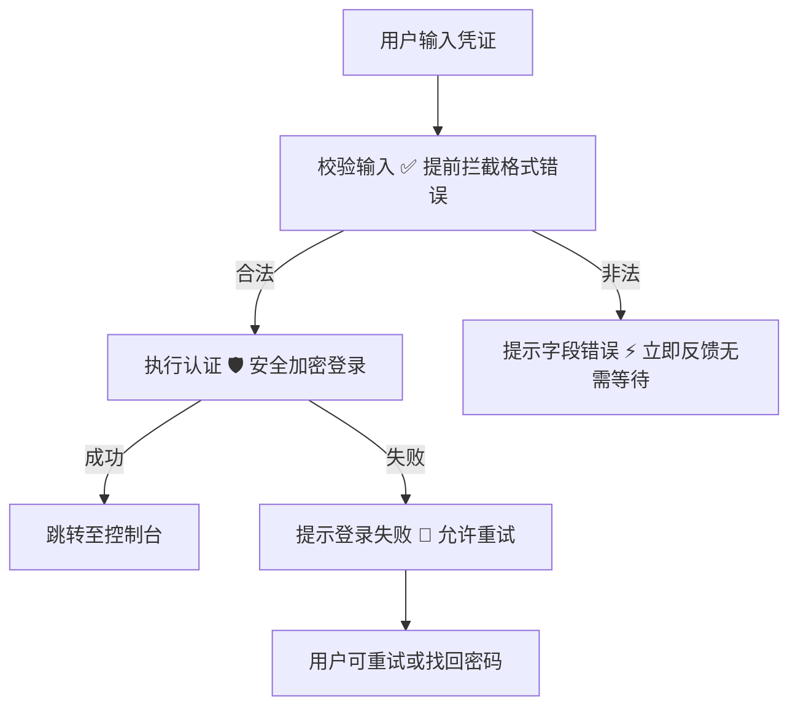
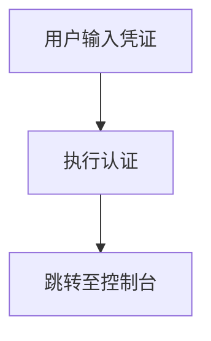
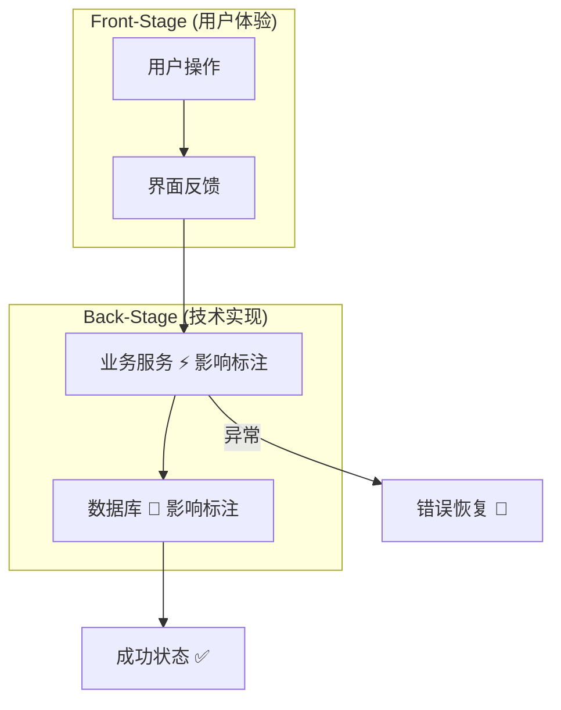
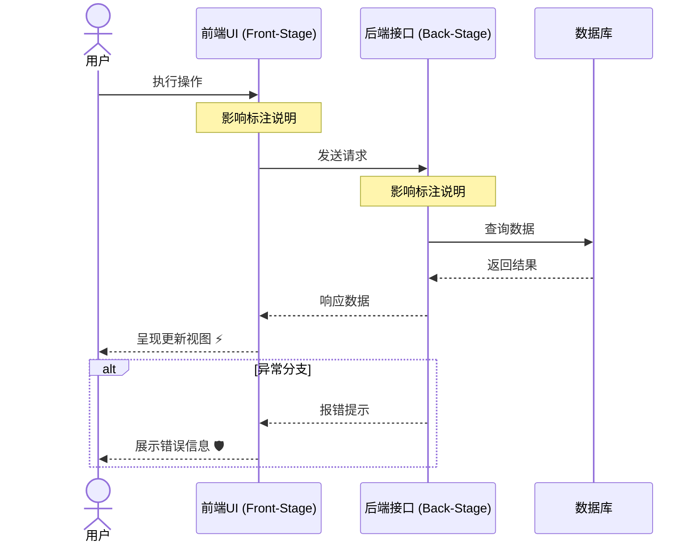
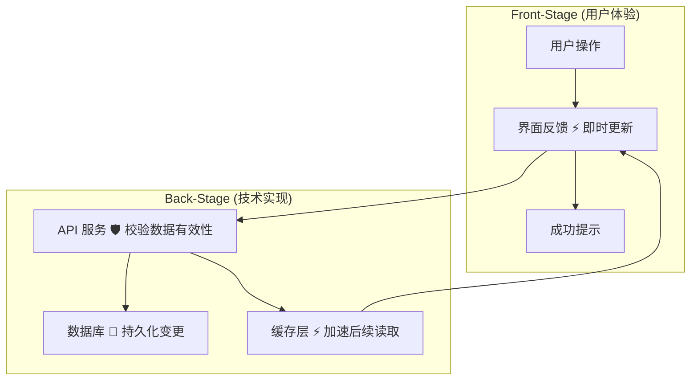
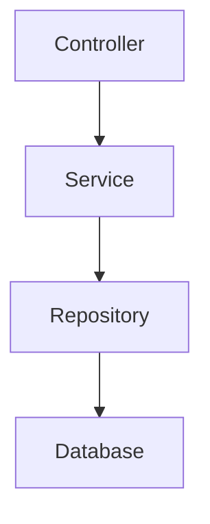
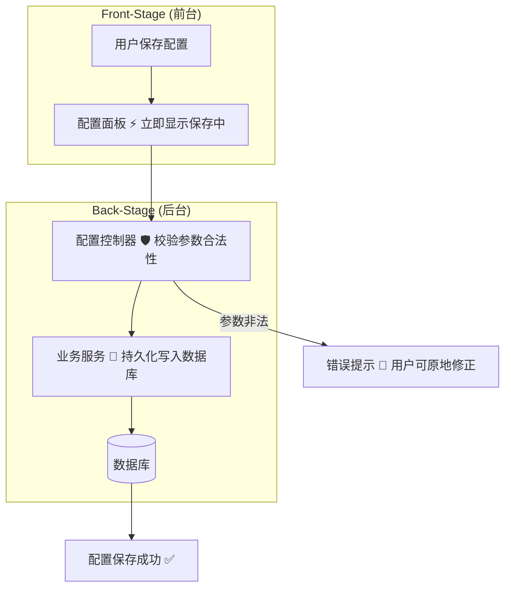
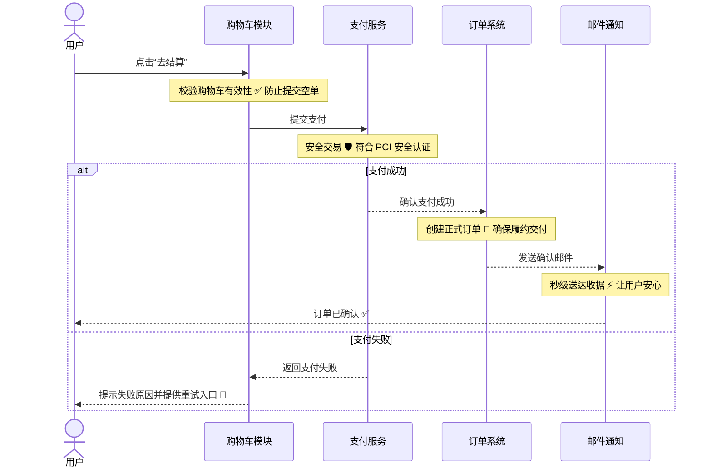
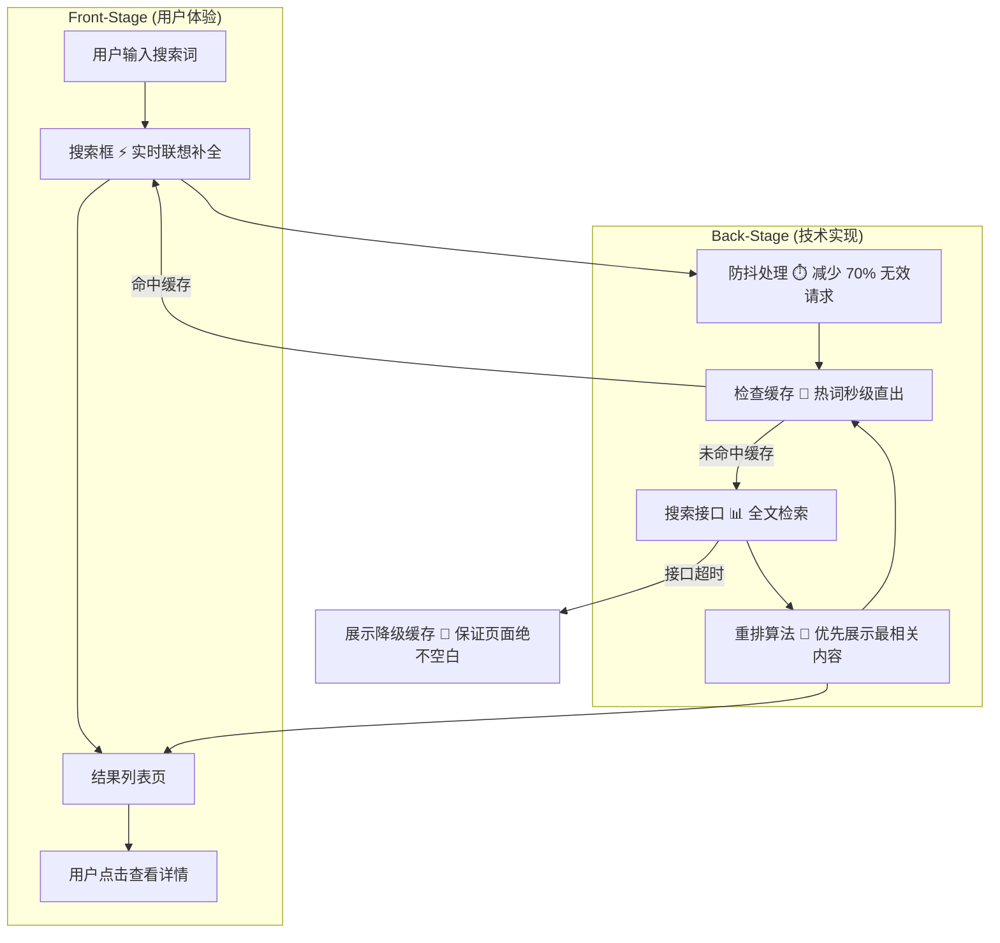

# 图驱动开发（DDD）原则 (Diagram Driven Development Principles)

连接用户价值与技术实现的核心图表构建方法论。

## 哲学理念

**传统图表说明代码“做了什么”。DDD 图表说明代码“为什么对用户重要”。**

每个图表都必须回答以下四个问题：
1. **这解决了什么用户需求？**
2. **底层技术实现如何交付这一价值？**
3. **当发生异常时会发生什么？**
4. **我们在哪里可以改善用户体验？**

## 两大核心舞台 (The Two Stages)

### 前台 (Front-Stage，用户体验)
用户看到、感知和体验到的内容：
- 用户的操作与决策
- UI 状态与即时反馈
- 等待时间与延迟
- 错误提示与恢复选项
- 成功确认提示

### 后台 (Back-Stage，技术实现)
我们如何支撑并交付这种体验：
- 服务与 API 接口
- 数据计算与处理
- 缓存机制与性能优化
- 异常错误处理
- 系统集成对接点

**关键要求**：每一个图表都必须同时展示这两个舞台，并清晰展现它们之间的连接。

## 影响标注 (Impact Annotations)

每个技术组件都必须附带一条标注，解释其对用户的价值影响。

### 优秀的影响标注示例
```
API Call [⚡ Loads in <100ms for instant search]
Caching Layer [💾 Reduces load time by 80%]
Error Handler [🛡️ Prevents data loss during failures]
Validation [✅ Prevents user frustration from invalid data]
Async Processing [⏱️ Keeps UI responsive during heavy operations]
```

### 糟糕的影响标注（过于偏向纯技术实现）
```
API Call [REST endpoint using JWT]
Caching Layer [Redis with 1hr TTL]
Error Handler [Try/catch block with logging]
Validation [Zod schema validation]
```

### 标注符号规范
- ⚡ 速度 / 性能影响 (Speed/Performance)
- 💾 存储 / 缓存收益 (Storage/Caching)
- 🛡️ 安全 / 稳定保障 (Security/Safety)
- ✅ 校验 / 正确性 (Validation/Correctness)
- ⏱️ 响应度 / 流畅体验 (Responsiveness/UX smoothness)
- 🔄 可靠性 / 容灾恢复 (Reliability/Recovery)
- 📊 数据准确性 / 完整性 (Data accuracy/integrity)
- 🎯 功能使能 / 核心支持 (Feature enablement)

## 错误路径要求 (Error Path Requirements)

每个图表都必须展示：
1. **成功主路径 (Happy path)** - 一切运行正常时的流程
2. **错误分支路径 (Error paths)** - 发生失败时的流向
3. **恢复选项 (Recovery options)** - 用户如何进行补救与重试
4. **降级兜底行为 (Fallback behavior)** - 优雅降级机制

### 示例：登录流程

**优秀示例（包含了错误路径）：**


**糟糕示例（缺少错误路径）：**


## 图表类型与标准规范

### 1. 功能图 (Feature Diagrams)
展示某项具体功能如何交付用户价值。

**必备要素：**
- 用户入口点
- 贯穿功能的用户旅程
- 带有影响标注的技术组件
- 成功与失败的结果分支
- 性能与用户体验优化点

**标准模板：**


### 2. 时序图 (Sequence Diagrams)
展示随时间推移的用户旅程时序。

**必备要素：**
- 用户作为主参与者 (actor)
- 基于时间线的交互流动
- 请求与响应配对
- 异常场景分支 (alt)
- 每次交互过程中的影响标注

**标准模板：**


### 3. 架构图 (Architecture Diagrams)
展示系统级别的拓扑与组件协同。

**必备要素：**
- 核心系统组件
- 系统间的数据流向
- 用户触点 (User touchpoints)
- 性能与高可用说明
- 架构决策带来的业务影响

### 4. 测试覆盖图 (Test Coverage Diagrams)
展示测试用例如何守护用户价值。

**必备要素：**
- 正在测试的用户场景
- 测试分类（单元测试、集成测试、端到端测试）
- 每项测试所守护的具体用户价值
- 尚存的覆盖盲区 (Coverage gaps)

### 5. 重构对比图 (Refactoring Diagrams，Before/After)
展示重构对用户体验带来的改善。

**必备要素：**
- 重构前状态 (Before)
- 重构后状态 (After)
- 变更部分统一使用 `#90EE90`（浅绿色）高亮标注
- 变更给用户带来的实际影响
- 性能指标或交互体验的提升对比

## 颜色使用规范

### 允许使用的颜色
- **仅使用 Mermaid 默认主题颜色**（除下方规则外，禁止自定义填充色）
- **`#90EE90`（浅绿色）**：专门用于在重构对比图中高亮突出改动点

### 严禁使用的颜色
- 为了“好看”而随意自定义填充背景色
- 按节点类型进行花哨着色（例如全蓝、全红）
- 彩虹图风格
- 自定义主题配色

**设计理念**：颜色应该用于传递信息（即体现差异），而非用作无意义的装饰。统一默认配色能保证图表的专业性与无障碍可读性。

## 前台与后台的物理隔离

### 使用子图划分 (Subgraphs)


### 明确的分界线
- 前台：用户直接交互的区域
- 后台：提供运行支撑的后台组件
- 连接线：两者的通信协议与触发链路
- 影响标注：为什么这项技术实现对用户至关重要

### 核心选型准则：静态子图 (subgraph) vs 动态泳道 (Swimlane)
- **静态架构归属 → 选用 Mermaid subgraph**：若图表仅表达组件或服务属于前台还是后台，节点之间连线少且单向流动，使用子图划分。
- **跨层动态时序流转 → 优先选用 PlantUML 泳道图**：若请求在用户、前端、网关、多个微服务、数据库与消息队列之间多次来回穿梭流转，**严禁在 Mermaid 中使用 subgraph 跨子图反复交叉连线**（极易排版崩塌与打结）。此时必须优先使用 **PlantUML 泳道图**。泳道图能确保执行时间线严格自上向下推进，AI 与开发人员理解毫无歧义。

## 质量验证检查清单

在保存任何图表之前，请仔细核对：

### 结构规范
- [ ] 前台与后台双层视角均已呈现
- [ ] 使用了 Subgraph 或 PlantUML 泳道清晰分离各层职责
- [ ] 复杂跨层多步骤动态流转优先使用了 PlantUML 泳道图
- [ ] 用户作为主参与者和流程入口点
- [ ] 展示了明确的错误分支路径
- [ ] 记录了用户可执行的恢复选项

### 标注规范
- [ ] 每个后台组件均附带影响标注
- [ ] 标注聚焦于用户价值，而非死板的技术细节
- [ ] 正确使用了符号（⚡💾🛡️✅⏱️🔄📊🎯）
- [ ] 尽可能量化了性能影响指标

### 内容规范
- [ ] 记录了关联的实现代码文件
- [ ] Purpose 字段阐述了用户价值
- [ ] Key Insights 列举了用户影响
- [ ] Change History 记录了版本演变
- [ ] Last Updated 日期保持为最新状态

### 技术规范
- [ ] Mermaid 语法完全合法
- [ ] 未使用自定义颜色（改动高亮使用 #90EE90 除外）
- [ ] 图表能够正常渲染无报错
- [ ] 节点文本简洁明了

### 以用户为中心
- [ ] 流程图以用户为始，以用户为终
- [ ] 用户收益明确呈现，无需脑补
- [ ] 异常场景给出了用户的挽救出口
- [ ] 性能指标直接关联到用户主观体验

## 常见反模式

### ❌ 纯技术图表

**问题**：无用户上下文，无影响标注，未解释业务价值。

### ✅ 符合 DDD 原则的图表


### ❌ 缺失错误路径
仅绘制成功的主流程，完全忽略系统发生故障时的状态。

### ❌ 缺少影响标注
摆放大量底层技术组件，却完全不解释这对用户有什么好处。

### ❌ 隐去用户角色
流程中默认暗含了用户，却未在图表中明确画出用户实体。

### ❌ 滥用自定义配色
绘制五颜六色的彩虹图，干扰了核心信息的表达。

## 真实案例参考

### 电商结算流程（优秀案例）


**为什么这是优秀的 DDD 图表：**
- 用户作为主触发角色
- 前台交互与后台服务分明
- 每个交互步骤均有影响标注
- 包含清晰的失败分支与恢复选项
- 最终结果与用户收益非常明确

### 搜索功能流程（优秀案例）


**为什么这是优秀的 DDD 图表：**
- 前台与后台严格分离
- 每个技术步骤都附带了用户视角的收益标注
- 错误分支具备降级兜底方案
- 流程以用户为起点和终点
- 性能优化逻辑清晰落地

## 实操指引

### 创建图表时

1. **从用户需求出发**
   - 这个功能解决了什么实际问题？
   - 它给用户带来了什么价值？

2. **绘制用户主旅程**
   - 确定入口点
   - 梳理操作步骤与决策点
   - 明确成功完成的目标
   - 预设可能出现的异常分支

3. **补充后台技术组件**
   - 我们依赖哪些组件交付这一体验？
   - 哪些技术保障了快速、安全与可靠？

4. **追加影响标注**
   - 为什么每个组件必不可少？
   - 它带给了用户什么具体的收益？

5. **绘制异常处理分支**
   - 可能会在哪个环节发生失败？
   - 用户如何从错误中恢复？

6. **质量交叉校验**
   - 对照 DDD 检查清单核验
   - 确保前后台平衡
   - 确认每条标注都解释了用户价值

### 更新图表时

1. **理清代码改动的范围**
2. **评估改动对用户带来的影响**
3. **更新图表拓扑以匹配最新链路**
4. **同步修正影响标注**
5. **在文档底部追加 Change History**
6. **更新 Last Updated 字段**
7. **重新核对 DDD 检查清单**

### 审计图表时

1. **核对结构规范**
   - 是否包含前后台划分？
   - 是否有异常路径？
   - 是否以用户为中心？

2. **核对标注质量**
   - 是否表达了用户价值？
   - 是否足够具体？
   - 符号使用是否规范？

3. **核对同步状态**
   - 图表是否与当前代码相符？
   - Last Updated 日期是否过旧？
   - 关联代码路径是否依然有效？

4. **核对完整度**
   - 是否存在无图表保护的重大功能？
   - 是否存在失修过时的图表？
   - 是否存在需要重构成 DDD 规范的纯技术图表？

## DDD 实践成效对比

### 引入 DDD 之前
开发者绘制的传统技术架构图充斥着方框和箭头。图表上布满了服务层、数据库和接口，却完全无法看出它们解决的是什么业务问题。

### 引入 DDD 之后
开发者绘制的图表清晰呈现：
- 用户尝试完成什么目标
- 前端 UI 如何响应用户行为
- 哪些后台技术支撑了该响应
- 为什么每个系统对用户体验至关重要
- 系统故障时如何自愈并引导用户
- 用户如何从错误状态恢复

**收益**：非技术背景的业务人员也能轻松看懂图表。工程师清楚每个技术决策背后的“Why”。所有人都能直观看到代码变更对用户的实际影响。

## 结语

DDD 图表不仅是系统文档，更是一种“以用户为中心”审视系统的思维工具。每项技术决策都应溯源到用户价值，而图表让这种连接变得直观且不可辩驳。

**谨记**：如果你无法说出一个技术组件对用户的价值，请认真思考系统是否真的需要它。
